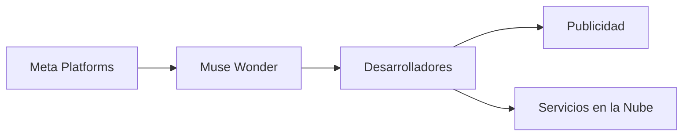

# Meta’s Muse Wonder: A Strategic Play in the AI Arms Race

Meta Platforms ha lanzado **Muse Wonder**, un marco creativo impulsado por IA que promete generar contenido de alta fidelidad en texto, audio y vídeo con mínima intervención humana. Aunque la tecnología es impresionante, el lanzamiento es más que una demostración de capacidad técnica; es un movimiento calculado para consolidar poder dentro del ecosistema AI de la gran empresa de redes sociales.

## La lógica de negocio detrás de Muse Wonder

Las principales fuentes de ingresos de Meta siguen ancladas en la **publicidad** en Facebook, Instagram y WhatsApp. El informe de resultados de 2023 de la empresa mostró que casi **$117 billion** de sus **$117 billion** de ingresos totales provienen de la publicidad. Al integrar Muse Wonder en su **ecosistema de desarrolladores**, Meta puede dirigir a una nueva ola de creadores terceros a producir contenido soportado por anuncios que se mantenga dentro de sus plataformas, aumentando efectivamente el inventario publicitario sin incrementar proporcionalmente los costos de adquisición de usuarios.

El marco se presenta como una oferta **open‑source**, pero los términos de licencia son deliberadamente restrictivos. Los desarrolladores que deseen usar las versiones más avanzadas de Muse Wonder deben alojarlas en **Meta Cloud**, un servicio que compite directamente con Amazon Web Services (AWS), Microsoft Azure y Google Cloud. Esto crea un ciclo de **integración vertical**: los datos de las apps sociales de Meta alimentan el modelo, el modelo se ejecuta en Meta Cloud y la salida genera contenido publicitario que alimenta de nuevo el motor de ingresos de Meta.

## Contexto histórico: del optimismo open‑source a los ecosistemas cerrados

La industria AI tiene una larga historia en la que el optimismo inicial de código abierto da paso a ecosistemas cerrados. A principios de la década de 2010, empresas como Google lanzaron TensorFlow y público su apoyo a la colaboración abierta. Sin embargo, en los últimos cinco años, cada gran jugador tecnológico ha ido envolviendo gradualmente sus activos AI en capas propietarias, convirtiendo herramientas que antes eran abiertas en **puertas de entrada a sus propios servicios**.

Meta sigue un guion familiar, pero con un giro. Proyectos anteriores como **PyTorch** fueron genuinamente abiertos, pero la empresa construyó simultáneamente **Propaganda**, un motor interno de recomendación que impulsa sus algoritmos de alimentación. Muse Wonder extiende este patrón al ofrecer una **solución única** para la generación de contenido, reduciendo drásticamente la necesidad de modelos externos que podrían competir con la propia pila de tecnología publicitaria de Meta.

## Concentración de poder: ¿Quién controla los controles?

La emergence de una plataforma como Muse Wonder plantea tres preocupaciones interrelacionadas sobre la **concentración de poder**:

1. **Control del desarrollo del modelo** – Al restringir las versiones más poderosas de Muse Wonder a entornos alojados por Meta, la compañía limita la capacidad de los competidores para ajustar finamente modelos en su propia infraestructura. Este enfoque se asemeja a movimientos anteriores de **Apple** con Core ML y **Amazon** con SageMaker, ambos de los cuales atan a los desarrolladores a sus propias nubes.

2. **Monopolio de datos** – Las enormes reservas de datos de interacción de usuarios de Meta — “me gusta”, comentarios, tiempo de visualización — son ideales para entrenar modelos generativos que predigan preferencias del consumidor con una precisión inesperada. Poseer tanto la fuente de datos como el motor generativo crea una ventaja asimétrica que es difícil de replicar para nuevos entrantes sin una escala comparable.

3. **Ventaja publicitaria** – La capacidad de generar **contenido personalizado y de alta interacción** a gran escala aumenta directamente las impresiones publicitarias. Los desarrolladores que construyan sobre Muse Wonder pueden crear creatividades publicitarias dinámicas que se adapten en tiempo real al comportamiento del usuario, convirtiendo cada pieza de contenido generado en un posible espacio publicitario. Este estrecho bucle de retroalimentación entre **creación de contenido**, **interacción del usuario** y **ingresos publicitarios** refuerza la dominancia de Meta en el mercado publicitario digital.

## Repercusiones competitivas

Si se deja sin control, esta concentración podría estancar la competencia de dos maneras:

- **Barreras de entrada al mercado** – Las nuevas startups que dependen de herramientas AI abiertas e interoperables pueden encontrar económicamente inviable competir cuando los modelos más atractivos quedan atrapados detrás de un solo proveedor.
- **Homogeneización de la innovación** – Cuando la mayor parte del contenido generado proviene de una sola fuente, la diversidad de outputs creativos puede disminuir, llevando a un **bucle de retroalimentación** en el que solo los formatos publicitarios más rentables dominan el ecosistema.

## Perspectiva regulatoria

Los gobiernos de todo el mundo están examinando cada vez más la **interdependencia entre datos, nube y AI**. El **Reglamento de Mercados Digitales (DMA)** de la Unión Europea apunta a los guardianes que pueden autoreferenciar sus propios servicios, mientras que la Comisión Federal de Comercio (FTC) de EE. UU. está investigando prácticas de **licenciamiento excluyente** en los mercados AI. El enfoque de Meta con Muse Wonder — ofrecer un modelo “gratuito” pero exigir su uso en Meta Cloud — encaja perfectamente en el tipo de conducta que los reguladores están observando.

El resultado de estas investigaciones podría remodelar cómo se **licencian y distribuyen** las plataformas AI, obligando potencialmente a Meta a abrir sus modelos a proveedores de nube más amplios o a separar la capa del modelo de su infraestructura propietaria.

## Conclusión

Muse Wonder es más que un avance tecnológico; es un **instrumento estratégico** para reforzar el control de Meta sobre la cadena de valor AI. Al vincular capacidades generativas de vanguardia a sus propios servicios de publicidad y cloud, Meta amplifica una estructura de poder que ya muestra una fuerte tendencia hacia la concentración de capital y monopolios de datos.

La industria tecnológica se encuentra en una encrucijada: seguir un camino en el que unas pocas corporaciones dictan el futuro de la creación de contenido, o impulsar un panorama AI más **descentralizado y competitivo** que fomente la colaboración abierta e innovación diversa. Las decisiones prises hoy definirán no solo la próxima ola de productos AI, sino también la configuración del entramado económico y social de la era digital.

---

Prompt de imagen: corrida editorial de un pasillo de centro de datos con iluminación natural suave, estanterías de servidores que se alejan en perspectiva, tonos neutros de gris.

Prompt de imagen: ilustración minimalista de pantalla de smartphone que muestra una interfaz genérica de aplicación AI, formas geométricas simples, paleta azul y gris apagados.

Mermaid:

