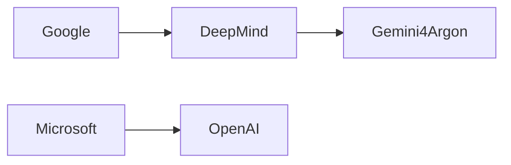

## Introducción

El anuncio de **Gemini 4 Argon**, el último modelo de IA de DeepMind, ha encendido los foros de HackerNews y los tableros de inversión de Silicon Valley. Más que una simple mejora de capacidad de cómputo, este modelo simboliza una tendencia estructural: la **concentración cada vez mayor de poder** en manos de unas cuantas corporaciones que dominan el desarrollo de inteligencia artificial. En este artículo desglosaremos qué significa Gemini 4 Argon para la industria, cómo se inserta en la historia de los monopolios tecnológicos y qué desafíos plantea a reguladores y sociedad.

---

## Gemini 4 Argon en contexto

Según la página oficial de DeepMind, Gemini 4 Argon combina un modelo de lenguaje multimodal con una arquitectura de razonamiento simbólico, capaz de manejar tanto texto como código y datos visuales en tiempo real. Sus especificaciones técnicas —billones de parámetros, entrenamiento a escala de exabytes y acceso a los TPU v5 de Google— lo sitúan a la par de los sistemas de OpenAI y Anthropic.

Lo relevante no es sólo la potencia del modelo, sino **quién controla los recursos para construirlo**. DeepMind, adquirido por Google en 2015 por alrededor de $500 mil millones, ha convertido su laboratorio de investigación en una fábrica de productos que se integran directamente en los servicios de la compañía: Search, Maps, Cloud y, próximamente, la suite de productividad de Google Workspace. Gemini 4 Argon no será un producto aislado; será una pieza clave del ecosistema de **Google Cloud AI**, que ya factura más de $10 bn al año.

---

## Poder y capital: el nuevo orden de la IA

### 1. Concentración de capital

Los gigantes tecnológicos han demostrado una capacidad sin precedentes para **acumular capital y talento**. En la última década, la inversión global en IA ha superado los $150 bn, y más del 60 % de ese capital se concentra en cinco empresas: Google (Alphabet), Microsoft, Amazon, Meta y Apple. Cada una de estas compañías posee un “ecosistema cerrado” que bloquea a los competidores: infraestructura de hardware (TPU, Azure AI, AWS Inferentia), plataformas de datos (Search, Bing, Facebook Graph) y canales de distribución (Google Search, Microsoft Office, Amazon Marketplace).

### 2. Relaciones de poder entre empresas

| Empresa | Subsidiaria/Plataforma | Rol en IA |
|---------|-----------------------|-----------|
| **Google (Alphabet)** | DeepMind → Gemini 4 Argon | Investigación + producto SaaS |
| **Microsoft** | OpenAI → GPT‑4 | Licencia exclusiva y Azure integration |
| **Amazon** | AWS AI | Servicios de inferencia y entrenamiento |
| **Meta** | Meta AI → LLaMA | Modelos de código abierto y entrenamiento interno |
| **Apple** | ML Frameworks (Core ML) | IA on‑device y servicios de privacidad |

Esta tabla muestra cómo la **estructura vertical** de cada conglomerado garantiza control de la cadena completa: desde la investigación básica hasta la entrega al usuario final. La diferencia clave es que Google, a través de DeepMind, ha optado por una **estrategia de “modelo interno primero”** antes de abrirlo a terceros, mientras que Microsoft ha licenciado GPT‑4 para posicionarse como la “capa de IA de Azure”. Ambos caminos refuerzan la **dependencia del mercado** en unos pocos proveedores de infraestructura.

### 3. Dinámicas económicas reales

La carrera por los modelos de gran escala está impulsada por **economías de escala** y efectos de red. Cada nuevo modelo genera más datos de entrenamiento, lo que a su vez mejora el desempeño y atrae más clientes, creando un **ciclo de retroalimentación positiva**. En términos financieros, las compañías pueden amortizar la enorme inversión inicial (centenares de millones en hardware, energía y talento) a lo largo de contratos de varios años con clientes corporativos.

Sin embargo, este mismo ciclo implica **riesgos de concentración**: si una empresa falla o es sancionada, todo el ecosistema dependiente sufre. Además, la verticalidad impide a pequeñas empresas competir en igualdad de condiciones, desplazando la innovación hacia los labs internos y reduciendo la diversidad de enfoques de investigación.

---

## Un vistazo histórico: ¿un nuevo monopolio o la evolución natural?

### 1. De la era de los mainframes a la nube

En los años 70 y 80, IBM dominaba el mercado de mainframes y “estándar de la industria”. La ruptura llegó con la **descentralización de la computación**: PC, servidores x86 y, más tarde, la nube. Cada rupture estuvo acompañada por un nuevo “gigante” que absorbió la infraestructura previa (Microsoft con Windows, Amazon con AWS). La diferencia actual es que la **propiedad intelectual** y los **modelos de IA** son más intangibles y, a la vez, más críticos para la competitividad.

### 2. Lecciones de la historia antimonopolio

Los intentos de desmantelar monopolios tecnológicos (por ejemplo, la acción contra Microsoft en 1998) mostraron que la **regulación tardía** suele ser menos eficaz que la intervención proactiva. Hoy, la Comisión Europea y la FTC de EE.UU. están evaluando “prácticas de apilamiento” de IA, pero la velocidad de desarrollo supera la capacidad de los reguladores para comprender y legislar.

### 3. El papel de los estándares abiertos

A diferencia de la era del software propietario, la comunidad de IA ha visto un impulso hacia **códigos abiertos**: LLaMA, BLOOM, Stable Diffusion. Estas iniciativas nacen como respuesta al dominio de OpenAI y Google. Sin embargo, la **madurez y la capacidad de producción** de modelos como Gemini 4 Argon **están** fuera del alcance de los proyectos open‑source, lo que arrastra la brecha de poder de nuevo a las grandes corporaciones.

---

## Implicaciones éticas y sociales

La potencia de Gemini 4 Argon plantea preguntas sobre **sesgo, privacidad y seguridad**. DeepMind cuenta con un equipo de ética, pero la **responsabilidad última** recae en Google, cuya estructura corporativa privilegia la rentabilidad. La integración de Gemini 4 Argon en productos de búsqueda y publicidad podría amplificar sesgos si no se supervisa de forma independiente.

Además, la **centralización de datos** usada para entrenar estos modelos incrementa riesgos de vigilancia masiva. En un escenario donde Google controla tanto los datos de búsqueda como los modelos que interpretan esos datos, el poder de influencia sobre la opinión pública se vuelve **exponencial**.

---

## ¿Qué pueden hacer los reguladores y la sociedad?

1. **Evaluaciones de impacto antes del despliegue**: exigir a Google y otras compañías que realicen auditorías independientes de sesgo y seguridad.
2. **Fomentar el acceso a datos y hardware**: programas públicos que permitan a startups entrenar modelos a escala sin depender de los gigantes.
3. **Promover estándares abiertos**: apoyar proyectos como Hugging Face y la Alianza para la IA Responsable, que busquen interoperabilidad y transparencia.
4. **Desarrollar marcos antimonopolio específicos para IA**: reconocer que la propiedad de modelos y datos constituye una forma de monopolio no tradicional.

---

## Conclusión

Gemini 4 Argon no es sólo la última versión de un modelo de IA; es un espejo que refleja la **concentración de poder** en la industria tecnológica contemporánea. La unión de recursos financieros, infraestructura de hardware y talento científico bajo el paraguas de Google y DeepMind configura un escenario donde la capacidad de innovar está cada vez más ligada a la capacidad de **acaparar capital**. La historia nos enseña que la regulación reactiva suele ser insuficiente; es necesario un debate público informado y políticas proactivas que garanticen que la IA sirva a la sociedad y no solo a los balances de unas pocas empresas.

*¿Estamos dispuestos a ceder más control a los gigantes tecnológicos en nombre del progreso?* La respuesta determinará el futuro de la innovación y la equidad en la era de la inteligencia artificial.