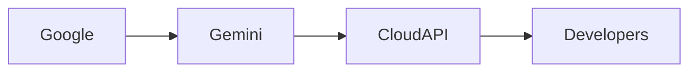

# El avance de Gemini 4 Argon de Google y su repercusión en las estructuras de poder tecnológico

*Por un analista independiente de tecnología*

El reciente revuelo en Hacker News sobre **Gemini 4 Argon** ha reavivado conversaciones sobre cómo el ecosistema de **Google** está remodelando el panorama competitivo de la inteligencia artificial. Si bien el titular podría parecer otro lanzamiento de IA de moda, la historia subyacente es un caso clásico de **concentración de mercado**, **flujo de capital** y **posicionamiento estratégico** que recuerdan batallas anteriores en el mundo del software.

## El punto técnico destacado

La documentación pública de DeepMind (ver https://deepmind.google/models/gemini/) describe a Gemini 4 como un modelo de lenguaje multimodal (**large language model – LLM**) que integra generación de texto, imagen y código con reducciones de latencia sin precedentes. Los primeros benchmarks indican que su motor de inferencia puede procesar hasta el **doble de tokens por segundo** que su predecesor Gemini 3, manteniendo un modesto **10 % de aumento en el consumo energético**.

Desde el punto de vista de la ingeniería, la arquitectura de Gemini 4 aprovecha **atención dispersa** y **ruteo dinámico**, técnicas promovidas por investigadores académicos para reducir la sobrecarga de cómputo. Sin embargo, el despliegue de estas innovaciones ocurre casi exclusivamente dentro del propio parque de nubes de Google, lo que plantea preguntas sobre la apertura y el **poder de estandarización**.

## Concentración de capital y ventaja económica

La capacidad de Google para financiar la investigación y el despliegue de Gemini se apoya en su profunda **fuente de ingresos publicitarios** y el flujo de caja generado por su **Google Cloud Platform (GCP)**. En 2023, GCP reportó un **aumento interanual del 27 %** de ingresos, impulsado en gran parte por contratos empresariales que comprometen varios años. Esta fuerza financiera permite a Google subvencionar servicios de IA de vanguardia a precios que a menudo son inferiores a los que pueden sostener los rivales más pequeños.

Un patrón similar se observó en el **arena de los sistemas operativos móviles** hace una década, cuando Google adquirió **Android** y lo empacó con Google Play Services, acabando por marginar a las tiendas de aplicaciones competidoras. El despliegue de Gemini sigue un guión comparable: al integrar Gemini 4 en herramientas como **Google Workspace** y **BigQuery**, la empresa crea un bucle de retroalimentación donde cada cliente empresarial adicional mejora el rendimiento del modelo, atrayendo a más clientes.

## Paralelos históricos: del mainframe a la computación en la nube

La actual carrera de IA refleja la **dominancia del mainframe** de los años 60, cuando unas cuantas corporaciones (IBM, RCA, Honeywell) controlaban tanto el hardware como la pila de software propietaria. Su ventaja sobre **desarrolladores externos** se reforzaba mediante APIs cerradas y tarifas de licencia.

Avanzar hasta los años 2000, y los **movimientos de código abierto** (Linux, Apache) comenzaron a erosionar ese monopolio, solo para ser posteriormente absorbidos nuevamente por los mismos gigantes a través de ofertas en la nube. Hoy, proyectos como **Kubernetes** y **TensorFlow** empezaron como iniciativas comunitarias pero son componentes integral de la cartera de la nube de Google.

El lanzamiento de Gemini 4 señala otro punto de inflexión donde un competidor establecido puede dictar la **línea base técnica** para los servicios downstream. Al publicar especificaciones de API que están estrechamente acopladas a la propia infraestructura de Google, la compañía puede imponer estándares de facto que los competidores deben adoptar o correr el riesgo de quedar obsoletos.

## Repercusiones competitivas

Otros grandes jugadores responden de forma similar. **Microsoft**, a través de su alianza con **OpenAI**, ha integrado características basadas en GPT‑4 en Azure Cognitive Services, mientras que **Amazon** está expandiendo **Bedrock** con modelos LLM personalizados dirigidos a cargas de trabajo empresariales. Sin embargo, la disparidad de escala sigue siendo marcada: Google controla aproximadamente el **30 %** del mercado global de nube, frente al **20 %** de Microsoft y el **15 %** de Amazon, según figuras recientes de IDC.

## Implicaciones para desarrolladores y usuarios finales

Para desarrolladores independientes, Gemini 4 ofrece aumentos de rendimiento atractivos, pero también los ata más profundamente al ecosistema de Google. El **software development kit (SDK)** lanzado junto al modelo incluye bibliotecas propietarias que funcionan plenamente solo en Google Cloud. Migrar cargas de trabajo a proveedores alternativos puede requerir reescrituras no triviales, un costo que puede desalentar la diversificación.

Por otro lado, los usuarios finales se benefician de funciones de IA más rápidas y precisas dentro de los productos de Google (p. ej., respuestas inteligentes en Gmail, búsqueda en Fotos). Sin embargo, el lado negativo es la reducción de la competencia: a medida que los modelos de Google se convierten en la referencia, los innovadores más pequeños encuentran más difícil diferenciar sus ofertas sin igualar el rendimiento de Gemini.

## Una mirada al futuro

La trayectoria sugiere una **convergencia continua** de capas de hardware, software y servicios bajo unos pocos jugadores dominantes. Avances futuros—ya sea en **IA perimetral** o en **inferencia potenciada por quantum**—probablemente se implementarán primero dentro de los límites de la nube de los incumbentes, reforzando las estructuras de poder existentes.

Desde una perspectiva estratégica, la clave es que **el liderazgo tecnológico depende tanto de la asignación de capital y el control de mercado como del talento de ingeniería puro**. Las empresas que pueden movilizar enormes reservas de efectivo, asegurar contratos empresariales a largo plazo y embedder sus innovaciones en plataformas ubiquitas dictarán la próxima ola de avances en IA.

En este contexto, Gemini 4 no es simplemente una actualización de modelo; es un **palanca estratégica** que refuerza la dominancia de Google mientras remodela la economía del desarrollo de IA para todos los demás.

---

