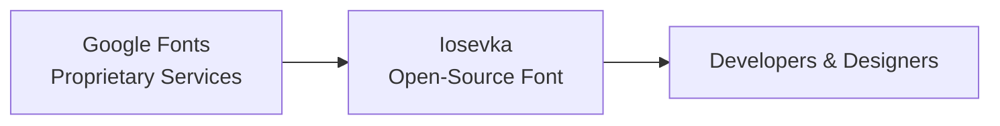

# El ascenso de Iosevka: tipografía de código abierto desafía el poder de las grandes tecnológicas

El reciente revuelo alrededor de **Iosevka** en Hacker News no es solo una nota celebratoria sobre una nueva tipografía. Señala un sutil pero profundo cambio en el panorama de la **tecnología** donde las **fuentes de código abierto** empiezan a desafiar la hegemonía de soluciones propietarias que durante mucho tiempo han estado controladas por unas pocas grandes empresas.

En este artículo analizamos las ventajas técnicas de Iosevka, ubicamos su posición en el mercado más amplio de **fuentes** y examinamos las dinámicas económicas y de poder que sustentan este cambio.

## Distinción técnica: sans‑serif que se combina con slab‑serif en un solo paquete

Iosevka combina la claridad del **sans‑serif** con la presencia distintiva del **slab‑serif** en fuentes monoespaciadas tradicionales. Su diseño está deliberadamente pensado para **programación**, emuladores de terminal y flujos de trabajo centrados en la terminal, donde la legibilidad en tamaños pequeños es indispensable. El algoritmo de incrustación (hinting) de la tipografía, el espaciado meticuloso y el amplio conjunto de glifos la convierten en una fuerte contendiente para cualquier proyecto de **diseño digital** que requiera coherencia entre código, documentación y elementos de interfaz.

## Contexto histórico: de los clásicos de matriz a estrategias modernas de código abierto


La historia de las fuentes monoespaciadas se remonta a la era de **Teletype**, cuando los glifos bitmap eran la única solución práctica para los primeros terminales de computadora. Fuentes como **Courier** se volvieron sinónimos de código, pero su diseño estaba limitado por la cuadrícula bitmap. A medida que la tecnología de pantallas avanzó, las fuentes basadas en vectores—destacando especialmente **TrueType** y **OpenType**—abrieron nuevas posibilidades. Empresas como **Microsoft** (Consolas), **Apple** (San Francisco) y **Google** (Roboto) aprovecharon estos avances, incorporando sus fuentes propietarias en sistemas operativos para afianzar la identidad de marca y la experiencia del usuario.

Iosevka surgió en un momento en que las **grandes tecnológicas** ya habían consolidado sus ecosistemas de fuentes. Por ejemplo, Google Fonts sirve a miles de millones de vistas de página diariamente, guiando sutilmente a los diseñadores web hacia un conjunto curado de tipografías que son a la vez **gratuitas** y **optimizadas** para el rendimiento web. Si bien este servicio democratiza el acceso, también concentra **capital** bajo el paraguas infraestructural de Google, definiendo estándares estéticos sin una supervisión democrática explícita.

## Dinámica de poder: control corporativo versus gestión comunitaria

La relación entre proyectos **open‑source** y el panorama **corporativo** puede enmarcarse como una lucha de cuerdas sobre la **definición de estándares**. Las fuentes propietarias suelen gozar de una ubicación privilegiada en los **SDKs (software development kits)**, aplicaciones del sistema predeterminadas e incluso extensiones de **IDE**. En cambio, el modelo de distribución de Iosevka se basa en descargas directas, gestores de paquetes como **npm** y **Homebrew**, y en repositorios comunitarios mantenidos como **Awesome Fonts**.

Un ejemplo revelador de esta tensión es la manera en que los principales proveedores de nube y plataformas de alojamiento de código negocian pipelines de renderizado de fuentes. Por ejemplo, **GitHub** utiliza **Fuentes de Google** para renderizar su markdown, reforzando indirectamente la dominancia de Google. Simultáneamente, **GitLab** ha experimentado con paquetes de fuentes auto‑alojados, insinuando un posible movimiento hacia la **descentralización**. Estas decisiones estratégicas ilustran cómo los incentivos **económicos**—eficiencia de costos, simplicidad de licencias y consistencia de marca—impulsan decisiones que refuerzan las estructuras de poder existentes.

## Implicaciones económicas: concentración de capital e incentivos del mercado


Al examinar la **industria tecnológica** desde una perspectiva económica, la **concentración de capital** se hace evidente en la forma en que se financian los ecosistemas de fuentes. Las grandes corporaciones pueden subvencionar el desarrollo de fuentes como parte de inversiones más amplias en UI/UX, recuperando costos mediante diferenciación de productos y efectos de bloqueo. En contraste, iniciativas **open‑source** como Iosevka dependen de trabajo voluntario, patrocinios y ocasionales subvenciones—modelos de financiación que son inherentemente más precarios.

Consideremos la valoración de las **funderías de tipos** que se especializan en tipografías corporativas personalizadas. Empresas como **Adobe** y **Monotype** comandan ingresos de varios miles de millones de dólares en parte porque sus fuentes se vuelven integrantes de la identidad de marca. Las alternativas de código abierto erosionan el poder monopolístico de estas entidades al ofrecer un sustituto **gratuito** que puede adaptarse a restricciones técnicas específicas, redistribuyendo así el valor económico de regreso a la comunidad de **desarrolladores**.

## El papel de las plataformas: Hacker News, redes sociales y percepción pública

La publicación en **Hacker News** que destacó Iosevka actuó como catalizador de un discurso más amplio. Plataformas como **Reddit**, **Twitter** y **LinkedIn** ampliaron la conversación, convirtiendo un anuncio técnico de nicho en un momento cultural. Esta viralidad evidencia el poder de la **prueba social** en la adopción tecnológica: cuando voces influyentes respaldan una herramienta, sus **efectos de red** pueden superar rápidamente los presupuestos de marketing tradicionales.

Sin embargo, las mismas plataformas pueden marginalizar proyectos **open‑source** si carecen de un respaldo corporativo sostenido. La **economía de la atención** premia la novedad y la utilidad inmediata, dejando a menudo en segundo plano el compromiso comunitario a largo plazo. La trayectoria de Iosevka ilustra tanto las oportunidades como las vulnerabilidades inherentes a esta dinámica.

## Trayectorias futuras: posibles escenarios para la gobernanza de fuentes

Mirando hacia el futuro, pueden surgir varios escenarios plausibles. En un futuro **descentralizado**, **WebAssembly** y las **fuentes variables** podrían permitir la carga de fuentes en tiempo de ejecución desde fuentes alojadas por los usuarios, reduciendo la dependencia de repositorios centralizados como Google Fonts. Este cambio capacitaría a los **desarrolladores** para curar sus propias pilas de fuentes, alineando la estética visual directamente con los objetivos del proyecto en lugar de algoritmos de plataforma.

Alternativamente, un escenario de **consolidación** podría ver a grandes firmas tecnológicas adquirindo proyectos **open‑source** prometedores de fuentes para incorporarlos a ecosistemas propietarios, ampliando así su control sobre los estándares de diseño. Dichas adquisiciones probablemente se enmarcarían como “inversiones estratégicas”, pero podrían reforzar el statu quo de **concentración de capital**.

Una tercera vía—la **gobernanza colaborativa**—implica la creación de organismos multistakeholder donde **desarrolladores**, **diseñadores** y **socios corporativos** co‑gobiernos repositorios de fuentes. Iniciativas como la **Open Font Library** proponen precisamente este modelo, buscando equilibrar **innovación** con **acceso equitativo**.




## Conclusión: reflexiones sobre poder, elección y el futuro de la tipografía digital

El ascenso de Iosevka encierra una narrativa más amplia: a medida que la **tecnología** sigue permeando cada facet​a del trabajo y la creatividad, las herramientas que usamos para expresar información—entre ellas las fuentes—se convierten en campos de batalla de influencia. Ya sea un espléndido **slab‑serif** monoespaciado creado por una comunidad global o una tipografía propietaria atrapada tras una licencia corporativa, las decisiones que tomamos sobre tipografía reflejan estructuras de poder más profundas.

Como lectores, desarrolladores y diseñadores, nos encontramos en una encrucijada. Podemos seguir aceptando las fuentes predeterminadas impuestas por las plataformas dominantes, o bien podemos abogar por alternativas abiertas, adaptables y impulsadas por la comunidad que democratizan la expresión visual. La conversación despertada por Iosevka nos invita a preguntar: *¿Quién controla realmente el idioma que vemos en nuestras pantallas, y qué implica eso para el futuro del **diseño digital**?*   

La respuesta quizá no esté escrita solo en glifos, sino en las decisiones colectivas que tomamos acerca de las herramientas que impulsamos.

``` 
 graph LR
 GoogleFonts["Fuentes de Google<br>Servicios propietarios"]
 OpenSource["Iosevka<br>Fuente de código abierto"]
 Developers["Desarrolladores y diseñadores"]
 ```