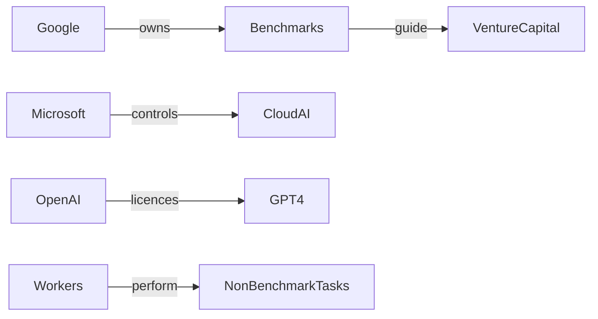

# El 90 % del tiempo laboral estadounidense escapa a los benchmarks de IA  

Un informe reciente de Mercor, citado en HackerNews, muestra que **el 90 % de las horas trabajadas en EE. UU. corresponde a tareas que los benchmarks de inteligencia artificial (IA) no cubren adecuadamente**. El hallazgo no solo sacude la idea de que la IA está lista para sustituir la mayor parte del trabajo humano, sino que también revela la **concentración de capital y poder** en un puñado de empresas que dominan los estándares técnicos.  

## ¿Qué mide realmente un benchmark de IA?  

Los benchmarks son pruebas estandarizadas que evalúan el rendimiento de modelos de IA en tareas concretas: reconocimiento de imágenes (ImageNet), procesamiento del lenguaje (GLUE, SuperGLUE), razonamiento lógico (ARC, BIG‑Bench). Estas métricas son creadas, mantenidas y publicadas mayoritariamente por **gigantes como Google, Microsoft, Meta y OpenAI**, cuyas infraestructuras de cómputo y bases de datos alimentan los modelos de última generación.  

Sin embargo, los benchmarks tienden a enfocarse en **problemas bien definidos, cuantificables y “limpios”**. En el mundo real, la mayoría de las labores —desde la negociación de contratos hasta la atención al cliente en contextos emocionales complejos — son **ambiguas, contextuales y no reducibles a una única métrica**. El estudio de Mercor mapea cientos de ocupaciones contra los benchmarks existentes y encuentra que solo un **10 %** de los roles diarios encajan con precisión en esa cuadrícula.  

## Concentración de poder: quién controla los benchmarks  

| Empresa | Benchmark dominante | Modelo de negocio |
|--------|----------------------|-------------------|
| **Google** | Imagenet, BERT, PaLM | Publicidad + Cloud |
| **Microsoft** | MS MARCO, Azure AI | Cloud + SaaS |
| **Meta** | LLaMA, FAIR Seq2Seq | Redes sociales + VR |
| **OpenAI** | GPT‑4, CLIP | API SaaS + licencias |

Estas compañías no solo diseñan los tests, sino que **dictan qué constituye “inteligencia”**. Al financiar la investigación y ofrecer los recursos de cómputo necesarios, imponen sus propias definiciones de éxito, lo que a su vez orienta la inversión privada hacia áreas que **benefician a sus plataformas**.  

El efecto es doble: por un lado, **las startups y los laboratorios académicos quedan atrapados en la necesidad de “subir” en los rankings de los benchmarks**; por otro, el resto del ecosistema laboral queda excluido de la ola de financiación y desarrollo. Esta dinámica reproduce una **concentración de capital similar a la de la era de los sistemas operativos**, cuando Microsoft y Apple monopolizaron los estándares de software, obligando a los desarrolladores a alinearse con sus plataformas.  

## ¿Qué trabajos quedan fuera de la visión de IA?  

El informe de Mercor enumera categorías como:  

* **Trabajo cognitivo complejo** – strategy consulting, gestión de proyectos, toma de decisiones basada en juicio humano.  
* **Interacción social** – educación primaria, atención sanitaria, servicios de asistencia social.  
* **Creatividad abierta** – escritura literaria, diseño de moda, dirección artística.  

Estas áreas requieren **intuición, empatía y contexto cultural**, habilidades que los modelos actuales apenas rozan. Por ejemplo, los chatbots de atención al cliente pueden gestionar consultas estructuradas, pero fallan cuando el cliente expresa frustración o necesita una solución personalizada.  

## Historia recurrente: la ilusión de la automatización total  

En los 90, la **externacionalización de procesos de negocio (BPO)** trasladó tareas repetitivas a países con mano de obra barata, pero también generó una élite de gestores de relaciones internacionales. Hoy, la narrativa de que la IA “robó” el 90 % de los trabajos es una **versión moderna de la misma ilusión**, reforzada por la cobertura mediática que privilegia los éxitos de los grandes laboratorios de IA sobre los fracasos cotidianos.  

## Dinámicas económicas reales detrás del hype  

1. **Inversión de riesgo orientada a “AI‑first”** – Fondos de capital de riesgo destinan más del 30 % de sus capitales a startups que prometen aplicar GPT‑4 o modelos de visión computacional, reduciendo la disponibilidad de financiación para soluciones basadas en humanos.  
2. **Política pública influenciada por lobby** – Grandes empresas de IA invierten millones en campañas de cabildeo para moldear regulaciones que favorezcan la recopilación de datos masiva, reforzando su ventaja competitiva y desincentivando regulaciones que protejan tareas laborales vulnerables.  
3. **Externalidades de datos** – Los benchmarks se alimentan de enormes conjuntos de datos públicos y privados; las empresas que poseen estos datos (Google, Meta) convierten la información en una barrera de entrada que otros actores no pueden superar sin incurrir en costos prohibitivos.  

## El papel de los trabajadores y los sindicatos  

En un escenario donde **solo el 10 % de las horas laborales se alinean con los benchmarks**, el resto del trabajo sigue dependiendo de habilidades humanas que la IA no puede replicar fácilmente. Los sindicatos, sin embargo, se enfrentan a una narrativa dominante que los presenta como “obsoletos”.  

Algunos movimientos laborales están empezando a **reclamar derechos para la “capa humana”**, exigiendo que los empleadores reconozcan la complementariedad entre IA y talento humano, y que se establezcan marcos de retribución para el trabajo que la IA automatiza parcialmente (por ejemplo, supervisión de algoritmos).  

## ¿Qué implica esto para la estrategia empresarial?  

Las compañías que basan su hoja de ruta tecnológica únicamente en los benchmarks actuales corren el riesgo de **desconectar sus productos de las necesidades reales del mercado**. Empresas como **Salesforce** y **ServiceNow** están experimentando con IA “augmented intelligence”, donde los humanos siguen en el bucle de decisión, reconociendo que la mayoría de los procesos empresariales siguen siendo “no‑benchmarkables”.  

Al mismo tiempo, **las firmas de consultoría** (McKinsey, BCG) están lanzando marcos de evaluación que van más allá del rendimiento en pruebas estándar, incorporando métricas de “valor añadido humano” y “resiliencia organizacional”. Estas nuevas métricas podrían desafiar el monopolio de los benchmarks tradicionales y abrir espacio para startups enfocadas en la **IA colaborativa**.  

## Conclusión: repensar el futuro del trabajo  

El dato de que el 90 % de las horas trabajadas en EE. UU. no están cubiertas por los benchmarks de IA es una llamada de atención. No se trata únicamente de una cuestión técnica, sino de **poder económico, concentración de capital y decisiones políticas** que están configurando la agenda tecnológica.  

Si la industria sigue centrando su discurso en los logros de unos pocos laboratorios, se corre el riesgo de **deshumanizar el mercado laboral** y de subestimar el valor de competencias que la IA aún no puede emular. La verdadera revolución será aquella que reconozca la complementariedad entre la inteligencia artificial y el ingenio humano, y que redistribuya el poder de decisión de los algoritmos a los trabajadores que los utilizan.  

*¿Estamos preparados para una nueva era donde la colaboración, y no la sustitución, sea la verdadera promesa de la IA?*  

    Google -->|owns| Benchmarks
    Microsoft -->|controls| CloudAI
    OpenAI -->|licences| GPT4
    Benchmarks -->|guide| VentureCapital
    Workers -->|perform| NonBenchmarkTasks