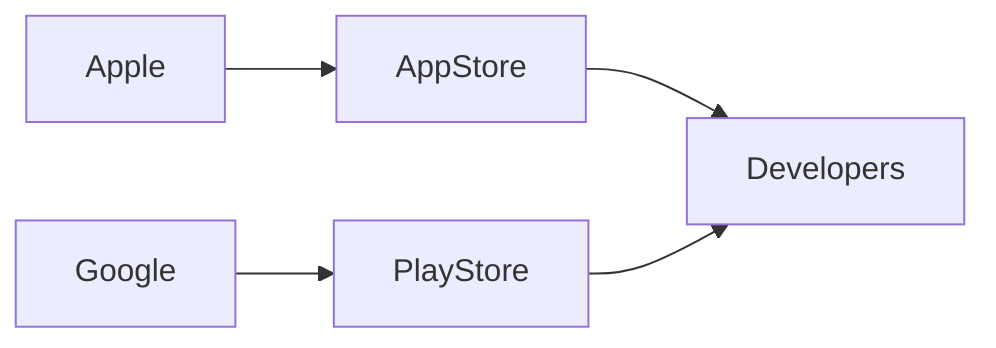

## Introducción

En la última década, la narrativa dominante sobre la **industria tecnológica** ha girado en torno a la figura del programador individual, el “héroe del código” que hace posible la última aplicación o el algoritmo de recomendación. La publicación *Someone behind the software* en Hacker News, basada en el ensayo de Kaarisaarinen, desmonta ese mito y revela la compleja red de poder, dinero y decisiones corporativas que realmente está detrás del software que usamos a diario.

Este artículo explora esas dinámicas, poniendo en evidencia **la concentración de capital**, las **relaciones de poder** entre gigantes tecnológicos y sus ecosistemas de desarrolladores, y los paralelos históricos que explican por qué el “alguien” que escribe el código rara vez es quien se lleva el crédito ni la recompensa económica.

---

## La ilusión del creador invisible

El ensayo original señala que, tras la fachada del código abierto, se esconden capas de *inversión estratégica* y **acuerdos de licencia** que favorecen a las grandes corporaciones. Un proyecto de código abierto puede recibir miles de contribuciones, pero la dirección del proyecto —las decisiones de roadmap, los cambios de arquitectura, la aceptación de pull‑requests— suele estar en manos de una **organización sin fines de lucro o una fundación** respaldada por la empresa dominante.

Ejemplo paradigmático: **Linux** es coordinado por la Fundación Linux, cuyo consejo está fuertemente influenciado por **Intel**, **IBM** y **Google**. Estas compañías aportan recursos financieros y hardware, pero también dictan prioridades que alinean el kernel con sus propias estrategias de mercado (por ejemplo, el soporte de nuevas instrucciones de CPU o la optimización para la nube).

El mensaje es claro: el “software libre” no está exento de **poder económico**; simplemente reconfigura la forma en que ese poder se manifiesta.

---

## Concentración de capital en la era de la nube

La emergencia de los **servicios de nube** (AWS, Azure, Google Cloud) ha sido el principal motor de la **concentración de capital** en la industria tecnológica. Estas plataformas no solo alquilan capacidad de cómputo; también venden **ecosistemas de desarrollo** donde los lenguajes, frameworks y herramientas aparecen pre‑instalados y directamente integrados con los servicios de la nube.

- **Amazon Web Services (AWS)** controla más del 30 % del mercado global de infraestructura como servicio (IaaS). Su modelo de precios basado en consumo induce a los clientes a migrar sus bases de datos y pipelines de CI/CD a servicios propietarios como **RDS**, **Lambda** y **SageMaker**, creando una dependencia que se traduce en **bloqueo de cliente**.
- **Microsoft Azure** avanza bajo la premisa “cloud‑first” y ha adquirido empresas como **GitHub** y **Red Hat**, consolidando la cadena de suministro del software: desde el repositorio de código hasta la producción en la nube.
- **Google Cloud**, aunque con menor cuota, se apoya en su dominio del **framework Android** y la infraestructura de **Kubernetes**, patrocinando proyectos como **Istio** que favorecen su propia estrategia de “service mesh”.

Esta concentración genera un círculo vicioso: **más capital permite mayor inversión en infraestructuras propietarias**, y esas infraestructuras dictan los estándares de desarrollo, relegando a los pequeños proveedores a un papel de complementos.

---

## Poder corporativo y la cadena de valor del software

Para comprender mejor las relaciones de poder, es útil visualizar la **cadena de valor** que conecta a las grandes corporaciones con los desarrolladores finales.

| Nivel | Actor principal | Forma de control |
|------|----------------|-----------------|
| 1 | **Plataforma de distribución** (Apple App Store, Google Play) | Reglas de publicación, cuotas del 15‑30 % |
| 2 | **Frameworks y SDKs** (Android, iOS, .NET) | Licencias, requerimientos de compatibilidad |
| 3 | **Servicios de backend** (Firebase, Azure Functions) | Dependencia de APIs propietarias |
| 4 | **Infraestructura de nube** (AWS, GCP, Azure) | Facturación por uso, lock‑in de datos |
| 5 | **Desarrollador independiente** | Margen de beneficio reducido, exposición a cambios de política |

En cada nivel, la empresa que controla la capa superior impone sus condiciones a las capas inferiores, creando **asimetrías de poder**. Un caso reciente: la política de Apple que obliga a los **desarrolladores de iOS** a usar su **sistema de pago in‑app** con una comisión del 30 % para apps bajo 1 USD de suscripción, limitando la capacidad de competir con soluciones de pago alternativas.

---

## Conexiones históricas: de la era del mainframe a la nube

A finales de los 90, la **consolidación** de la industria con la compra de **Netscape** por AOL y la posterior absorción de **Sun Microsystems** por Oracle ilustra cómo la **acumulación de patentes y plataformas** se utilizó para bloquear a la competencia, una práctica que la Comisión Europea ha investigado recientemente contra **Google** por abuso de posición dominante en el mercado de búsqueda.

En la era actual, la diferencia radica en la **escala global** y la **velocidad de adopción**. Los actuales “gatekeepers” pueden afectar a millones de usuarios en cuestión de segundos, y la **interconexión de servicios** (p. ej., un móvil Android que depende de Google Play, Firebase y Google Cloud) amplifica su poder de forma exponencial.

---

## Impacto en los desarrolladores y en la sociedad

### Desarrolladores

- **Reducción de margen**: la obligación de pagar comisiones a plataformas de distribución y a proveedores de nube disminuye la rentabilidad de aplicaciones independientes, impulsando la consolidación de estudios de videojuegos y startups en grandes conglomerados.
- **Fragmentación de habilidades**: para sobrevivir, los programadores deben dominar múltiples SDKs y plataformas de nube, aumentando la carga de aprendizaje y reduciendo la movilidad laboral.

### Sociedad

- **Privacidad de datos**: los grandes proveedores de nube almacenan la mayor parte de los datos generados por aplicaciones móviles, lo que genera riesgos de vigilancia y usos no consensuados.
- **Sesgo algorítmico**: el control de los modelos de IA (por ejemplo, **OpenAI** con Microsoft) influye en la forma en que se construyen productos de software, perpetuando sesgos incorporados en los datos de entrenamiento provistos por las mismas corporaciones.

---

## ¿Qué alternativas existen?

A pesar del predominio de los grandes actores, hay movimientos que buscan **descentralizar el poder**:

1. **Edge computing** y **blockchain** – proyectos como **Filecoin** o **IPFS** ofrecen almacenamiento distribuido que reduce la dependencia de los proveedores de nube centralizados.
2. **Fundaciones de código abierto** – la **Apache Software Foundation** y la **Linux Foundation** continúan siendo espacios donde la gobernanza está más abierta, aunque siguen recibiendo financiamiento de los mismos gigantes.
3. **Regulación** – iniciativas como la **Digital Markets Act** de la UE pretenden limitar el poder de los “gatekeepers”, obligándolos a permitir interoperabilidad y a reducir comisiones abusivas.

Sin embargo, estas soluciones enfrentan el desafío de **escalar** y de competir con los recursos financieros masivos de los “Big Tech”. 

---

## Conclusión

La figura del programador “solitario” que escribe código mágico es más un mito que una realidad. Detrás de cada línea de código hay una **estructura de poder** que involucra **capital**, **propiedad intelectual**, y **control de infraestructura**. Entender estas dinámicas es crucial para cualquier profesional de la tecnología que busque navegar una industria cada vez más concentrada.

A medida que la economía digital madura, la pregunta que debemos hacernos no es *“Quién está detrás del software?”* sino *“Quién se beneficia de él y bajo qué condiciones?”* Solo con esa claridad podremos diseñar políticas, productos y carreras que fomenten un **ecosistema tecnológico** más equitativo.

---