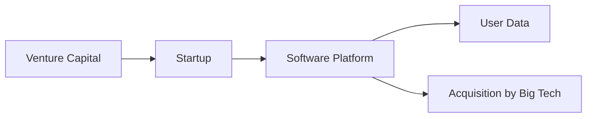

# El rostro invisible detrás del software

En los últimos meses, una publicación de Karris Aarinen titulada *Someone behind the software* ha reavivado el debate sobre quién controla realmente el código que alimenta nuestras vidas digitales. La pieza, que circuló rápidamente en HackerNews, no presenta una nueva tecnología ni un escándalo de seguridad; más bien, propone una mirada estructural a las relaciones de poder que se esconden tras la aparente **open source** y la **colaboración comunitaria**.

Este artículo nos invita a repensar la narrativa dominante del “software como bien común”. En la práctica, el desarrollo de productos digitales está mediado por una serie de fuerzas económicas que favorecen a unos pocos gigantes y a los fondos de **venture capital** (VC) que los respaldan. Para comprender la magnitud del fenómeno, es necesario situarlo dentro de la evolución histórica de la industria tecnológica, desde los mainframes de IBM hasta la era del **cloud computing** y los ecosistemas de plataformas.

## 1. De la era del mainframe al dominio de la plataforma

En la década de 1960, IBM monopolizaba el mercado de los mainframes, pero su modelo se basaba en hardware propietario y en contratos de mantenimiento a largo plazo. Con la llegada de la **PC** en los 80, empresas como Microsoft y Apple cambiaron el juego: el software pasó a ser un activo separado del hardware, creando nuevas oportunidades de monetización. El **modelo de licencias** y el **software como servicio (SaaS)** se consolidaron en los 90, impulsados por la explosión de Internet.

Hoy, el mismo patrón se repite a gran escala. **Google**, **Amazon** y **Microsoft** son plataformas que no solo ofrecen infraestructura (AWS, Google Cloud, Azure) sino que también albergan cientos de miles de aplicaciones que se ejecutan sobre sus APIs. El valor real se extrae del **control de datos** y de la capacidad de dictar los términos de uso a desarrolladores externos. La *capa de abstracción* que ofrecen estas plataformas oculta una relación de dependencia asimétrica: los pequeños estudios de software entregan valor a los gigantes a cambio de acceso a recursos críticos.

## 2. Capital de riesgo: el motor de la concentración

Ejemplos recientes ilustran este mecanismo:

| Fondo de VC | Startup financiada | Resultado |
|-------------|--------------------|-----------|
| Andreessen Horowitz | **Clubhouse** | Valoración de $4 bn, luego caída y venta a una empresa de medios |
| Sequoia Capital | **Snowflake** | IPO de $70 bn, consolidación de datos en la nube |
| Insight Partners | **Atlassian** | Expansión global, adquisición de **Trello** |

## 3. El “software sin dueño” en la práctica

El movimiento de código abierto se ha convertido en una herramienta de legitimación para los grandes jugadores. **Microsoft** compró **GitHub** en 2018, convirtiendo una plataforma comunitaria en un activo estratégico que alimenta su ecosistema de Azure DevOps. **Google** impulsa **Kubernetes**, pero también controla el registro de contenedores y el flujo de actualizaciones, obligando a los usuarios a depender de los servicios de Google Cloud para obtener soporte completo.

Esta dualidad crea una **paradoja de poder**: mientras que el código está disponible públicamente, la infraestructura que lo ejecuta y el soporte comercial están centralizados. Los desarrolladores pueden copiar la base del proyecto, pero a la hora de escalarlo necesitan servicios de **AWS**, **Azure** o **Google Cloud**, lo que a su vez genera ingresos para esos proveedores y refuerza su posición dominante.

## 4. Historias de adquisición: la consolidación como norma

A lo largo de la historia reciente, la adquisición ha sido la estrategia preferida para neutralizar la competencia y absorber innovación. Algunos casos emblemáticos:

* **Oracle → Sun Microsystems (2010)**: adquisición del hardware y del lenguaje de programación **Java**, consolidando el control sobre una de las pilas tecnológicas más extensas.
* **IBM → Red Hat (2019)**: compra por $34 bn que le dio a IBM una posición fuerte en el mundo del **open source** empresarial y acceso a la comunidad de desarrolladores.
* **Facebook → Instagram (2012) y WhatsApp (2014)**: absorción de plataformas sociales emergentes que amenazaban su dominio publicitario.
* **Amazon → Whole Foods (2017)**: diversificación que permite a AWS ofrecer soluciones de **logística** y **cadenas de suministro** a clientes corporativos.

Estas fusiones no son meras decisiones financieras; son movimientos estratégicos para **capturar flujos de datos**, **eliminar rivalidades potenciales** y **ampliar la barrera de entrada** para nuevos competidores.

## 5. Dinámicas económicas reales: datos como nueva divisa

El valor de una empresa tecnológica ya no se mide únicamente por su facturación, sino por la **cantidad y calidad de los datos** que acumula. Plataformas como **TikTok** (propiedad de ByteDance) y **Snap** lucran con algoritmos que convierten la atención del usuario en un producto comercializable. En este escenario, la **propiedad intelectual** es una fachada: lo que realmente se compra y vende son **datasets**.

Los poderes de mercado se refuerzan por medio de **economías de escala**. Cuantos más usuarios genera una plataforma, más precisa se vuelve su modelo de negocio basado en publicidad o en servicios premium. Por tanto, la **concentración de capital** y la **acumulación de usuarios** forman un círculo vicioso que dificulta la entrada de alternativas.

## 6. ¿Qué significa esto para los desarrolladores y usuarios?

Para los **desarrolladores**, la presión para integrarse en ecosistemas controlados es palpable. La mayoría de los paquetes npm, PyPI o Maven dependen de infraestructuras hospedadas en los servidores de los grandes proveedores. La **dependencia de terceros** genera vulnerabilidades de seguridad y de gobernanza: una interrupción, una política de precios inesperada o una restricción de API pueden paralizar proyectos enteros.

Para los **usuarios**, la ilusión de elección se desvanece cuando las aplicaciones que utilizan comparten la misma infraestructura subyacente. Los términos de servicio están escritos en lenguaje legal complejo, mientras que la **transparencia** sobre el uso de datos suele ser mínima. El desequilibrio de poder impide que los consumidores exijan mayor responsabilidad.

## 7. Un llamado a la reflexión y a la acción

El relato de *Someone behind the software* nos recuerda que el software no es un fenómeno espontáneo sino el producto de relaciones estructurales de poder. La historia muestra que cada revolución tecnológica —desde los mainframes hasta la computación en la nube— ha sido liderada por unos pocos que, respaldados por capital, han monopolizado la distribución de valor.

Para romper este ciclo, es necesario:

1. **Fomentar regulaciones antimonopolio** que consideren no solo la cuota de mercado, sino también la posesión de datos y la dependencia de infraestructura.
2. **Apoyar proyectos de código abierto verdaderamente independientes**, con financiamiento público o cooperativo que no dependa de VC.
3. **Promover la interoperabilidad** mediante estándares abiertos que reduzcan la necesidad de “bloquear” a los usuarios en ecosistemas propietarios.
4. **Educar a los desarrolladores** sobre los riesgos de la dependencia de plataformas y sobre prácticas de arquitectura resiliente (multicloud, open standards).

En última instancia, la cuestión no es solo quién escribe la línea de código, sino quién controla los canales que la hacen llegar a los usuarios finales. La concentración de capital y la centralización del poder siguen siendo los verdaderos “detentores” del software que usamos día a día.

---

**Conclusión**

Mientras celebramos la velocidad con la que la innovación se despliega, debemos recordar que cada avance está mediado por intereses económicos y por estructuras de poder que perpetúan la concentración. Solo mediante una mirada crítica y acciones concretas podremos garantizar que el software sirva al bien común y no solo a una élite financiera.

