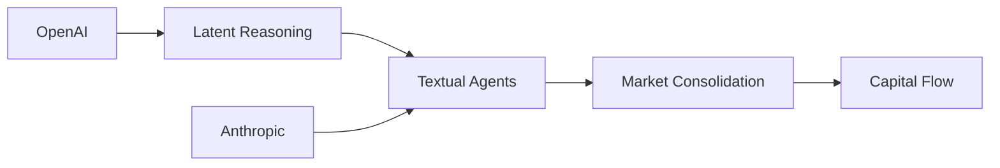

 # La Nueva Arquitectura del Pensamiento

Un nuevo preprint en arXiv—número 2610.18861, titulado Agentes de Razonamiento Híbrido: agentes LLM que piensan en el espacio latente, actúan a través del texto—ha comenzado a circular por círculos tecnológicos, y con ello llega una recalibración silenciosa pero significativa de cómo entendemos la agencia de grandes modelos de lenguaje. El artículo propone una arquitectura donde el razonamiento del modelo ocurre en el espacio comprimido y de alta dimensión de las activaciones neuronales en lugar de como una cadena de pensamiento explícita, token por token. La salida, sin embargo, permanece textual: una serie de acciones, comandos o respuestas generadas en lenguaje natural. En la práctica, esto significa que el modelo puede planificar internamente manipulando conceptos sin compromiso a una secuencia lineal y observable, y solo superfician el resultado una vez que la computación interna se estabiliza.

Para un sector ya saturado de anuncios de agentes autónomos, esta distinción puede parecer incremental. Sin embargo, la implicación es estructural: al mover la carga computacional más pesada al espacio latente, el enfoque promete un consumo reducido de tokens, una latencia menor y una posible resolución de problemas multi-paso más coherente. Pero como suele ser el caso en la tecnología contemporánea, la novedad técnica lleva consecuencias económicas y políticas en capas que merecen un escrutinio más cercano.

# El Espacio Latente como la Nueva Caja Negra

La distinción entre razonar en espacio latente versus razonar en texto es más que un detalle de implementación; representa un cambio en lo visible, y por lo tanto, en lo discutible. Cuando un LLM razona token por token, cada paso es legible. Investigadores, usuarios y auditores pueden rastrear la lógica, identificar errores e intervenir. El razonamiento en espacio latente oscurece ese proceso. El pensamiento ocurre en una subespacio de activaciones que ningún humano can inspeccionar directamente, y solo se emite la salida textual final.

Para las empresas que impulsan este cambio, los beneficios son tangibles. El uso reducido de tokens se traduce directamente en ahorros de costo a escala. Para un servicio como la API de OpenAI, donde el precio es por token, una arquitectura que razona de manera más eficiente en pocos tokens mejora los márgenes. Para las empresas que despliegan agentes a gran escala, la promesa de facturas de cómputo menores es un incentivo inmediato. Pero el intercambio es una capa opaca adicional entre la intención del usuario y la acción del agente, reforzando las dependencias de las arquitecturas de los proveedores.

# Poder, Capital y la Pila de Agentes

Estas empresas no están solo lanzando herramientas; están configurando la pila sobre la que depende la innovación subsiguiente. Cuando el razonamiento de un modelo está bloqueado en un marco propietario de espacio latente, el costo económico de cambiar —o de construir un agente competidor que piensa de manera similar se vuelve prohibitivo. Estamos asistiendo a la consolidación gradual de lo que podría llamarse la pila de agentes: la infraestructura en capas desde los pesos del modelo hasta los puntos finales de la API hasta la herramienta de capa de aplicación. Cada capa está controlada por un círculo cada vez más pequeño de capital e influencia.

# Ecos Históricos: De Simbólico a Estadístico

¿Por qué este momento se siente consecuente? Para entender, ayuda a mirar cómo la industria ha ciclicamente recorrido entre el razonamiento explícito, simbólico y el enfoque estadístico, conexionista. La era simbólica de los años 80 prometía inteligencia transparente y basada en reglas pero luchó con la mugre del conocimiento del mundo real. El posterior giro de redes neuronales, especialmente después de la revolución del deep learning alrededor de 2012, abrazó la opacidad a cambio de un rendimiento notable en tareas de reconocimiento de patrones.

# La Verdadera Economía de la Acción Textual

Ademàs, la restricción actuando a través del texto significa que el razonamiento interno del agente se mapea a una interfaz legible por humanos. Este mapeo no es neutral. La elección de qué conceptos latentes superficie, cómo formatearlos como texto y qué omitir son todas decisiones de diseño tomadas por los entrenadores del modelo. De hecho, esto le da a la empresa originaria una latitude significativa para moldear lo que el agente ve y dice, efectivamente externalizando ciertas formas de establecimiento de agenda a la arquitectura subyacente. La salida textual se vuelve una ventana curada sobre un proceso de toma de decisiones mayormente oculto.

# Quién Tiene el Control Remoto?

# Conclusión

El surgimiento de agentes de razonamiento híbrido que piensan en el espacio latente y actúan a través del texto es más que una mejora técnica; es un momento de consolidación arquitectónica en un campo ya concentrado. La promesa de costos reducidos de tokens y una mejor coherencia de agentes es real, pero también lo son las tendencias hacia el bloqueo, la toma de decisiones opaca y las ventajas de capital reforzado para aquellos con los recursos para construir y desplegar tales sistemas. A medida que la industria navega este cambio, las decisiones tomadas por investigadores, empresas y reguladores determinarán si la capa latente se convierte en un puente hacia una IA más capaz y transparente, o otro techo detrás del cual el poder y la ganancia acumulan silenciosamente. La interfaz basada en texto puede permanecer igual, pero lo que sucede debajo de ella es donde se decidirá la próxima ola de poder tecnológico y económico.

OpenAI[OpenAI] --> LatentSpace[Razonamiento Latente]
Anthropic[Anthropic] --> TextAgentes[Agentes de Texto]

