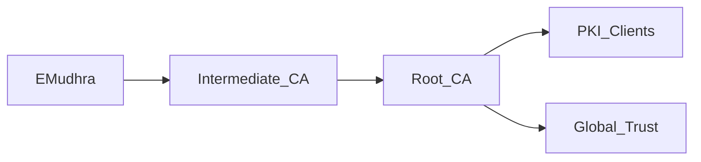

### La posición de EMudhra en el ecosistema PKI\n\nLa violación fue confirmada cuando los actores de amenaza filtraron un subconjunto de claves privadas pertenecientes a la CA intermedia de EMudhra. Con esas claves, podían generar certificados que los navegadores validarían como provenientes de una fuente confiable, eludiendo efectivamente los mecanismos tradicionales de revocación. Para las organizaciones que dependen de certificados emitidos por EMudhra para servicios internos, conexiones VPN o firma de código, el riesgo se traduce en posibles ataques de tipo hombre‑en‑el‑medio, robo de credenciales y daño reputacional.\n\n### Poder, Capital y la Concentración del PKI\n\nLo que hace que el incidente de EMudhra sea más que una violación de seguridad rutinaria es su implicación más amplia para la dinámica estructural del mercado de PKI. El mercado global de PKI está dominado por un pequeño número de proveedores — DigiCert, Sectigo (anteriormente Comodo), GlobalSign, Entrust Datacard y algunas CAs estatal — que controlan la mayor parte del volumen de emisión de certificados, poseen infraestructura extensiva y disfrutan de efectos de red que atrapan a los clientes. La concentración de capital se evidencia en la reciente ola de adquisiciones: la fusión de DigiCert con Versapay (una plataforma de procesamiento de pagos) y la adquisición pendiente de Entrust por un consorcio de fondos de capital privado ilustran cómo el poder financiero refuerza la dominación del mercado.\n\n### Realidades Económicas para las Empresas\n\nPara las empresas, el costo de la emisión de certificados no es solo un partida de gasto; es una palanca estratégica que se interrelaciona con iniciativas más amplias de transformación digital. Las compañías que adoptan servicios de nube enfocados en energías renovables, por ejemplo, pueden depender de certificados emitidos por CAs especializadas para demostrar el cumplimiento de estándares de sostenibilidad. Cuando ocurre una violación, el impacto downstream puede obligar a re‑emitir certificados en decenas de servicios, generando costos ocultos que a menudo superan en órdenes de magnitud la tarifa original de emisión.\n\nDesde el punto de vista económico, la concentración del mercado amplifica el poder de negociación de las CAs. Estas pueden dictar precios, imponer requisitos de validación rigurosos e incluso influir en las rutas de desarrollo de la industria a través de su participación en foros de estándares como el CA/Browser Forum. Este dinamismo significa que las CAs más pequeñas, como EMudhra, deben especializarse en nichos (PKI gubernamental, cumplimiento regional) o buscar alianzas estratégicas para sobrevivir. La reciente violación podría acelerar una tendencia hacia la consolidación, ya que las CAs más grandes adquieren intermediarios vulnerables para reforzar sus propias cadenas de confianza.\n\n### Implicaciones para la Seguridad de la Cadena de Suministro\n\nEl caso EMudhra también pone de relieve los riesgos de la cadena de suministro inherentes a la emisión de certificados. Muchos proveedores de software incorporan certificados de firma de código en sus pipelines de construcción, y dichos certificados suelen transitar por CAs de terceros. Si una CA intermedia es comprometida, los atacantes pueden inyectar firmas fraudulentas en binarios que de otro modo serían legítimos, socavando todo el ecosistema de distribución de software. Análisis recientes de la violación sugieren que una parte significativa del portafolio de certificados de EMudhra se utilizaba para firma de código y autenticación de dispositivos en entornos IoT, sectores donde la confianza es paramount.\n\nPara mitigar estos riesgos, las empresas están adoptando cada vez más registros de transparencia de certificados, certificados de vida corta y políticas de rotación automática. No obstante, estas prácticas requieren una coordinación robusta con las CAs y mecanismos de revocación fiables, los cuales pueden obstaculizar la adopción de estas prácticas sin una coordinación adecuada con las CA y mecanismos de revocación confiables.

