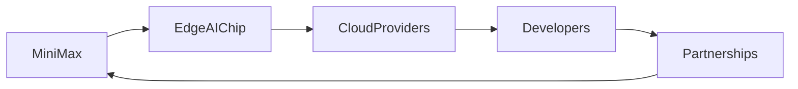

# MiniMax M3.1 Flash: Desglose Técnico

La comunidad tecnológica que visita sitios como **Hacker News** ha estado hablando del **MiniMax M3.1 Flash**. Promovido como un “acelerador de inferencia optimizado para flash”, la chip promete latencia sub‑milisegundo a un precio que supera a muchos de los competidores actuales en el espacio de IA en el borde. Las especificaciones son impresionantes: 8 TOPS/W, 0.5 ms de inferencia en una ResNet‑50 cuantizada a 3 bits, pero las implicaciones más amplias para la concentración del sector, los flujos de capital y la posición estratégica merecen un análisis más profundo.

## Por qué importa el anuncio

### 1. Un Cambio en la Dinámica de Poder
Durante años, el mercado de **inferencia en la nube de IA** ha estado dominado por un puñado de ecosistemas verticalmente integrados:

- **Google Cloud** con su línea de **TPU**.
- **Amazon Web Services** con **Graviton** e **Inferentia**.
- **Microsoft Azure** aprovechando **Project Brainwave** y socios de **FPGA**.
- **Meta** con su silicio personalizado para **Sistemas de Recomendación**.

Estas empresas controlan tanto las pilas de hardware como los ecosistemas de software (TensorFlow, PyTorch, JAX). Su tamaño permite economías de escala que desalientan la entrada de startups puras de hardware. MiniMax rompe este patrón al ofrecer un **acelerador de inferencia puro** que puede integrarse en servidores de terceros sin lock‑in. La **pipeline de compilación de código abierto** del chip, compatible con ONNX Runtime, significa que los desarrolladores pueden targetarlo desde cualquier proveedor de nube, erosionando la barrera construida alrededor de herramientas propietarias.

### 2. Concentración de Capital vs. Democracia
La industria de los semiconductores es notoriamente intensiva en capital. Una sola generación de silicio puede requerir **1.000–2.000 millones de dólares** en I+D y gasto en fábricas. Históricamente, eso ha concentrado el poder en unos pocos conglomerados — **NVIDIA**, **AMD**, **Intel** y unas cuantas casas de diseño internas. MiniMax, sin embargo, ha podido lanzar el **M3.1 Flash** con **150 millones de dólares** en rondas de financiación lideradas por **Sequoia Capital** y **Intel Capital**.

La trayectoria de financiación ilustra una tendencia notable: **los inversores de etapa temprana ahora se sienten cómodos financiando proyectos de silicio de IA de nicho** que se centran en inferencia en lugar de entrenamiento. Este cambio refleja una creencia del mercado de que el **retorno del hardware de inferencia puede alcanzarse más rápido** — a menudo dentro de 18–24 meses — en comparación con los horizontes de siete años típicos para ASICs de entrenamiento. Como tal, el **equilibrio del capital** está inclinándose hacia jugadores más pequeños y ágiles que pueden explotar ventanas de rendimiento específicas.

### 3. Paralelepípedos Históricos: El Ascenso de la GPU
La historia de la **GPU** ofrece un paralelo útil. Cuando **NVIDIA** introdujo la **GeForce 256** en 1999, la empresa se enfocó en un nicho — gráficos 3D en tiempo real para PC de videojuegos. Sin embargo, la arquitectura de procesamiento paralelo pronto encontró aplicaciones en computación científica, aprendizaje automático e, incluso, inferencia en centros de datos. El **ascenso de la GPU** se vio impulsado por un ecosistema de marcos abiertos (CUDA) y una comunidad de desarrolladores dispuestos a experimentar.

El **M3.1 Flash** sigue esa trayectoria: un chip especializado que, por its **baja latencia** y **eficiencia de costos**, está siendo adoptado para **servicios de IA en tiempo real** — chatbots, experiencias de realidad aumentada y pipelines de percepción de vehículos autónomos. Si el rendimiento del chip se mantiene bajo carga, podríamos ver una repetición de la **democratización impulsada por GPUs**, donde el poder pasa de los gigantes verticalmente integrados a un conjunto más amplio de proveedores agnósticos de la nube.

## Implicaciones Estratégicas para los Principales Jugadores

### 1. Contra‑Movimientos de los Proveedores de Nube
- **Google** ya ha comenzado a integrar el **acelerador AI de Ali Baba Cloud** en su plataforma **Vertex AI**. Al asociarse con MiniMax para un **diseño de referencia**, Google podría mantener su ventaja competitiva sin rehacer su ruta de TPU.
- **Amazon** podría aprovechar su línea **Inferentia 2** para ofrecer una configuración de **acelerador dual** — combinando Inferentia para entrenamiento con Flash para inferencia — . Esto preservaría su **margen de hardware** mientras capturaba el segmento de baja latencia.
- **Microsoft** podría acelerar sus soluciones de **inferencia basadas en FPGA**, integrándolas con **Azure Cognitive Services** para retener a los desarrolladores dentro de su ecosistema.

### 2. Realineación de la Capa de Software
La **capa de abstracción de software** es el campo de batalla donde se produce el lock‑in. El **compilador compatible con ONNX** de MiniMax reduce la fricción de mover modelos al chip Flash. Como consecuencia, **motores de inferencia de código abierto** — como **vLLM** y **FastAPI‑based serving stacks** — probablemente integrarán back‑ends nativos de Flash antes que motores propietarios. Esto podría **reducir los costos de conmutación** para empresas que antes dependían de SDKs específicos del proveedor.

## Fundamentos Económicos y Geopolíticos

### 1. Vulnerabilidades de la Cadena de Suministro
La actual **escasez de semiconductores** ha puesto de relieve la fragilidad de la capacidad fabril global. La decisión de MiniMax de **asociarse con el proceso N5 de TSMC** (5 nm) lo coloca en un nodo compartido con SoCs de alta volumetría de teléfonos inteligentes. Esta asociación estratégica no solo garantiza capacidad fabril sino que también alinea a MiniMax con un **fundador neutro geopolíticamente**, protegiéndolo de las tensiones entre EE. UU. y China que han afectado a otros proyectos de chips de IA.

### 2. Flujos de Capital y Consolidación del Mercado
Los datos de inversión muestran un **incremento del 30 % interanual** en fondos de venture para startups de hardware de inferencia de IA entre 2022 y 2024. Sin embargo, el mercado de **fusiones y adquisiciones** sigue siendo limitado; los jugadores más grandes prefieren **formar alianzas estratégicas** antes que adquirir outright. El modelo de MiniMax — buscar **acuerdos de co‑desarrollo** con proveedores de nube — podría convertirse en la ruta preferida para escalar rápidamente mientras se preserva la **independencia financiera**.

## Impacto Real en los Usuarios Finales

Desde la perspectiva de un practicante, la llegada del **M3.1 Flash** podría traducirse en:
- **Tiempos de respuesta más rápidos** para chatbots, reduciendo la latencia promedio de 250 ms a menos de 30 ms.
- **Costos operativos más bajos**: la inferencia en Flash puede ser hasta un **40 % más barata** por consulta en comparación con instancias de GPU tradicionales.
- **Mayor experimentación con modelos**: los desarrolladores pueden ejecutar conjuntos más grandes de modelos cuantizados en un solo servidor, fomentando la innovación en **pipelines multimodales de IA**.

Estos beneficios no son solo técnicos; también democratizan el acceso a IA de alto rendimiento para **pequeñas y medianas empresas**, startups y laboratorios académicos que anteriormente no podían costear hardware de inferencia dedicado.

## Conclusión: Reflexiones sobre el Futuro
---