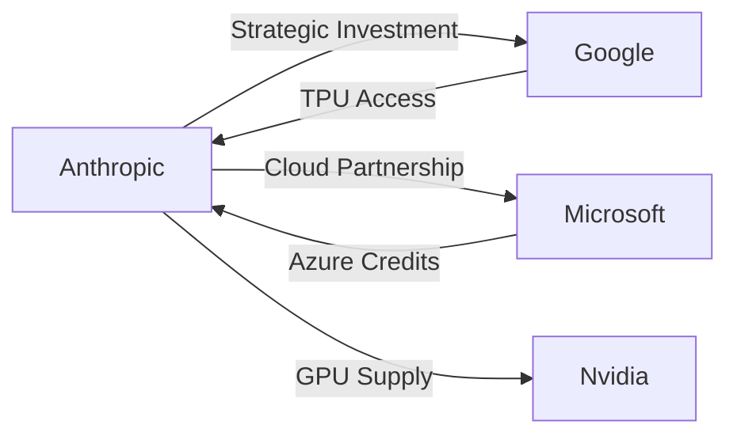

## Introducción  

El 26 de junio de 2024, **Anthropic**, la startup de inteligencia artificial fundada en 2020 por ex‑empleados de OpenAI, presentó su documento **S‑1** ante la SEC para completar una fusión con una compañía de adquisición con propósito especial (SPAC). Más que una simple salida a bolsa, este filing expone la dinámica de poder y la concentración de capital que está remodelando la industria de la IA. En un entorno donde **OpenAI**, **Google DeepMind**, **Microsoft** y **Nvidia** dominan los recursos de cómputo y los flujos de datos, Anthropic se posiciona como un nuevo punto de presión —y, al mismo tiempo, como un espejo de la dependencia estructural que los emprendedores tecnológicos tienen con los megafondos y los conglomerados de la “Big Tech”.

## ¿Qué revela el S‑1 de Anthropic?

El documento presentado en **https://www.sec.gov/Archives/edgar/data/2130357/000162828026067168/anthropicpbc-sx1.htm** detalla una valoración de aproximadamente **$4 billion**, con una combinación de capital proveniente de inversores institucionales (como **a16z**, **Foundation Capital**, y **Coatue**) y de socios estratégicos:

| Inversor | Participación Aproximada | Tipo de Inversión |
|----------|--------------------------|-------------------|
| **Google (Alphabet)** | 10 % | Inversión estratégica y acceso a TPU |
| **Microsoft** | 5 % | Acuerdo de licencia de Azure |
| **Amazon Web Services** | 3 % | Crédito de cómputo |
| **Nvidia** | 2 % | Acuerdos de suministro de GPU |

Estos números no son meramente financieros; representan **alianzas de poder** que otorgan a Anthropic acceso a infraestructura crítica a cambio de potenciales derechos sobre su tecnología. La presencia de Google y Microsoft como accionistas estratégicos sugiere una **co‑dependencia** que puede limitar la independencia tecnológica de Anthropic y, a la larga, reforzar la hegemonía de los gigantes del cloud.

## Concentración de capital: la nueva regla del juego

Desde la explosión del **boom de los modelos de lenguaje grande (LLM)** en 2022, la mayor parte de la financiación ha fluido hacia un número reducido de actores. OpenAI recaudó **$10 billion** en su última ronda, respaldado por Microsoft, mientras que Anthropic, con su SPAC, busca **$2 billion** en capitalización de mercado. Este patrón coincide con la teoría de **“capital de riesgo de concentración”**, donde unos pocos fondos controlan la mayoría de los recursos disponibles para startups de alta tecnología.

### Impacto en la competencia

1. **Barreras de entrada**: la necesidad de cientos de petaflops de GPU o TPU hace que sólo los startups con alianzas estratégicas puedan entrenar modelos competitivos.
2. **Efecto “lock‑in”**: los acuerdos con Azure y Google Cloud condicionan a los clientes a usar sus plataformas, reduciendo la interoperabilidad.
3. **Fusión de ecosistemas**: la inversión cruzada (por ejemplo, Nvidia suministra hardware a ambos, Google a su vez impulsa TPU) crea un **ecosistema cerrado** que margina a actores independientes.

## Dinámicas económicas reales: ¿Quién gana y quién pierde?

### Ganadores

- **Los megaconglomerados**: Google, Microsoft y Amazon consolidan su posición como proveedores de infraestructura y, con ello, como custodios de los datos que alimentan los LLM.
- **Los fondos de VC**: a16z y Sequoia, al invertir temprano, aseguran participación en la valorización futura de la IA.
- **Los usuarios finales de gran escala**: corporaciones como Salesforce o Meta se benefician de modelos pre‑entrenados que reducen sus costos de desarrollo interno.

### Perdedores

- **Startups independientes**: sin acceso a gran escala de cómputo, sus modelos quedan rezagados en precisión y velocidad.
- **Pequeñas empresas de software**: la dependencia de APIs controladas por unos pocos proveedores eleva los costos y reduce la capacidad de negociación.
- **Sociedad civil**: la concentración de datos y poder de decisión sobre los modelos de IA aumenta riesgos de sesgo y falta de transparencia.

## Lecciones históricas: de la era de los navegadores a la IA

La situación actual recuerda a la **guerra de los navegadores** de los años 90, cuando Netscape y Microsoft compitieron por la supremacía del *software* a través de estrategias de integración vertical y apuestas de capital. Al final, Microsoft ganó la mayoría de los contratos de **Internet Explorer**, mientras que los desarrolladores de terceros fueron empujados a plataformas propietarias.

Similarmente, en la década del **2000**, los **proveedores de servidores** como **IBM** y **HP** consolidaron su dominio mediante adquisiciones de pequeñas empresas de software de middleware, creando un **monopolio de facto** sobre la infraestructura empresarial. En la actualidad, la IA está siguiendo un camino comparable: los recursos de cómputo y los datos actúan como los “cables de red” del primer milenio, y quienes los controlan pueden imponer estándares, precios y orientaciones de desarrollo.

## ¿Qué significa esto para la regulación?

Una posible respuesta regulatoria podría ser:

- **Auditorías de dependencia de infraestructura**: exigir que las startups revelen el porcentaje de cómputo provisto por cada proveedor.
- **Obligaciones de interoperabilidad**: forzar a los proveedores de cloud a permitir la exportación de modelos entrenados a otras plataformas sin penalizaciones de rendimiento.
- **Límites a la inversión cruzada**: prohibir que los mismos fondos de VC posean simultáneamente acciones mayoritarias en competidores directos de IA.

## Perspectivas a medio plazo

A medida que la IA se infiltre en aplicaciones críticas —desde la medicina personalizada hasta los sistemas de defensa— la concentración de capital puede traducirse en **concentración de poder político**. Las empresas con mayor acceso a la supercomputación podrán influir en la definición de normas éticas y de seguridad, tal como lo hacen hoy los principales **think tanks** de la industria.

Para los emprendedores, la lección es clara: **alinear la estrategia tecnológica con alianzas de infraestructura** es indispensable, pero también implica riesgos de dependencia. Los modelos de negocio basados en **“AI‑as‑a‑Service”** deberán diseñar mecanismos de escape (por ejemplo, exportar pesos a formatos abiertos) para evitar el “vendor lock‑in”.

## Conclusión

El filing S‑1 de Anthropic no es solo una hoja de balance; es un mapa de poder que muestra cómo la **IA está consolidándose bajo los amos del cloud y el capital de riesgo**. La historia de la industria tecnológica nos enseña que la concentración de recursos tiende a generar monopolios de facto, con consecuencias que trascienden lo económico y tocan lo social y político.

Invitamos a lectores, inversores y reguladores a reflexionar: ¿estamos construyendo una infraestructura de IA que favorezca la innovación abierta o una fortaleza donde solo unos pocos deciden el futuro de la tecnología? La respuesta determinará la forma en que la IA impactará a la sociedad en la próxima década.

---

