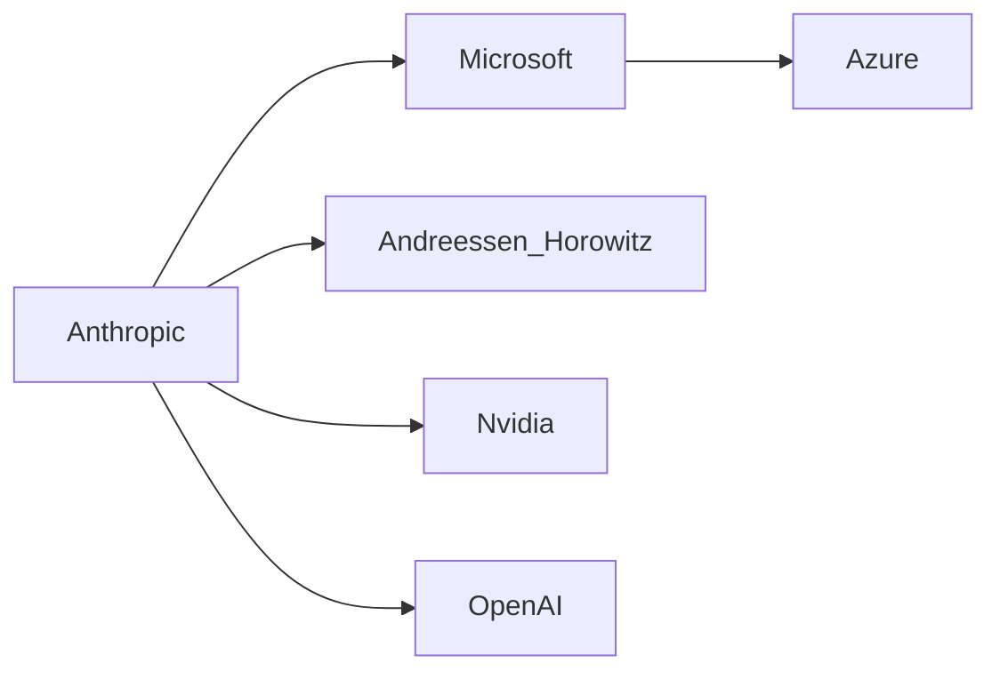

## Introducción

El 26 de junio de 2026, Anthropic, la startup de IA fundada por ex‑empleados de OpenAI, presentó su **Formulario S‑1** ante la SEC, marcando el paso de una ronda de financiamiento privado a una oferta pública inicial (IPO). Más que una simple hoja de registro, el documento expone la estructura de capital, los grandes inversores y las alianzas estratégicas que definen el panorama actual de la inteligencia artificial generativa. En este artículo, analizamos qué significa el S‑1 de Anthropic para la industria tecnológica, cómo se refleja la concentración de poder y qué lecciones históricas podemos extraer de esta nueva fase de consolidación.

## Un vistazo rápido al S‑1

El S‑1 muestra que Anthropic ha recaudado **aproximadamente $4.5 mil millones** en financiamiento privado, con participaciones importantes de:

| Inversor | Participación estimada |
|----------|------------------------|
| **Microsoft** | 11 % (incluye inversión de $1.5 bn) |
| **Andreessen Horowitz** | 9 % |
| **Spark Capital** | 5 % |
| **Tiger Global Management** | 4 % |
| **Otros VCs** | 12 % |

La compañía reporta ingresos de **$450 millones** en los últimos doce meses, impulsados por contratos de licencia de su modelo Claude con empresas como **Snowflake**, **PayPal** y **Nvidia**. Sin embargo, la mayor parte de sus gastos sigue enfocada en la expansión de infraestructura en la nube y la contratación de talento de élite.

## La dinámica del poder: de la innovación abierta a la consolidación

### 1. **Los gigantes tecnológicos como “socios‑capitalistas”**

Microsoft ya no es solo un cliente; es un inversor y una puerta de acceso a **Azure**. Este modelo de “venture‑capital corporativo” permite a los gigantes tecnológicos asegurar una posición de liderazgo antes de que los modelos de IA se conviertan en productos de consumo masivo. La misma estrategia se observó hace diez años cuando Google invirtió en **DeepMind** y, a la postre, la absorbió completamente.

### 2. **Concentración de capital y barreras de entrada**

El documento muestra que los fondos de capital riesgo más influyentes —Andreessen Horowitz, Tiger Global, Spark— están concentrando sus apuestas en un puñado de startups de IA. Esta concentración crea un **efecto de “bola de nieve”**: los jugadores con acceso a capital pueden financiar la adquisición de hardware de alta gama (GPUs, TPUs), atraer a científicos de datos de élite y, a su vez, elevar los costos de desarrollo para los competidores emergentes.

### 3. **Estrategia de “doble uso” y la presión regulatoria**

Anthropic enfatiza la “seguridad por diseño” de sus modelos, una respuesta directa a la creciente presión regulatoria en EE. UU. y la UE. Sin embargo, al alinearse con reguladores a través de un discurso de “IA responsable”, la empresa refuerza su posición frente a competidores menos preparados para enfrentar normas emergentes, como **Stability AI** o **Cohere**, que podrían quedar rezagados.

## Comparación con fases históricas de la industria

| Período | Característica clave | Ejemplo relevante |
|--------|----------------------|--------------------|
| **Década de 1990** – Era de los navegadores | Consolidación alrededor de pocos navegadores, adquisición de Netscape por AOL | AOL → Netscape |
| **2000‑2010** – Cloud computing | Amazon Web Services monopoliza infraestructura, mientras que Google y Microsoft siguen con IaaS | Amazon → AWS |
| **2010‑2020** – Big Data y Machine Learning | Google adquiere **DeepMind**, Microsoft compra **GitHub**, Nvidia lidera GPUs para IA | Google → DeepMind |
| **2020‑presente** – IA generativa | Capital concentrado en unos pocos “modelos de gran escala”; alianzas estratégicas con cloud y hardware | Microsoft → Anthropic, Nvidia → Infrastructure |

Anthropic está jugando el mismo papel que DeepMind hace una década: una startup de alta tecnología respaldada por los recursos de un gigante, que luego se vuelve un **activo estratégico** dentro del ecosistema del inversor. La diferencia radica en la **velocidad**: los ciclos de financiación y desarrollo son ahora de **meses**, no años, lo que acelera la presión sobre los competidores y los reguladores.

## Impacto en la cadena de valor de la IA

1. **Infraestructura en la nube** – Azure se consolida como la “casa” de Anthropic, lo que obliga a otras nubes a ofrecer incentivos a startups rivales para evitar una dependencia excesiva.
2. **Hardware** – Nvidia continúa liderando la provisión de GPUs, mientras que Google intenta revivir sus TPUs con nuevos contratos de suministro.
3. **Aplicaciones empresariales** – Grandes corporaciones (PayPal, Snowflake) buscan integrar LLMs para automatizar flujos, lo que crea una **dependencia de los proveedores de modelo**.
4. **Talento** – Los salarios de los investigadores de IA se acercan a los de los banqueros de inversión, limitando la capacidad de startups sin capital de riesgo para atraer talento.

## Riesgos y oportunidades de la consolidación

### Riesgos

- **Monopolio de la innovación**: Con pocos actores capaces de entrenar modelos de varios billones de parámetros, la diversidad de enfoques de investigación disminuye.
- **Dependencia del ecosistema en la nube**: Si Microsoft decide cambiar sus condiciones de precios, los clientes de Anthropic podrían enfrentar costos inesperados.
- **Censura y control de datos**: Los gobiernos podrían presionar a los pocos proveedores de IA para que implementen filtros, limitando la libertad de desarrollo.

### Oportunidades

- **Escalabilidad y estabilidad**: Los recursos de Azure y Nvidia permiten a Anthropic ofrecer SLA de nivel empresarial, lo que abre mercados regulados (finanzas, salud).
- **Ecosistema de socios**: Startups menores pueden especializarse en capas verticales (por ejemplo, IA para diagnóstico médico) usando la API de Claude, creando un **modelo de “plataforma + complementos”** similar al de Salesforce.
- **Normativas de IA segura**: Al posicionarse como pionera en “IA responsable”, Anthropic puede influir en la formulación de estándares, lo que le otorga una ventaja competitiva frente a actores menos comprometidos.

## El futuro de la IPO de Anthropic

La salida a bolsa será, sin duda, un **evento de referencia** para otras startups de IA. La valoración preliminar supera los **$25 mil millones**, lo que sitúa a Anthropic en la misma gama que OpenAI (cuando este decida unirse a los mercados) y por encima de la mayoría de los unicornios de la década pasada. Esta valoración refuerza la idea de que el **capital del mercado** está dispuesto a financiar no solo la capacidad de cómputo, sino también los riesgos regulatorios y de seguridad.

Sin embargo, el éxito de la IPO dependerá de factores externos: la respuesta de la **Reserva Federal** a la inflación, la evolución de la normativa de datos en la UE y la capacidad de Anthropic para demostrar una **rentabilidad sostenible** más allá del ciclo de inversión inicial.

## Conclusión

El S‑1 de Anthropic no es solo un documento financiero; es una radiografía del actual **ecosistema de IA generativa**, donde el poder está cada vez más concentrado en alianzas entre gigantes tecnológicos y fondos de capital riesgo. La historia nos muestra que cada ola de innovación —desde los navegadores hasta la computación en la nube— termina con una fase de consolidación que determina quién controla la infraestructura, el talento y los estándares futuros.

Para los inversores, reguladores y desarrolladores, la lección es clara: la **capacidad de escalar** ya no depende únicamente de la genialidad del algoritmo, sino de la **red de capital, hardware y alianzas estratégicas** que se construye alrededor de él. La pregunta que queda es si esta concentración impulsará una IA más segura y útil, o si limitará la diversidad de ideas que históricamente ha alimentado los mayores avances tecnológicos.

---