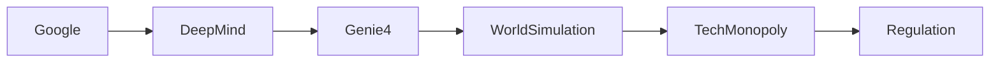

## Introducción

El 30 de octubre de 2024 DeepMind publicó *Genie 4*, la cuarta generación de su plataforma de simulación de mundos. Más que un avance técnico, el anuncio plantea preguntas sobre quién controla las herramientas que modelan la realidad y cómo esa capacidad se traduce en poder económico y político. En este artículo, desglosamos el significado de Genie 4, lo situamos en la trayectoria histórica de la industria y examinamos las dinámicas de concentración de capital que emergen alrededor de los gigantes de la IA.

## ¿Qué es Genie 4?

Genie 4 es una arquitectura híbrida que combina un gran modelo de lenguaje (LLM) con un motor de simulación física y social, permitiendo a los agentes aprender y razonar dentro de entornos complejos y persistentes. A diferencia de sus predecesores, Genie 4 incorpora:

* **Simulación multi‑agente a escala**: miles de entidades interaccionan simultáneamente, lo que mejora la capacidad de modelar fenómenos macro como mercados, pandemias o cambios climáticos.  
* **Aprendizaje por refuerzo jerárquico**: los agentes pueden crear sub‑políticas y abstraer conocimientos, reduciendo la necesidad de recompensas externas intensivas.  
* **Integración de visión y lenguaje**: los modelos pueden interpretar imágenes y textos del entorno, cerrando la brecha entre percepción y razonamiento.

Desde el punto de vista técnico, la plataforma supera a sus rivales de código abierto, como *OpenAI Gym* y *DeepMind Lab*, al ofrecer entornos “de mundo abierto” que pueden ser personalizados por investigadores externos mediante licencias controladas.

## El poder detrás de la simulación

### Google y la concentración de capital

DeepMind es, en última instancia, una filial de Alphabet, cuyo ecosistema abarca desde la publicidad digital (Google Ads) hasta la computación en la nube (Google Cloud). La publicación de Genie 4 refuerza la posición de Google como *gatekeeper* de los recursos de IA más avanzados. Con la infraestructura de TPU de Google, la empresa puede entrenar modelos de billones de parámetros a costes que quedan fuera del alcance de la mayoría de startups o universidades.

Esta capacidad de “economía de escala” no solo crea una barrera de entrada, sino que también permite a Google ofrecer servicios de simulación como SaaS, potencialmente empaquetándolos con su suite de Cloud AI. Los clientes que adopten Genie 4 quedarán atados a la infraestructura de Google, incrementando su dependencia y reduciendo la competencia en el mercado de plataformas de simulación.

### Competidores y respuestas estratégicas

* **Microsoft** está impulsando su alianza con OpenAI, licenciando GPT‑4 y anunciando su propio motor de simulación llamado *Azure WorldSim*. Sin embargo, carece de la integración profunda de hardware que Google posee con sus TPUs, lo que le obliga a depender de hardware de terceros o de la nube de Azure, más costoso a escala.

* **Meta** ha invertido en *AI Habitat* y en modelos de agentes que interactúan en entornos 3D, pero su enfoque se ha centrado en la realidad virtual para consumidores, no en simulaciones de alto nivel para investigación de políticas públicas.

* **Amazon Web Services** ofrece *SageMaker RL* y simuladores de logística, pero su portafolio se orienta a casos de negocio específicos, sin la visión de “mundo entero” que propone Genie 4.

Esta fragmentación refuerza la idea de que los grandes conglomerados tecnológicos están divididos en “carriles” de especialización, pero el que controla la capacidad de crear y entrenar agentes en entornos universales posee una ventaja estratégica decisiva.

## Lecciones históricas: de mainframes a la nube

La consolidación que vemos hoy tiene paralelos claros con etapas anteriores:

1. **IBM y los mainframes (1960‑80)**: IBM monopolizó el hardware de cómputo y definió estándares de software que obligaban a los clientes a comprar licencias propietarias. La aparición de minicomputadoras y, posteriormente, de PC cambió esa dinámica, pero no antes de que IBM acumulase enormes reservas de capital.
2. **Microsoft y el dominio del sistema operativo (1990‑2000)**: Windows se convirtió en la plataforma universal, y los desarrolladores tenían que adherirse a sus APIs. La llegada de Linux y la proliferación de la web fracturaron ese monopolio, aunque Microsoft siguió lucrando con licencias y servicios en la nube.
3. **Amazon y la nube pública (2006‑2020)**: AWS lideró la oferta de infraestructura como servicio (IaaS). Los competidores tardaron años en cerrar la brecha, y la mayoría de startups dependieron de Amazon para escalar rápidamente.

Genie 4 representa la **cuarta ola**: la capacidad de modelar entornos complejos y, por ende, de prever y manipular resultados económicos, políticos y sociales. Quien domine esa tecnología podrá ofrecer “predicciones como servicio”, transformando desde la planificación urbana hasta la estrategia militar.

## Dinámicas económicas reales: IA como activo financiero

### Valoración de capital intelectual

Los modelos de simulación como Genie 4 se convierten en *activos intangibles* que aparecen en los balances de Alphabet como “propiedad intelectual”. La contabilidad de estos activos sigue siendo opaca: el coste de desarrollo se capitaliza, pero la valoración de su potencial de mercado depende de estimaciones internas. Este fenómeno alimenta la *burbujas de IA*, donde invertimos miles de millones en tecnologías cuya rentabilidad futura es incierta.

### Externalidades y regulación

La capacidad de simular políticas públicas o mercados financieros plantea riesgos de *externalidades negativas*. Por ejemplo, una empresa podría usar Genie 4 para probar estrategias de manipulación de precios antes de implementarlas en el mundo real, creando una ventaja desleal y potencialmente desestabilizando mercados. Actualmente, la regulación de IA se centra en algoritmos de generación de contenido, pero la simulación de sistemas completos está fuera del alcance de la mayoría de leyes existentes.

### Concentración de talento

DeepMind atrae a investigadores de élite, ofreciendo salarios y recursos que superan a cualquier laboratorio académico. La fuga de cerebros hacia la industria intensifica la brecha entre la investigación pública (p. ej., universidades) y la privada, limitando la diversidad de enfoques y reduciendo la transparencia de los resultados.

## ¿Qué implica para los actores más pequeños?

Los startups de IA que no pueden costear TPUs a gran escala se ven forzados a:

1. **Utilizar APIs de terceros** (p. ej., OpenAI, Anthropic) bajo modelos de suscripción que pueden ser prohibitivamente caros cuando el número de llamadas crece.  
2. **Especializarse en nichos** donde la simulación global de Genie 4 no aporta ventaja competitiva, como hardware especializado o aplicaciones de IA en el edge.  
3. **Buscar alianzas con universidades** para acceder a infraestructura compartida, aunque la competencia por esos recursos también está en aumento.

En la práctica, la brecha de capacidad de simulación crea un *ecosistema de dos capas*: los que pueden entrenar y ejecutar mundos completos, y los que sólo pueden consumir resultados pre‑empaquetados.

## Conexión con la agenda de IA segura

DeepMind ha subrayado que Genie 4 incluye *mecanismos de alineación* y de control de comportamientos no deseados. Sin embargo, la misma potencia que permite probar la seguridad de sistemas autónomos también abre la puerta a pruebas de vulnerabilidades y a la creación de agentes que aprendan a evadir controles. La falta de supervisión independiente intensifica el riesgo de que estos avances se utilicen para fines militares o de vigilancia sin una auditoría pública robusta.

## Conclusión

Genie 4 es, sin duda, un hito técnico que empuja los límites de la simulación de mundos y del aprendizaje autónomo. Pero su lanzamiento también subraya una tendencia inexorable: **el control de los instrumentos que modelan la realidad está cada vez más concentrado en manos de unos pocos gigantes tecnológicos**. Al observar la historia – IBM, Microsoft, Amazon – vemos un patrón de monopolios temporales que remodelan industrias enteras antes de ser desafiados por la innovación descentralizada.

La pregunta que queda es: ¿Podremos crear marcos regulatorios y comunidades de código abierto suficientemente fuertes para contrarrestar esta concentración, o seguiremos viendo cómo la capacidad de imaginar y predecir el futuro se convierte en un activo exclusivo de las mayores corporaciones? La respuesta dependerá de la voluntad colectiva de gobiernos, investigadores y la sociedad civil para demandar transparencia y pluralidad en la era de la IA de simulación.