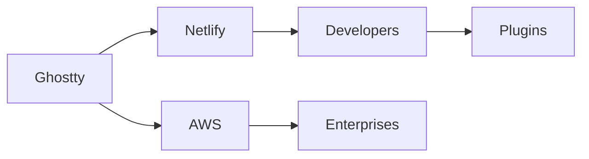

## Introducción

El ecosistema Jamstack ha crecido de forma explosiva en los últimos cinco años, impulsado por herramientas de generación estática, despliegues instantáneos y la promesa de sitios más seguros y rápidos. En medio de esta carrera, Ghostty –un generador de sitios estáticos orientado a la comunidad de diseñadores y desarrolladores– lanzó la versión **1.4**, anunciada en Hacker News y documentada en su página oficial. Más que una simple lista de correcciones, la actualización abre la puerta a una reflexión sobre quién controla la infraestructura que sostiene la nueva web y cómo el capital sigue concentrándose en unas pocas corporaciones.

## Qué trae Ghostty 1.4

Según las notas de la release, Ghostty 1.4 introduce cuatro bloques principales:

1. **Compilación incremental**: permite actualizar solo los archivos modificados, reduciendo los tiempos de build en un 30 % en proyectos medianos.
2. **Mejoras en la previsualización en vivo**: ahora el hot‑reload funciona también con archivos de estilo y fuentes, ofreciendo una experiencia más fluida para diseñadores.
3. **Integración nativa con Netlify Functions**: los usuarios pueden añadir lógica del lado del servidor sin dejar el flujo de trabajo de Ghostty.
4. **Sistema de plugins reescrito**: una API más estable y documentación ampliada para que terceros desarrollen extensiones sin romper compatibilidad.

Estas mejoras responden a demandas concretas de la comunidad: velocidad, facilidad de uso y la necesidad de combinar contenido estático con funcionalidades dinámicas. Pero también revelan el punto de inflexión donde los *generadores de sitios* ya no son meros “compiladores”, sino plataformas que dependen de servicios externos para ofrecer lo que antes se consideraba “todo en el cliente”.

## El contexto de poder en el Jamstack

### La tríada Netlify–Vercel–Cloudflare

Desde la aparición de los sitios estáticos, tres empresas han capitalizado la tendencia: **Netlify**, **Vercel** y **Cloudflare**. Cada una ofrece un modelo de negocio “Jamstack‑as‑a‑service” que combina alojamiento, CDN y funciones serverless bajo un mismo techo. Estas plataformas han levantado rondas de financiación multimillonarias y, en muchos casos, están respaldadas por fondos de capital riesgo que buscan escalar rápidamente.

### Amazon Web Services y la nube de facto

Aunque Ghostty se promociona como “agnóstico de la nube”, la mayoría de sus usuarios despliegan los resultados en **AWS S3 + CloudFront**, **Google Cloud Storage** o **Azure Blob Storage**. Estas tres gigantes representan más del 70 % del gasto mundial en infraestructura cloud, según Gartner 2023. La realidad es que la libre competencia se ve limitada por la capacidad económica de migrar datos, entrenar equipos y negociar precios. En otras palabras, la liberación que promete el código abierto se ve aislada por la “puerta de entrada” del hosting.

### El papel de GitHub y el ecosistema de repositorios

La integración con GitHub Actions para CI/CD es otro pilar del flujo de trabajo Jamstack. Microsoft, propietaria de GitHub, ha diseñado planes empresariales que incluyen minutos de compilación gratuitos y, al mismo tiempo, cobra por almacenamiento y por funcionalidades avanzadas de seguridad. Cada paso del pipeline –desde el commit hasta la distribución– se vuelve una cadena de dependencias sobre infraestructura de capital privado.

## Concentración de capital y sus consecuencias

### Valor económico versus control técnico

El valor económico generado por los proyectos Jamstack se concentra en las plataformas que proveen los servicios de hosting, CDN y funciones server‑less. Aunque el código de Ghostty es abierto, el control técnico recae en quien ofrece la infraestructura donde se ejecuta el sitio. Esto permite a los proveedores fijar precios, aplicar limitaciones de uso y, en algunos casos, imponer actualizaciones que los usuarios deben aceptar para mantener la disponibilidad.

### Externalización del conocimiento

El nuevo *plugin API* permite a terceros crear extensiones, pero el punto de entrada sigue siendo el repositorio oficial de Ghostty. En la práctica, las empresas que desean funcionalidades avanzadas contratan a consultoras especializadas (por ejemplo, **Shopify Partners** o agencias de **DigitalOcean Marketplace**) que, a su vez, dependen de la misma capa de servicios cloud. Así, el conocimiento especializado se vuelve más caro y menos accesible para proyectos independientes.

### Historias repetidas: del browser a los frameworks

La centralización no es un fenómeno nuevo. En la historia de la web, primero los navegadores se volvieron monolíticos, luego surgieron los frameworks JavaScript que dependían de grandes corporaciones para su mantenimiento. Hoy, los generadores estáticos y las plataformas Jamstack siguen ese mismo patrón: la innovación de código abierto se apoya sobre infraestructuras controladas por unos pocos actores, reproduciendo la misma dinámica de concentración de poder.

## Oportunidades de resistencia y caminos alternativos

### Infraestructura autogestionada

Una respuesta viable es el **autoservicio de infraestructura** mediante herramientas como **Terraform**, **Nomad** o **K3s**. Algunas comunidades están creando “clusters distribuídos” donde los sitios estáticos se alojan en nodos de usuarios llamados “edge peers”. Este modelo recuerda al proyecto **IPFS**, que intenta descentralizar el almacenamiento web.

### Plataformas cooperativas

Empresas emergentes como **Render**, **Fly.io** y **Supabase** están experimentando con precios más transparentes y modelos de código abierto para partes de su stack. Si Ghostty continúa permitiendo la integración con cualquier backend, los proyectos podrán migrar a estas alternativas sin grandes fricciones.

### Políticas públicas y regulación

A nivel macro, la UE y EE. UU. están considerando regulaciones que obliguen a la **portabilidad de datos** y a la **interoperabilidad** entre proveedores de cloud. Si se implementan, los usuarios de Ghostty podrían negociar mejor sus contratos con Netlify o AWS, reduciendo la capacidad de estas compañías para fijar precios monopolísticos.

## Conclusión

Como analista independiente, invito a los lectores a reflexionar sobre dónde se está creando el valor real y quién lo captura. Si la visión de un internet abierto y descentralizado sigue siendo importante para nosotros, es necesario apoyar modelos de infraestructura que reduzcan la dependencia de los gigantes del cloud, fomentar la creación de herramientas cooperativas y presionar por regulaciones que garanticen la portabilidad y la competencia. Solo así la evolución tecnológica podrá acompañarse de una distribución de poder más equitativa.