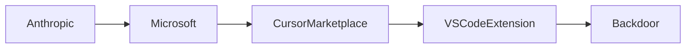

```mdx
## Introducción

En marzo de 2024, la comunidad de desarrolladores se vio sacudida por la revelación de una **backdoor** incrustada en la extensión *Claude Code* para Visual Studio Code, distribuida a través del **Cursor Marketplace**. La investigación publicada por Phorion.io mostró que el código de la extensión había sido alterado para enviar datos de uso a servidores externos sin el conocimiento del usuario. Este incidente no es sólo una falla técnica; es el reflejo de una serie de dinámicas estructurales que están remodelando la industria del software: la creciente concentración de capital en empresas de IA, el control sobre plataformas de distribución y la vulnerabilidad de la cadena de suministro de código abierto.

> *“La seguridad de la cadena de suministro ya no es un asunto técnico; es un problema de poder y control de mercado.”* – Analista independiente

En este artículo desglosaremos el caso Claude Code, analizaremos quiénes son los actores involucrados y situaremos estos hechos dentro de una tendencia histórica de **centralización** y **dependencia** tecnológica.

## El caso Claude Code: ¿Qué sucedió?


Claude Code es una extensión de IA generadora de código desarrollada por **Anthropic**, la startup detrás del modelo de lenguaje *Claude*. La extensión se promocionó como una herramienta “plug‑and‑play” para programadores que buscan acelerar la escritura de código mediante sugerencias contextuales. Para facilitar su adopción, Anthropic se asoció con **Cursor**, una plataforma de desarrollo que alberga su propio marketplace de extensiones.

### La vulnerabilidad

Según el informe de Phorion, una versión del paquete *vsx* subido al Cursor Marketplace contenía código que:

1. **Interceptaba** los snippets generados por Claude.
2. **Enviaba** información del archivo, línea de código y contexto a un dominio controlado por terceros.
3. **Permitía** la ejecución de comandos arbitrarios bajo ciertos parámetros.

El código malintencionado estaba ofuscado, lo que dificultó su detección durante la revisión de seguridad habitual. Sólo después de que varios usuarios reportaran comportamientos sospechosos y que una auditoría externa detectara el tráfico de red inesperado, se descubrió la puerta trasera.

### Reacción de los involucrados

- **Anthropic**: emitió un comunicado señalando que “el incidente fue causado por un tercero no autorizado" y prometió “revisar y reforzar los procesos de control de calidad”.
- **Cursor**: retiró rápidamente la extensión y anunció la implementación de **escaneos estáticos reforzados** para todas las extensiones del marketplace.
- **Comunidad de desarrollo**: unió voces críticas contra la falta de **transparencia** y la **dependencia** de los desarrolladores en herramientas de un número limitado de proveedores de IA.

## Relaciones de poder y concentración de capital

### Anthropic y Microsoft: una alianza estratégica

En 2023, **Microsoft** invirtió mil millones de dólares en Anthropic, convirtiéndose en su principal accionista. Esta alianza ha permitido a Anthropic integrar sus modelos de IA en productos de Microsoft, como *Azure AI* y *Copilot*. La inversión no sólo otorga a Microsoft una ventaja competitiva frente a OpenAI, sino que también le brinda influencia directa sobre la hoja de ruta de Anthropic.

Esta relación se vuelve relevante al analizar la vulnerabilidad de Claude Code porque:

- **Control financiero**: Microsoft puede dictar prioridades de desarrollo, enfocándose en la velocidad de despliegue sobre la auditoría exhaustiva.
- **Estrategia de ecosistema**: Al promover extensiones como Claude Code en marketplaces de terceros, Microsoft y Anthropic buscan crear **lock‑in** para los desarrolladores, reduciendo la probabilidad de migrar a competidores.
- **Externalización de riesgos**: Delegar la distribución a plataformas como Cursor permite que la responsabilidad de seguridad se diluya entre varios actores, dificultando la rendición de cuentas.

### Cursor Marketplace: centralización de la distribución

Cursor, fundada en 2021, se posicionó rápidamente como un hub alternativo al oficial **VS Code Marketplace** de Microsoft. Sin embargo, el hecho de que un **solo marketplace** haya alojado la versión comprometida expone la fragilidad de confiar en **puntos de distribución limitados**. Cuando una plataforma se vuelve dominante, su capacidad para **filtrar** o **negar** contenido se vuelve una herramienta de poder que puede ser usada – tanto consciente como inadvertidamente – para influir en la cadena de suministro de software.

### Comparación histórica: el caso Sony BMG y la raíz del DRM

Este episodio recuerda a la polémica del **rootkit de Sony BMG** (2005), donde la empresa insertó código malicioso en CDs para proteger sus derechos de autor. Ambos casos muestran cómo la **privación de control del usuario** por parte de corporaciones con intereses económicos puede derivar en vulnerabilidades de seguridad masivas. La diferencia hoy radica en la escala: la IA y los marketplaces de extensiones están integrados directamente en el flujo de trabajo de desarrolladores, haciendo que cualquier falla se propague con mayor rapidez.

## Dinámicas económicas reales: la carrera por la captura de datos


### Datos como commodity

El objetivo de la backdoor parecía ser la recopilación de **datos de código fuente**. Esta información es oro negro para los entrenadores de modelos de IA: permite mejorar algoritmos de autocompletado, detección de vulnerabilidades y generación de código según patrones reales de desarrollo. En un mercado donde **modelos de lenguaje** de gran escala requieren enormes volúmenes de datos, la presión por obtener acceso a código propietario o de código abierto se traduce en incentivos económicos claros para **explotar** cualquier vía de extracción.

### Externalidades negativas

- **Riesgo reputacional** para Anthropic y Microsoft, cuyo posicionamiento como custodios de la seguridad de IA se ve amenazado.
- **Costos de remediación**: los equipos de desarrollo deben invertir tiempo y recursos para auditar extensiones, actualizar pipelines de CI/CD y reforzar políticas de seguridad.
- **Desconfianza del usuario**, que puede frenar la adopción de herramientas de IA en entornos empresariales, retardando la monetización de la tecnología.

## Implicaciones para la cadena de suministro de software

### Falta de normas homogéneas

A diferencia de los entornos de **software empresarial**, donde normas como **ISO/IEC 27001** y **SOC 2** guían la gestión de riesgos, el ecosistema de **extensiones de editor** carece de certificación obligatoria. Los desarrolladores confían en revisiones automatizadas y en la reputación del marketplace, lo que deja brechas abiertas.

### Necesidad de “SBOMs” para extensiones

Los **Software Bill of Materials (SBOM)** se están convirtiendo en un requisito regulatorio en algunos países (EE. UU., UE). Extender esta práctica a extensiones de IDE permitiría a los consumidores rastrear cada componente, detectar versiones vulnerables y validar la procedencia del código. Sin embargo, la adopción es todavía incipiente y depende de la voluntad de plataformas como Cursor para proporcionar estos metadatos de forma transparente.

## Tendencias futuras: ¿Más control centralizado o descentralización?

#### 1. Consolidación de marketplaces

Los gigantes tecnológicos (Microsoft, Google, Amazon) están invirtiendo en sus propios stores de extensiones, lo que sugiere una **tendencia a la consolidación**. Esto podría simplificar la auditoría, pero también aumenta el riesgo de un **punto único de falla**.

#### 2. Modelos de IA “open‑source”

Proyectos como **llama.cpp** o **Mistral** promueven modelos de IA abiertos, reduciendo la dependencia de proveedores cerrados. Sin embargo, la falta de financiación robusta a menudo implica recursos limitados para pruebas de seguridad exhaustivas.

#### 3. Regulación emergente

La **EU AI Act** y los proyectos de ley en EE. UU. sobre la integridad de la cadena de suministro podrían obligar a los marketplaces a implementar **escaneos de seguridad obligatorios** y a publicar SBOMs. Si se aplican, la carga de cumplimiento recaerá en plataformas como Cursor, obligándolas a elevar sus estándares.




## Conclusión

El caso del backdoor en Claude Code no es una anomalía aislada; es una señal de que la **concentración de poder** en unos pocos actores – Anthropic, Microsoft y marketplaces como Cursor – está redefiniendo la geografía de la seguridad del software. La presión por obtener más datos para entrenar modelos de IA, combinada con la falta de normas uniformes, crea un fértil caldo para vulnerabilidades que amenazan tanto a desarrolladores individuales como a empresas enteras.

Para evitar que incidentes como este se conviertan en la norma, es crucial que la comunidad tecnológica exija **transparencia**, fomente la **descentralización de la distribución** y apoye la adopción de **SBOMs** y otros mecanismos de auditoría. La pregunta que queda es si los reguladores, los proveedores de IA y los propios desarrolladores podrán equilibrar la carrera por la innovación con la necesidad de proteger la integridad de la cadena de suministro.

*Invitamos a los lectores a reflexionar: ¿estamos dispuestos a sacrificar la seguridad por la conveniencia de herramientas impulsadas por IA, o es hora de reescribir las reglas del juego?*
```