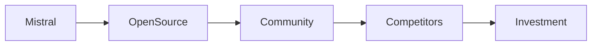

## La jugada de Mistral: pesos liberados, puertas abiertas

En noviembre de 2024, la startup francesa **Mistral AI** anunció la publicación de los pesos de su modelo de lenguaje **Mistral Large‑4**, el más potente que ha puesto en el mercado abierto hasta la fecha. El anuncio, compartido en su blog oficial y amplificado en Hacker News, no solo brinda a investigadores y desarrolladores acceso libre a un modelo de **7 mil millones de parámetros**, sino que también reabre el debate sobre quién controla la infraestructura central de la IA generativa.

Este movimiento contrasta con la tendencia dominante de gigantes como **OpenAI**, **Google DeepMind** y **Microsoft**, cuyas arquitecturas más avanzadas están custodiadas detrás de API propietarias o licencias restrictivas. Al abrir los pesos, Mistral plantea un modelo alternativo que podría redistribuir la influencia tecnológica, aunque está lejos de ser una solución universal.

## Poder de los datos versus poder del capital

El valor de un modelo de lenguaje ha evolucionado de la mera “capacidad de cómputo” a una combinación de **datos**, **algoritmos** y **infraestructura de entrenamiento**. Las grandes corporaciones acumulan datos a escala que ninguna startup puede igualar; sin embargo, la **propiedad intelectual** de los pesos —la representación numérica del conocimiento aprendido— sigue siendo la moneda de cambio más estratégica.

Mistral ha invertido **120 millones de dólares** provenientes de fondos como **Sequoia Capital**, **Lightspeed** y **SV Angel**. Este capital le permitió entrenar Large‑4 en supercomputadoras de última generación, pero la decisión de liberar los pesos representa una apuesta de que la comunidad pueda crear valor añadido sin que la empresa pierda su ventaja competitiva. En la práctica, la medida sirve para:

1. **Atraer talento** que busca trabajar con modelos de última generación sin los costes de licencia.
2. **Crear un ecosistema de complementos** (fine‑tuning, herramientas de inferencia) que potencialmente genere ingresos de servicios de soporte.
3. **Desafiar la narrativa de “caja negra”** que domina a los gigantes de la IA, ofreciendo mayor transparencia y auditabilidad.

Al mismo tiempo, la liberación de los pesos plantea la cuestión de si el **capital de riesgo** sigue siendo el motor principal de innovación. Si los pesos se convierten en un recurso “gratuito”, los inversores podrían redirigir su apuesta hacia la capa de servicios —infraestructura de nube, API de alto nivel y soluciones verticales— donde la monetización es más predecible. Esto recuerda a la ola de **software de código abierto** en los años 2000, cuando proyectos como **Linux** desafiaron a Microsoft, pero el poder económico se desplazó a firmas como Red Hat y, posteriormente, a la nube de Amazon.

## Concentración de talento y la “casa de los pesos”

Mistral se fundó en 2023 con un equipo de investigadores provenientes de **DeepMind**, **Meta AI** y **OpenAI**. Esta migración de talento es parte de una dinámica más amplia: los expertos en IA se concentran en pocos “hubs” de alta remuneración, alimentando una **capa de élite** que controla tanto la investigación como la propiedad de los pesos. Al publicar los pesos, la empresa intenta democratizar ese conocimiento, aunque el **costo de entrenamiento** sigue siendo prohibitivo.

En este contexto, **NVIDIA** sigue siendo el proveedor dominante de GPU para entrenamiento masivo, con una participación de mercado superior al 80 % en la categoría de aceleradores de IA. La dependencia de NVIDIA refuerza una cadena de suministro donde el poder se concentra en pocos fabricantes de hardware, mientras que los modelos abiertos compiten por acceso a recursos de cómputo asequibles. Iniciativas como **AMD Instinct** y la emergente **European Processor Initiative** buscan romper este oligopolio, pero aún están en fase temprana.

## El rol de las plataformas de nube

Amazon Web Services (AWS), Microsoft Azure y Google Cloud Platform (GCP) controlan la mayor parte de la infraestructura de inferencia a nivel global. Aunque los pesos son libres, su despliegue a gran escala sigue requiriendo **instancias de GPU** que se alquilan a precios que pueden superar los **10 USD por hora**. Esto mantiene a los grandes proveedores de nube como **guardianes** de la capacidad de ejecución.

Algunos actores intentan contrarrestar esta dependencia. **Mistral AI** ha anunciado una colaboración con **Paperspace** para ofrecer “Mistral‑as‑a‑Service” en una capa de precios competitiva. Sin embargo, la estrategia de precios bajos es una táctica que históricamente ha sido replicada por los megaplayadores de la nube, quienes pueden absorber márgenes reducidos gracias a economías de escala.

## Tendencias históricas y paralelismos

El movimiento de Mistral se asemeja a la **“OpenAI Charter”** de 2018, que prometía evitar la concentración de poder en IA. Sin embargo, la práctica mostró que OpenAI rápidamente se alineó con Microsoft, transformándose en una entidad de alto valor de mercado y con acceso privilegiado a la infraestructura de Azure. De forma similar, la **publicación de los pesos de GPT‑2** en 2019 por OpenAI despertó esperanzas de apertura, pero la comunidad se topó con barreras de hardware y de datos.

A lo largo de la historia del software, cada ola de apertura ha sido seguida por una consolidación en la capa de servicios. **Unix → Linux → Amazon Web Services**, **Apache → Hadoop → Cloudera** son ejemplos claros. La clave está en quién controla la **orquestación**: los paquetes de código abierto pueden ser gratuitos, pero el **valor de la integración, la seguridad y el soporte** suele estar en manos de corporaciones con capital significativo.

## Implicaciones económicas reales

1. **Reducción de costos de I+D para startups**: Con pesos disponibles, nuevas empresas pueden enfocarse en casos de uso verticales sin invertir en entrenamiento. Esto podría aumentar la **tasa de creación de startups IA**, pero también crear una mayor dependencia de servicios de nube y plataformas de despliegue.  
2. **Presión sobre los precios de API**: Si terceros pueden replicar funcionalidades de GPT‑4 usando Mistral Large‑4, los gigantes podrían verse obligados a ajustar sus precios para mantener la ventaja competitiva.  
3. **Reconfiguración de la cadena de valor**: Los **proveedores de datos** —empresas de medios, centros de datos y plataformas sociales— podrían ganar mayor relevancia al vender “conjuntos de datos de entrenamiento” premium a quienes buscan superar el rendimiento de los modelos abiertos.  
4. **Riesgo de fragmentación**: Con varios modelos abiertos compitiendo, la comunidad podría dividir recursos de investigación, limitando la velocidad de avance comparado con un modelo centralizado y fuertemente financiado.

## ¿Quién gana y quién pierde?

- **Ganadores potenciales**: investigadores académicos, startups de nicho y comunidades de código abierto que ahora pueden experimentar con un modelo de gran escala sin barreras de licencia.  
- **Perdedores potenciales**: proveedores de API propietarias que dependen de la exclusividad de sus pesos, y los actores de infraestructura de nube que podrían ver una reducción en la demanda si los usuarios optan por optimizar modelos en hardware propio o en dispositivos edge.  
- **Neutros con oportunidades**: fabricantes de hardware como NVIDIA, que seguirán vendiendo GPU independientemente del origen del modelo; y **empresas de seguridad en IA**, que podrían ofrecer auditorías y certificaciones para pesos abiertos, creando un nuevo nicho de negocio.

## Conclusión: ¿Una apertura real o una estrategia de mercado?

Mistral AI ha dado un paso valiente al liberar los pesos de Large‑4, pero el acto de abrir el modelo no garantiza una verdadera democratización del poder en inteligencia artificial. La concentración de capital, la dependencia de infraestructura de nube y la hegemonía de los proveedores de GPU siguen configurando una **estructura de poder asimétrica**.

Lo que realmente determinará el impacto de esta iniciativa son las **dinámicas de mercado** que se desarrollen en los próximos años: si la comunidad logra construir una infraestructura de inferencia asequible y si los servicios de valor añadido pueden prosperar sin caer bajo el control de los gigantes de la nube. En última instancia, la pregunta que deberíamos hacernos es si la liberación de pesos es una señal de que el ecosistema IA está madurando hacia una **economía más abierta**, o simplemente una táctica para crear una nueva corriente de ingresos en un mercado cada vez más saturado.