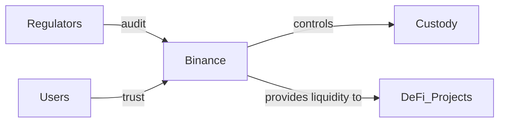

**Una brecha de 20 minutos, una pérdida de $6.3 mil millones**
El pasado 19 de octubre, Binance, el mayor exchange de criptomonedas del mundo, sufrió un ataque coordinado que drenó al menos $6.3 mil millones de fondos en menos de veinte minutos, según la investigación publicada por *Wired* y citada en *Hacker News*. La rapidez del robo – una “carrera contra el reloj” que terminó antes de que los sistemas internos pudieran reaccionar – pone de relieve la vulnerabilidad de los intercambios centralizados, pese a los miles de millones invertidos en ciberseguridad y compliance.

**El modelo de negocio que favorece la concentración**
Binance es más que una plataforma de trading; es una empresa que controla una infraestructura completa: wallet custodial, servicio de préstamos, staking, venta de tokens y una red de partners que incluyen firmas de custodia como Fireblocks y proveedores de liquidez como Jump Crypto. Esta verticalidad le permite captar comisiones masivas (más del 60 % del volumen global de cripto según datos de Kaiko) y, a la vez, crear una “dependencia de un solo punto” para millones de usuarios y proyectos.

Esa dependencia genera una paradoja: los usuarios confían su capital a una entidad que, por su tamaño, debería contar con los recursos necesarios para protegerlo; sin embargo, la propia lógica del negocio – reunir la mayor cantidad de activos bajo una única capa de control – incrementa la superficie de ataque. En términos económicos, el “efecto de atracción” de Binance genera economías de escala, pero también externaliza riesgos que eventualmente terminan en los usuarios finales.

**Historia cíclica de los hacks en exchanges centralizados**

Esta tendencia recuerda a los primeros años del internet, cuando los data centers monopolizados por empresas como AOL o AOL Time Warner determinaban el acceso a la red. Al igual que entonces, la concentración de infraestructura crítica en manos de unos pocos crea cuellos de botella de seguridad y poder.

**Poder financiero y regulatorio en juego**
Binance opera en más de 180 jurisdicciones, a menudo en una zona gris regulatoria. Su fundador, Changpeng Zhao (CZ), ha tratado de posicionar a la empresa como “un puente entre la regulación y la innovación”. Sin embargo, la reciente auditoría de la Autoridad de Conducta Financiera del Reino Unido (FCA) y la presión de la SEC estadounidense demuestran que los reguladores están cerrando la brecha entre el sector cripto y el sistema financiero tradicional.

El hack pone en evidencia una relación de poder asimétrica: los reguladores dependen de los exchanges para obtener datos de mercado y rastrear actividades ilícitas, mientras los exchanges dependen de la “legitimidad” que les otorgan los gobiernos para atraer grandes flujos de capital. Cuando un gigante como Binance sufre una brecha, el impacto se siente en toda la cadena de suministro financiera: fondos de fondos de inversión, token de deuda, y hasta proyectos de finanzas descentralizadas (DeFi) que utilizan su liquidez como referencia de precios.

**La economía de la “seguridad como producto”**
La respuesta directa de Binance fue lanzar un “emergency withdrawal freeze” y compensar a los usuarios mediante su fondo de seguros, Secure Asset Fund for Users (SAFU). Esto subraya una práctica cada vez más extendida en la industria: vender la seguridad como un servicio premium. Mientras los exchanges más pequeños dependen de proveedores externos (por ejemplo, Fireblocks o BitGo), los grandes integran sus propios seguros y protocolos, creando barreras de entrada para nuevos competidores.

Desde la perspectiva de la economía política, la capacidad de Binance para absorber la pérdida sin colapsar se basa en su capital acumulado – reportó un flujo de caja operativo de más de $4 mil millones en el último trimestre. Esa reserva actúa como un “colchón de poder” que, irónicamente, refuerza su posición dominante al reducir la percepción de riesgo para los inversores institucionales.

**Descentralización parcial: ¿una solución real?**
Algunos analistas defienden la migración a custodios descentralizados (por ejemplo, wallets non‑custodial o protocolos de staking auto‑custodial) como la respuesta lógica. Sin embargo, la adopción masiva enfrenta obstáculos: la experiencia de usuario, la falta de seguros y la ausencia de regulación clara. Por ello, la industria se ha movido hacia modelos híbridos, como los “vaults” de DeFi que delegan la custodia a smart contracts auditados, pero que siguen requiriendo una capa de confianza en los desarrolladores.

En la práctica, la tendencia es que los grandes exchanges sigan gobernando la mayor parte del flujo de capital, mientras los proyectos descentralizados compiten por la atención de los usuarios mediante incentivos de rendimiento. Esta dinámica genera una “oligopolía de liquidez”: unos pocos actores (Binance, Coinbase, Kraken) dictan precios, normas de listados y protocolos de seguridad, mientras que los usuarios aceptan el costo de la vulnerabilidad bajo la premisa de conveniencia.

**Lecciones de la historia corporativa**
Si miramos a industrias tradicionales, como la banca o la telefonía, vemos patrones similares: la concentración de infraestructura conduce a crisis de confianza (p. ej., la crisis de 2008 en el sector financiero). La respuesta típica es la creación de regulaciones más estrictas y la consolidación de gigantes corporativos. En cripto, la respuesta aún está en formación, pero el hack de Binance sugiere que la regulación posterior al hecho (post‑mortem) será insuficiente si no se aborda la raíz estructural: la centralización del control de activos digitales.

**Reflexiones sobre el futuro del poder en cripto**
El hack de 20 minutos nos recuerda que la tecnología blockchain, aunque descentralizada en su capa de consenso, sigue siendo operada en gran medida por entidades centralizadas que gestionan la “capa de usuario”. La capacidad de un solo actor para mover miles de millones en segundos refuerza la idea de que el verdadero desafío no está solo en la criptografía, sino en la distribución del poder económico.

En los próximos años, es probable que veamos:

1. **Mayor presión regulatoria** sobre los exchanges con requisitos de capital y pruebas de resiliencia (similar a los stress tests bancarios).
2. **Desarrollo de seguros de riesgo cripto** respaldados por reaseguradoras tradicionales, lo que podría crear nuevos conglomerados financieros.
3. **Innovación en custodias descentralizadas** que ofrezcan seguros integrados, aunque su adopción dependerá de la confianza del mercado institucional.
4. **Consolidación del ecosistema**, donde los intercambios que logren combinar liquidez, cumplimiento y seguridad emergen como “bancos digitales” del futuro.

**Conclusión**
El robo a Binance no solo es un evento de ciberseguridad; es una señal de que la concentración de capital y poder sigue siendo el eje central de la industria cripto. Mientras los reguladores y los usuarios demandan mayor protección, la respuesta del mercado podría ser tan dual como la propia tecnología: más seguros institucionales y, simultáneamente, un impulso renovado hacia soluciones descentralizadas. La pregunta que queda es si la industria aprenderá a distribuir el riesgo antes de que otro ataque de 20 minutos ponga a prueba la resiliencia del ecosistema global.

