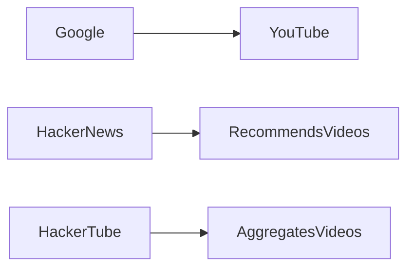

# HackerTube: Reimaginando YouTube con la Curación de Hacker News

En el blog de Andrej Karpathy apareció recientemente **HackerTube**, un experimento que extrae los videos recomendados en *Hacker News* (HN) y los presenta como una mini‑plataforma de streaming. La idea parece simple: aprovechar la “sabiduría colectiva” de una comunidad técnica para crear un canal de contenido curado, libre del algoritmo de recomendación de **YouTube**. Sin embargo, detrás de la fachada de “democracia del video” se esconden tensiones que revelan mucho sobre la **concentración de poder** en la industria del streaming y la **dinámica de capital** que sostiene a gigantes como **Google** (Alphabet) y **Meta**.

## ¿Qué es HackerTube y por qué llama la atención?

Desde un punto de vista **SEO**, términos como *video curation*, *alternative to YouTube*, y *Hacker News videos* aparecen de forma natural, lo que ayuda a que la iniciativa aparezca en búsquedas relacionadas con “alternativas a YouTube”. Pero el valor real del proyecto se mide en cómo confronta (o no) el modelo de negocio de los **monopolios del streaming**.

## El poder de la recomendación algorítmica

YouTube, con más de **2,5 mil millones** de usuarios activos mensuales, se ha convertido en la **plataforma de referencia** para la distribución de contenido audiovisual. Su algoritmo, que optimiza la retención de usuarios y la maximización de ingresos publicitarios, ha sido criticado por crear “cápsulas de filtro” que favorecen contenido polarizador y de alta capacidad viral. El control de la **caja negra** del algoritmo está en manos de **Google** y sus equipos de ingeniería, quienes también gestionan los datos de Google Ads, el motor de monetización que financia la mayor parte del ecosistema de creadores.

HackerTube, al basarse en la curación humana de HN, propone una **alternativa basada en reputación**: las **publicaciones** más votadas por usuarios con alto nivel técnico se convierten en la lista de videos. En teoría, esto reduce el sesgo de “click‑bait” y aumenta la calidad percibida del contenido. En la práctica, sin embargo, la escala es limitada y el modelo depende de la **concentración de atención** en una comunidad relativamente pequeña (≈1 % del tráfico global de YouTube). La pregunta central es: ¿puede una iniciativa de nicho desafiar un **modelo de poder** que se funda en la captura de la mayor parte del tiempo de pantalla del mundo?

## Capital, infraestructura y barreras de entrada

Crear y mantener un **centro de datos** capaz de servir videos a millones de usuarios implica **capex** que solo empresas como Google, Amazon y Microsoft pueden asumir sin sacrificar su rentabilidad. YouTube se apalanca en la infraestructura global de **Google Cloud**, que permite latencias bajas, replicación geográfica y una cadena de suministro de hardware automatizada.

HackerTube, al ser simplemente un front‑end que redirige a los videos alojados en los servidores de YouTube, no necesita esa infraestructura propia. Pero esa “dependencia” también significa que **Google sigue controlando la distribución**: los videos siguen estando bajo la política de derechos de autor, monetización y bloqueo de contenido de YouTube. Si Google decidiera aplicar restricciones –por ejemplo, desactivar la API de listado para ciertos videos– HackerTube perdería gran parte de su funcionalidad sin posibilidad de migrar a otra CDN sin incurrir en costos gigantes.

Este punto revela una **dinámica económica clásica**: la disrupción parece factible cuando la barrera tecnológica es baja (código abierto, APIs públicas), pero la verdadera barrera está en el **control del recurso clave**, en este caso la *infraestructura de entrega de video* y la *propiedad intelectual*.

## Historias de intentos de ruptura y su destino

Los intentos de crear alternativas a YouTube no son nuevos. **Vimeo**, fundado en 2004, se posicionó como una plataforma para profesionales creativos, ofreciendo mayor calidad y menos ruido publicitario. A pesar de su temprana adopción por parte de la comunidad de diseño, Vimeo nunca alcanzó la masa crítica de usuarios y se vio forzado a pivotar hacia un modelo de suscripción empresarial.

Más recientemente, **Dailymotion** y **PeerTube** intentaron ofrecer modelos descentralizados o basados en comunidades, pero su falta de fondos para infraestructura les dejó en una posición vulnerable frente a la **escala de YouTube**. En cada caso, el factor decisivo fue la **concentración de capital**: Google, con ingresos de más de 200 mil millones de dólares, reinvierte en mejorar su algoritmo y su red de distribución, dejando poco espacio para que un proyecto financiado por donaciones o por pequeños inversores escale.

HackerTube sigue la misma línea: es una *capa de presentación* sobre la infraestructura de YouTube, sin un modelo propio de monetización ni un plan de expansión de infraestructura. En otras palabras, **no rompe la lógica del poder**, sino que la reutiliza bajo una estética diferente.

## El papel de los reguladores y la presión social

En la última década, los reguladores de la UE y EE. UU. han incrementado la presión sobre los **monopolios digitales** (por ejemplo, la Ley de Servicios Digitales y la Ley de Competencia de la FTC). Sin embargo, la mayoría de las iniciativas como HackerTube se quedan fuera del foco regulatorio porque no alteran directamente la estructura del mercado: no compiten en cuota de mercado ni generan ingresos sustanciales.

No obstante, la **conciencia colectiva** sobre la concentración del poder tecnológico ha crecido. Movimientos como *digital sobriety* y *platform cooperativism* impulsan la creación de alternativas comunitarias, pero la falta de **economías de escala** sigue siendo un obstáculo. La lección de HackerTube es simbólica: la comunidad puede curar contenido, pero la distribución sigue anclada a los grandes actores.

## ¿Qué nos dice esto del futuro del streaming?

* **Curación humana vs. algoritmos:** La tendencia a combinar la inteligencia humana con la automatización será más frecuente. Plataformas podrían ofrecer “canales curados por la comunidad” dentro del mismo ecosistema de YouTube, como una respuesta al reclamo de calidad sin abandonar la infraestructura existente.
* **Descentralización parcial:** Proyectos como **IPFS** y **Livepeer** intentan descentralizar la entrega de video, pero todavía requieren incentivos económicos fuertes para competir con la eficiencia de los data centers de Google.
* **Regulación de datos:** La UE está considerando reglas específicas para los algoritmos de recomendación. Si se impusieran requisitos de **transparencia** y **auditabilidad**, los “cápsulas curadas” como HackerTube podrían ganar relevancia como ejemplos de **recomendación externa** que cumple con los estándares regulatorios.
* **Modelo de negocio híbrido:** Una posible vía para que iniciativas como HackerTube sobrevivan es asociarse con **creadores** que acepten donaciones o suscripciones directas, desvinculándose de la publicidad de Google. Sin embargo, la fricción cultural y la dependencia de la plataforma original complican este camino.

## Conclusión

HackerTube es una prueba de concepto fascinante que demuestra el **potencial de la curación humana** en un entorno dominado por algoritmos de gran escala. No obstante, su existencia también subraya la **realidad estructural** de la industria: el control de la infraestructura, la propiedad intelectual y el capital siguen concentrados en manos de gigantes como Google. Mientras la comunidad tecnológica seguirá buscando maneras de diversificar la curación y la distribución, cualquier disrupción significativa requerirá más que código abierto; necesitará una **reconfiguración de los flujos de capital** y tal vez la intervención regulatoria para romper los monopolios de la distribución de video.

¿Podremos, algún día, ver una plataforma de streaming verdaderamente independiente, donde la curación, la infraestructura y la monetización estén alineadas con los intereses de los usuarios y no de los accionistas? HackerTube abre la conversación, pero la respuesta dependerá de cómo la industria, los gobiernos y los propios creadores elijan reequilibrar el poder en el ecosistema digital.
---