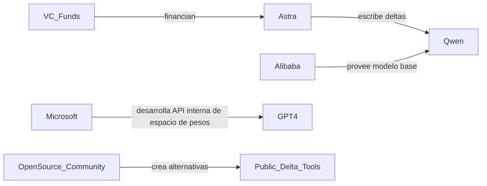

```mdx
## Astra puede leer y escribir pesos para mejorar Qwen – lo que significa para el panorama de IA

La reciente publicación en HackerNews sobre **la programación en el espacio de pesos de Astra** (ver la publicación original en el [blog de Rikiyat](https://rikiyat.github.io/blog/weight-space-programming/)) ha generado un debate animado entre investigadores e inversores. Astra afirma que puede *leer* y *escribir* directamente en el espacio de pesos de los grandes modelos de lenguaje (LLM) como **Qwen**, el LLM de código abierto lanzado por **Alibaba Cloud**. A primera vista, la hazaña técnica parece un atajo ingenioso para ajustar modelos masivos sin los costosos bucles de entrenamiento tradicionales. Sin embargo, más allá de la novedad de ingeniería, el enfoque de Astra plantea profundas preguntas sobre quién controla la mejora de los modelos, cómo se concentra el capital y qué patrones históricos se están repitiendo en el sector de IA.

### La tecnología en términos simples

La programación en el espacio de pesos trata el conjunto de todos los parámetros del modelo como un paisaje de alta dimensión que se puede *navegar* directamente. El ajuste fino tradicional modifica los pesos mediante descenso de gradiente, lo que requiere grandes lotes de datos etiquetados y costosos clústeres GPU. El método de Astra, en cambio, aprende un *transformer* que asigna un comportamiento deseado (p. ej., mejor generación de código) a un conjunto de delta de pesos. El transformer se entrena con un **pequeño conjunto de datos de indicaciones y salidas esperadas**, y luego se aplica al modelo objetivo —aquí, Qwen— añadiendo el delta a la matriz de pesos original.

En la práctica, esto implica:

1. **Leer** – Astra extrae la matriz de pesos actual de Qwen sin necesidad del checkpoint completo de entrenamiento.
2. **Escribir** – Inyecta un delta compacto que realinea las representaciones internas del modelo hacia una nueva capacidad.
3. **Iterar** – El proceso puede repetirse, permitiendo prototipos rápidos de variantes especializadas.

El resultado es un **fracción del coste computacional** comparado con el ajuste fino a gran escala, lo que resulta especialmente atractivo para startups y laboratorios de investigación que carecen de presupuestos de varios petaflops como los de los gigantes tecnológicos.

### ¿Quién gana y quién pierde? Concentración de capital y la "puerta de pesos"

Desde una perspectiva de mercado, la herramienta de Astra podría democratizar el acceso a LLMs de alto rendimiento. Sin embargo, la **propiedad del oráculo del espacio de pesos** —el transformer que escribe deltas— se convierte en una nueva forma de propiedad intelectual. La empresa detrás de Astra (una startup en modo silencioso respaldada por **Sequoia Capital** y **Andreessen Horowitz**) ya posee una **patente pendiente** sobre el algoritmo central. Esto crea una *puerta de pesos* que separa a quienes pueden pagar la licencia (generalmente grandes empresas) de quienes no pueden.

Consideremos las siguientes dinámicas de poder:

| Actor | Rol | Palanca económica |
|-------|-----|---------------------|
| **Alibaba Cloud** | Proveedor del modelo base (Qwen) | Controla el checkpoint subyacente, puede fijar tarifas de uso |
| **Astra** | Proveedor de la capa de programación en espacio de pesos | Posee la patente, puede cobrar por delta o suscripción |
| **OpenAI / Microsoft** | Propietarios de LLM competidores | Pueden adoptar tecnologías similares internamente, reduciendo la necesidad de herramientas de terceros |
| **Fondos de capital riesgo (VC)** | Financiadores de Astra y startups afines | Dirigen capital hacia la "infraestructura IA" como nicho lucrativo |

El **embudo VC** impulsa capital hacia empresas que prometen *reducir* el coste de iteración de modelos IA. Esto refleja el boom de la "infraestructura cloud" a principios de la década de 2010, donde firmas como **AWS** y **Google Cloud** acumularon dominio al abstraer recursos de cómputo. Ahora, la abstracción se mueve un nivel más profundo: de **hardware** a **pesos de modelo**.

### Eco histórico: de GPUs a pesos

En los 2000, **NVIDIA** aprovechó la escasez de GPUs para convertirse en el proveedor de facto de cómputo IA. Su ecosistema **CUDA** creó un bloqueo que obligó a los investigadores a escribir código en frameworks específicos de NVIDIA. El enfoque de Astra podría ser el próximo bloqueo, esta vez a nivel *parámetro‑software*. Así como CUDA hizo de NVIDIA el guardián del rendimiento, el transformer del espacio de pesos podría hacer de **Astra** el guardián de la *adaptabilidad del modelo*.

El patrón es claro:

1. **Innovación → Herramienta propietaria** (CUDA, TensorRT, transformer del espacio de pesos)
2. **Bloqueo del ecosistema** (desarrolladores, científicos de datos, empresas)
3. **Concentración de capital** (pocas firmas capturan la mayor parte del upside)

Si la industria repite este ciclo, podríamos ver a un puñado de compañías —probablemente **Astra**, **OpenAI**, **Anthropic** y **Microsoft**— controlando no solo el *hardware* y los *modelos base*, sino también los *pipelines de ajuste fino* que crean productos IA listos para el mercado.

### Reacción del mercado: valoraciones, fusiones y posicionamiento estratégico

Desde que surgió la publicación del blog, los **inversores de Serie A** han incrementado la valoración pre‑money de Astra en un 30 %. Simultáneamente, **Alibaba Cloud** anunció una asociación para integrar el motor de delta de Astra en su plataforma **PAI**, ofreciendo “especialización instantánea” como un complemento de pago. Esta colaboración ilustra una tendencia más amplia: **los grandes proveedores cloud buscan ampliar sus ofertas con servicios de modificación de pesos de terceros** en lugar de desarrollar la tecnología internamente.

En contraste, **OpenAI** anunció una “API de espacio de pesos” interna para su línea **GPT‑4**, insinuando un posible **acuerdo de exclusividad** con su patrocinador **Microsoft**. De confirmarse, el mercado podría bifurcarse en dos campos:

- **Campo de ecosistema abierto** – empresas como Alibaba, Anthropic y el emergente ecosistema Astra que promueven APIs abiertas y compatibilidad entre modelos.
- **Campo de ecosistema cerrado** – el paquete Microsoft‑OpenAI, donde las modificaciones de pesos están estrechamente vinculadas a los servicios de Azure.

La historia muestra que tales bifurcaciones a menudo terminan en **adquisiciones estratégicas**. Recordemos cuando **Google** adquirió **DeepMind** en 2014 para asegurar el acceso a la investigación de refuerzo de última generación. Una adquisición similar podría ocurrir si una gigante de IA quiere asegurar la *única* herramienta fiable de programación en espacio de pesos que funcione en múltiples familias de modelos.

### Incentivos económicos: por qué la "escritura de pesos" importa para la rentabilidad

Desde la perspectiva empresarial, la capacidad de generar rápidamente **LLM específicos de dominio** se traduce en lanzamientos de productos más ágiles y menores **costes de adquisición de clientes**. Por ejemplo, una startup fintech podría tomar Qwen, aplicar un delta de Astra que alinee el modelo con el lenguaje regulatorio y lanzar un chatbot compliant en semanas en lugar de meses. El ahorro estimado —**80 %** de los gastos computacionales— hace viable el emprendimiento incluso para equipos pequeños.

No obstante, las **estrategias de precios** son cruciales. Si Astra cobra por despliegue de modelo, cada variante especializada se convierte en una fuente de ingresos, transformando *ajustes de peso* en *micro‑transacciones*. Esto refleja el modelo **SaaS** que dominó el software empresarial en la década de 2010: una plataforma base (Qwen) más un mercado de complementos (deltas de Astra). El mercado podría evolucionar a un *mercado de espacio de pesos* donde desarrolladores externos vendan deltas propietarios, concentrando aún más los ingresos en manos de los dueños de la plataforma.

### Ángulos de política y ética

La concentración de herramientas de espacio de pesos plantea preocupaciones regulatorias. Los reguladores en la **UE** y los **EE. UU.** ya discuten **licenciamiento de modelos IA** y **gestión de riesgos**. Si un reducido conjunto de firmas puede modificar cualquier LLM de código abierto a voluntad, la línea entre *abierto* y *cerrado* se difumina. Esto complica la **auditabilidad** y la **transparencia**: un modelo que parece abierto podría estar alterado secretamente por un delta propietario, introduciendo sesgos ocultos o capacidades maliciosas.

Además, el panorama de **propiedad intelectual** se vuelve más confuso. ¿Quién posee el modelo resultante —Alibaba, Astra o el usuario final? La legislación de derechos de autor actual no está preparada para abordar obras derivadas creadas por *transformación de parámetros* más que por *modificación de código*. Esto podría impulsar la creación de nuevos marcos legales de **"derechos de peso"**, análogos a los debates sobre patentes de software de décadas anteriores.

### El ecosistema IA más amplio: ¿colaboración o competencia?

La colaboración de Astra con Alibaba podría señalar un modelo de **co‑opetición**: los incumbentes grandes licencian herramientas de espacio de pesos de terceros mientras siguen desarrollando sus propias soluciones internas. Mientras tanto, las comunidades de código abierto podrían responder creando **bibliotecas públicas de espacio de pesos**, similares al auge de **LoRA** (Low‑Rank Adaptation) y **PEFT** (Parameter‑Efficient Fine‑Tuning) a principios de esta década. Si una alternativa abierta gana tracción, podría erosionar el monopolio de Astra, tal como el hub de modelos de **Hugging Face** democratizó el acceso a pesos pre‑entrenados.

No obstante, el **efecto red** es poderoso. Los desarrolladores se inclinarán por la plataforma que ofrezca el pipeline de modificación de pesos más *estable*, *bien documentado* y *soportado comercialmente*. Esto podría consolidar el poder en torno a unos pocos ecosistemas curados, replicando la **dinámica de tiendas de apps** que Apple y Google dominan.

### Conclusiones clave para los diferentes actores

| Actor | Qué observar | Movimiento estratégico |
|-------|--------------|------------------------|
| **Startups** | Costes de licenciamiento de deltas de Astra | Evaluar alternativas de código abierto o negociar acuerdos de reparto de ingresos |
| **Inversores** | Flujo de capital hacia startups de espacio de pesos | Diversificar entre proyectos propietarios y de código abierto |
| **Reguladores** | Transparencia de modificaciones de pesos | Exigir registros de auditoría y estándares de procedencia de modelos |
| **Grandes clouds** | Asociaciones vs. desarrollo interno | Equilibrar ingresos a corto plazo con control a largo plazo de la pila tecnológica |
| **Comunidad open‑source** | Riesgo de fragmentación | Contribuir a herramientas de espacio de pesos interoperables y con licencias permisivas |

### Mirada al futuro

Si la tecnología de Astra escala, podríamos ver la **especialización instantánea** como norma: un panel SaaS donde los usuarios seleccionen una "habilidad" (p. ej., redacción legal, triage médico) y el sistema aplique al instante el delta de peso adecuado a un LLM base. Esto reduciría la barrera de entrada para productos impulsados por IA, acelerando la innovación pero también intensificando las dinámicas de **monopolio de datos**. Las compañías que posean las bibliotecas de deltas más completas controlarán el *conocimiento* incrustado en esas adaptaciones —una nueva forma de **capital intelectual** más difícil de cuantificar que los ciclos de cómputo, pero potencialmente mucho más valiosa.

### Conclusión

La capacidad de Astra para leer y escribir pesos en Qwen es más que un ingenioso atajo técnico; es una **palanca estratégica** que podría redefinir quién posee las llaves de la personalización de modelos IA. El movimiento refleja cambios industriales pasados donde nuevas capas de abstracción (GPUs, cloud, contenedores) crearon bloqueos que canalizaron capital hacia unos pocos jugadores dominantes. A medida que la programación en el espacio de pesos madure, los actores —desde startups hasta reguladores— deberán enfrentar un futuro donde la *adaptabilidad del modelo* es una mercancía controlada por un consorcio estrecho de firmas con abundante capital. La verdadera cuestión no es solo *cómo* funciona la tecnología, sino *quién* establecerá las reglas del juego.

*Reflexiona sobre las estructuras de poder que subyacen a cada avance técnico. ¿Quién se beneficia, quién queda atrás y cómo podríamos guiar el ecosistema IA hacia un horizonte más equitativo?*


```


