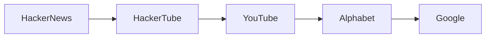

## Introducción

En el blog de Andrej Karpathy, uno de los referentes en inteligencia artificial, apareció recientemente **HackerTube**, una versión “alternativa” de YouTube construida exclusivamente a partir de videos que la comunidad de **Hacker News** ha recomendado. La idea, simple en apariencia, desata una serie de preguntas sobre la **concentración de capital**, los **algoritmos de recomendación** y la **dinámica de poder** que define a la industria del streaming de video. En este artículo, revisamos el proyecto, lo situamos dentro del contexto histórico de los gigantes de la información y reflexionamos sobre cómo iniciativas como HackerTube pueden desafiar —o reforzar— los modelos económicos dominados por Alphabet, Meta y Amazon.

## ¿Qué es HackerTube?

HackerTube es, esencialmente, un *curador* de contenidos. En lugar de depender de los algoritmos **propietarios** de **YouTube** (parte de Google/Alphabet), extrae los enlaces de videos que aparecen en los hilos de Hacker News con más puntuación y los organiza en una interfaz propia. No hay monetización directa, no se recopilan datos de usuarios más allá de lo necesario para reproducir el video y no existe un motor publicitario interno.

### Principios de diseño

1. **Transparencia**: la lista de videos proviene de una fuente pública (HN) y se actualiza en tiempo real.  
2. **Descentralización**: no hay “caja negra” que decida qué contenido subir al feed; la comunidad es la autoridad.  
3. **Libre de anuncios**: al no tener un modelo de ingresos basado en publicidad, se eluden las presiones de los anunciantes que influyen en los algoritmos tradicionales de YouTube.

## El poder de los algoritmos y la concentración de capital

YouTube controla más del **70 %** del tiempo de visualización de video en línea a nivel global, según datos de Statista 2023. Su algoritmo de recomendación, alimentado por datos masivos de usuarios y **perfil** de anunciantes, se ha convertido en una **máquina de atención** que maximiza el tiempo en pantalla y, por ende, los ingresos publicitarios de Alphabet. Este modelo ha generado críticas por, entre otras cosas, la difusión de desinformación y la creación de cámaras de eco.

HackerTube, al prescindir de dicho algoritmo, plantea la pregunta: *¿Puede una plataforma basada en curación comunitaria competir con la escala y el poder de un algoritmo entrenado en billones de puntos de datos?* La respuesta corta es “probablemente no”. Pero el proyecto sirve como **experimento de ruptura**, mostrando que la lógica de recomendación no es una ley natural sino una construcción tecnológica respaldada por enormes inversiones de capital.

## Historias de concentración: de MTV a Google

Para entender el peso de HackerTube, vale la pena recordar cómo la industria del video ha evolucionado:

- **MTV (1981)**: en sus inicios, lanzaba videos seleccionados por programadores humanos, creando una agenda cultural. Con el tiempo, la cadena perdió control editorial al ceder espacio a contenidos pagados.  
- **YouTube (2005)**: nació como una plataforma abierta, pero la adquisición por **Google** en 2006 marcó el comienzo de una integración vertical. Google aportó infraestructura de servidores, algoritmos de búsqueda y, crucialmente, el **ecosistema publicitario** de AdSense.  
- **TikTok (2016)**: la estrategia basada en *short‑form* y un algoritmo de “recomendación instantánea” ha demostrado que la concentración de poder puede desplazarse rápidamente hacia nuevos jugadores si logran ofrecer **engagement** superior.

En cada uno de estos hitos, el factor determinante fue la **inversión en infraestructura de datos** y la capacidad de **monetizar la atención**. HackerTube, sin presupuesto de servidores propio y sin motor publicitario, asume un papel marginal, pero su relevancia radica en la **crítica implícita** a los modelos de negocio que priorizan la recolección de datos sobre la experiencia del usuario.

## Dinámicas económicas reales: publicidad, datos y barreras de entrada

Los gigantes del video se financian principalmente a través de:

| Fuente de ingreso | Empresas clave | % del ingreso total |
|-------------------|----------------|---------------------|
| Publicidad programática | Google (YouTube), Meta (Facebook Watch), Amazon (Prime Video) | ~80 % |
| Suscripciones | Netflix, Disney+, Amazon Prime | ~15 % |
| Venta de contenido | Apple TV+, Hulu | ~5 % |

Los datos de usuarios son el activo más valioso: permiten segmentar anuncios a niveles de micro‑segmentación que justifican precios premium. La **capacidad de recolectar y procesar datos** crea una **barrera de entrada** que startups como HackerTube no pueden superar sin una inversión multimillonaria. Esa es la razón por la que la mayoría de los intentos de replicar YouTube terminan como nichos de comunidad o plataformas de pago.

## El papel de la comunidad de Hacker News

Hacker News, gestionado por **Y Combinator**, es una comunidad de emprendedores, ingenieros y entusiastas de la tecnología. Su algoritmo de puntuación da visibilidad a contenido que el resto de la web a menudo pasa por alto. Sin embargo, esta misma selectividad genera **sesgo de audiencia**: la audiencia de HN está compuesta mayoritariamente por profesionales técnicos de países desarrollados, con intereses en IA, programación y startups. El contenido recomendado reflejará esos intereses, excluyendo otras voces y reforzando una **burbuja de conocimiento**.

Esto plantea una paradoja: aunque HackerTube promueve la **transparencia**, su colección de videos está condicionada por la demografía de una sola comunidad. En contraste, el algoritmo de YouTube, aunque opaco, intenta servir a una audiencia global más diversa, aunque a costa de filtros y sesgos propios.

## ¿Qué significa para el futuro de los medios?

1. **Diversificación de fuentes de recomendación**: proyectos como HackerTube pueden inspirar a otras comunidades a crear sus propios “feeds” de video, reduciendo la dependencia de los algoritmos centralizados.  
2. **Presión regulatoria**: la UE y EE. UU. están considerando normas que obliguen a plataformas gigantes a ofrecer mayor **interoperabilidad** y **transparencia algorítmica**. Iniciativas de curación comunitaria podrían servir como modelos de referencia en futuros marcos regulatorios.  
3. **Modelo de negocio híbrido**: la ausencia de ingresos publicitarios obliga a explorar suscripciones, donaciones o micro‑pagos. La experiencia de **Patreon** y **Ko‑fi** sugiere que los creadores pueden sobrevivir fuera del modelo de anuncios, aunque a escala limitada.

## Conclusión

HackerTube no pretende destronar a YouTube; más bien funciona como una **lupa** que expone los mecanismos de poder y capital que sustentan la hegemonía de los gigantes del video. Al basarse en la curación manual de una comunidad técnica, evidencia que los algoritmos de recomendación no son inevitables, sino construidos sobre inversiones masivas en datos y publicidad. En un mercado donde la concentración de poder sigue creciendo, iniciativas como HackerTube ofrecen una vía para repensar quién controla la agenda cultural y cómo se monetiza la atención.

**Invitamos a los lectores a reflexionar**: ¿es la diversificación de curadores de contenido suficiente para equilibrar la balanza frente a la arquitectura de datos de Alphabet y Meta? ¿O necesitamos marcos regulatorios y modelos económicos radicalmente diferentes para romper la actual concentración de poder en la industria del streaming?

---