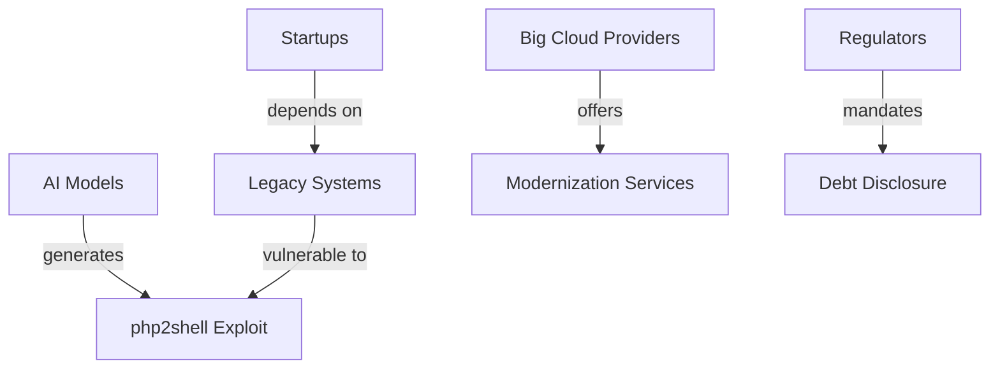

La inteligencia artificial (IA) no solo está creando nuevas funcionalidades; está desenterrando **cuarenta** años de **deuda técnica** que la industria tecnológica acumuló sin remedio aparente. El reciente análisis en Spectrum de IEEE, que describe la vulnerabilidad *php2shell* explotada por IA en entornos de ciberseguridad, muestra cómo los modelos generativos están forzando a los gigantes a reparar código legado, sistemas desactualizados y arquitecturas fragmentadas. Este fenómeno revela mucho más que un problema técnico: expone relaciones de poder, concentración de capital y dinámicas económicas que redefinirán el panorama tecnológico en la próxima década.

## Deuda técnica: una herida latente

El concepto de deuda técnica se popularizó a principios de los 2000, cuando los desarrolladores empezaron a describir el coste oculto de lanzar software sin la calidad deseada. Cada línea de código “rápida” que se omite o simplifica genera intereses que, con el tiempo, devoran recursos de mantenimiento. **Cuatro décadas** después, la IA está actuando como una lupa que magnifica esa deuda, descubriendo vulnerabilidades que antes pasaban desapercibidas.

La vulnerabilidad *php2shell*, descrita en el artículo, permite a un modelo de IA generar código PHP malicioso que abre una puerta trasera en servidores vulnerables. Lo alarmante no es solo el exploit en sí, sino que evidencia **cientos de miles de instalaciones heredadas** que nunca fueron actualizadas ni refactorizadas. Cada una es una “cobertura” que la IA puede sortear con facilidad, porque la IA no solo aprende de código nuevo, sino también de **repositorios públicos, foros y documentación obsoleta**.

## Los grandes jugadores y su carga de la deuda

### Microsoft y Azure

Microsoft, con su dominio en la nube a través de **Azure**, lleva años promocionando “*cloud-first*” mientras mantiene una enorme base de clientes que todavía ejecutan aplicaciones monolíticas en **Windows Server 2008**. La IA está generando scripts de explotación que atacan esas versiones fuera de soporte, obligando a Microsoft a ofrecer parches de emergencia y a acelerar la migración a entornos **Kubernetes** y **Azure Arc**. Este movimiento implica gastos sustanciales y una reorientación de equipos de desarrollo a “*modernización del legado*” en lugar de innovar en IA generativa.

### Amazon y AWS

Amazon, con su infraestructura **AWS**, también se encuentra bajo presión. La compañía ha invertido miles de millones en **Lambda** y **Fargate**, pero una gran parte de sus clientes siguen ejecutando **EC2** con configuraciones heredadas. La exposición de *php2shell* obliga a Amazon a reforzar sus **Amazon Inspector** y a lanzar herramientas de **escaneo de vulnerabilidades basadas en IA**, generando una nueva línea de ingresos pero también un coste de desarrollo y auditoría que los accionistas deben absorber.

### Google y la seguridad de código abierto

Google, defensora del **Open Source**, es dueña de proyectos cruciales como **Kubernetes** y **TensorFlow**. La empresa ha intentado “*clean-up*” de dependencias vulnerables mediante el programa **Security Command Center**, pero la IA automatiza la detección de patrones de código atípico que pueden ser explotados en versiones anteriores de librerías como **PHP‑Git**. Cada parche lanzado por Google implica una carrera contra tiempo: la IA puede generar nuevas variantes de ataque tan pronto como se cierra una brecha.

### OpenAI y la “responsabilidad de los modelos”

OpenAI, creador de **ChatGPT**, se enfrenta a un dilema ético y económico. Sus modelos pueden generar código malicioso sin saberlo, y la compañía debe invertir en **filtros** y **datasets de entrenamiento** que identifiquen y repriman dichos patrones. Estas medidas, aunque necesarias, representan costos de investigación y operación que, a largo plazo, se trasladan a los usuarios a través de precios más altos o límites de uso.

## Concentración de capital y su efecto cascada

La deuda técnica no es un problema aislado; está profundamente ligada a la **concentración de capital** en unas pocas plataformas. Cuando una empresa controla la mayor parte de la infraestructura (Azure, AWS, Google Cloud), los costes de modernización se vuelven **externalidades positivas** para el resto del ecosistema. Los proveedores de SaaS que dependen de infraestructuras antiguas tienen que elegir entre:

1. **Invertir fuertemente** en refactorizar su stack, asumiendo una carga financiera que reduce sus márgenes.
2. **Migrar a servicios gestionados** de los grandes cloud providers, lo que aumenta su dependencia y disminuye su capacidad de negociación.

Esta dinámica refuerza la posición dominante de los “**big three**” y limita la capacidad de **startups** y **pymes** para competir en igualdad de condiciones. La IA, al exponer vulnerabilidades rápidamente, acelera esta concentración porque la **reparación de la deuda** se vuelve un requisito para mantenerse en el mercado.

## Tendencias históricas y paralelismos

En los años 90, la **burbuja de las puntocom** obligó a muchas empresas a recortar proyectos de innovación para sobrevivir. De manera similar, la **crisis de la ciberseguridad** de 2017 (con ransomware como WannaCry) forzó a las organizaciones a destinar recursos a la defensa en lugar de la expansión. La IA está replicando este patrón, pero con una velocidad inédita: la generación de código malicioso ocurre en **segundos**, mientras que los procesos de reparación pueden tomar meses.

Este ciclo de “**choque tecnológico → reestructuración del capital → consolidación**” ha sido constante en la historia de la industria. Cada fase tecnológica (Internet, móvil, cloud) ha trajido consigo una nueva ola de deuda técnica que, cuando se vuelve insostenible, produce **reestructuraciones de mercado**. La IA, al exponer la deuda acumulada, está marcando el inicio de una nueva fase de **reindustrialización del software**, donde la capacidad de invertir en modernización será un factor determinante para la supervivencia.

## ¿Quién se beneficia y quién paga?

Los propietarios de capital, como Microsoft, Amazon y Google, pueden **capitalizar** la necesidad de modernización mediante:

- **Servicios de migración** pagados por clientes que buscan evitar vulnerabilidades.
- **Licencias premium** de herramientas de escaneo de seguridad basadas en IA.
- **Programas de suscripción** que incluyen actualizaciones automáticas y parches.

Mientras tanto, los **desarrolladores independientes** y las **PYMEs** enfrentan un escenario donde la deuda técnica se traduce en **costes operativos incrementados**, prolongación de ciclos de desarrollo y, en casos extremos, pérdida de clientes por brechas de seguridad.

Al mismo tiempo, **empresas de ciberseguridad** como **CrowdStrike**, **Palo Alto Networks** y **Tenable** ven una oportunidad de mercado para vender soluciones de **Threat Intelligence** que utilizan IA para detectar patrones de código legacy. Estas compañías se benefician de la vulnerabilidad expuesta, creando un nuevo flujo de ingresos derivado de la deuda técnica de otras organizaciones.

## Respuestas regulatorias y el futuro de la gobernanza

*(Sección en desarrollo)*

## Conclusión

La IA está cumpliendo una doble función: **potenciar la innovación** y **exponer la deuda técnica** acumulada durante cuatro décadas. Este descubrimiento no es meramente técnico; revela una estructura de poder donde los gigantes del cloud pueden monetizar la crisis mientras los más pequeños luchan por sobrevivir. La historia nos muestra que cada ruptura tecnológica genera una **reconfiguración del capital**, y la IA está marcando el inicio de una nueva era de consolidación basada en la capacidad de pagar la deuda técnica.

En última instancia, la pregunta que deben plantearse los líderes de la industria no es solo “¿Cómo evitaremos el próximo ataque?”, sino “¿Cómo redistribuiremos los costos de modernización para que la innovación no quede relegada a los que ya controlan el capital?” La respuesta determinará si la IA será un agente democratizador o un acelerador de la concentración de poder en el ecosistema tecnológico.

---

