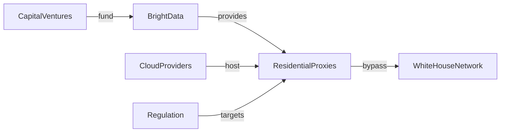

La noticia de que **proxies residenciales** estaban siendo detectados dentro de la red de la **Casa Blanca** ha encendido las alarmas en la comunidad de seguridad y ha abierto un debate sobre quién controla realmente la infraestructura de internet que alimenta a los gobiernos más poderosos. El reporte de *Layer3 Intel* – citado por HackerNews – describe cómo herramientas de anonimato comercializadas por empresas como **Bright Data** (antes Luminati), **Oxylabs** y **Smartproxy** lograron infiltrarse en servidores que supuestamente estaban aislados y protegidos.

## ¿Qué son los proxies residenciales y por qué importan?

Los proxies residenciales son direcciones IP asignadas a dispositivos domésticos reales, a menudo a través de acuerdos con proveedores de servicios de internet ( ISP ) o mediante la instalación de software en computadoras de consumidores. A diferencia de los servidores de datos tradicionales, estos proxies se presentan como usuarios “normales”, lo que los hace extremadamente difíciles de bloquear o identificar. La idea de que una red tan sensible como la de la **Casa Blanca** haya permitido el paso de este tipo de tráfico pone en tela de juicio la efectividad de los esquemas de defensa perimétrica que las agencias federales han usado durante décadas.

## Concentración de capital y control de la capa de acceso

El mercado de proxies residenciales está dominado por **pocos jugadores con acceso a capital considerable**. Bright Data, por ejemplo, ha recaudado más de **$500 millones** en rondas de financiación y cuenta con una infraestructura que alcanza cientos de miles de IPs en más de 200 países. Su modelo de negocio depende de la “gamificación” de la red de usuarios: mediante extensiones de navegador y aplicaciones móviles, convierten el ancho de banda doméstico en un recurso comercializable.

Esta concentración tiene dos implicaciones clave:

1. **Poder de mercado** – Las grandes empresas de proxy pueden fijar precios, dictar términos de uso y, en algunos casos, ofrecer “accesos privilegiados” a clientes gubernamentales o corporativos.
2. **Externalización de la seguridad** – Cuando gobiernos contratan estos servicios para tareas de investigación o monitoreo, delegan parte de su superficie de ataque a proveedores que operan bajo jurisdicciones y normas de cumplimiento que pueden diferir significativamente de las expectativas federales.

## Dinámicas económicas: rentabilidad frente a riesgo

El atractivo de los proxies residenciales radica en su **rentabilidad** para los operadores. Cada IP “viva” puede generar entre **$0.05 y $0.15** por hora, dependiendo del tráfico y la ubicación geográfica. Con miles de máquinas en operación simultánea, los ingresos llegan a millones de dólares al mes. Sin embargo, el modelo también genera riesgos externos: la exposición de usuarios domésticos a actividades ilícitas, demandas legales y, como muestra el caso de la Casa Blanca, **daños reputacionales que pueden traducirse en regulaciones restrictivas**.

En los últimos años, hemos visto cómo **las grandes plataformas de nube** – Amazon Web Services, Google Cloud y Microsoft Azure – se han convertido en los “backbones” de la mayoría de los servicios de proxy. Estas plataformas ofrecen capacidad elástica y facturación por consumo, lo que permite a los proveedores escalar rápidamente sin invertir en su propia infraestructura física. Esta dependencia refuerza la **concentración de poder en manos de los “Big Three”**, creando una cadena de valor donde los proveedores de proxies venden acceso a recursos que, en última instancia, son propiedad de los gigantes de la nube.

## Un paralelismo histórico: la era de los datacenters privados

La aparición de los proxies residenciales en un entorno gubernamental evoca la **guerra de los datacenters privados de los años 2000**, cuando compañías como **Equinix** y **CyrusOne** consolidaron la mayor parte del espacio de colocation. En ese periodo, la capacidad de albergar servidores críticos en ubicaciones estratégicas se tradujo en una nueva forma de poder: la capacidad de controlar el flujo de información a escala global.

Hoy, la ventaja se ha desplazado del espacio físico al **espacio de identidad digital**. En lugar de poseer rack tras rack, los actores con capital pueden comprar “identidades” que parecen originarse en hogares de todo el planeta. La analogía sugiere que la **concentración de capital** sigue siendo el motor, pero la herramienta ha evolucionado de hardware a “identidad como servicio”.

## Empresas bajo escrutinio: Bright Data y la ética de la extracción de datos

Bright Data, la empresa más visible del sector, ha sido objeto de críticas por su **modelo de “data extraction”**. Según informes de *The Wall Street Journal*, la compañía a veces recaba datos sin el consentimiento explícito del propietario del dispositivo, lo que plantea preguntas sobre la **soberanía de los datos personales**. En el contexto de la Casa Blanca, la posible utilización de estos proxies para evadir mecanismos de detección muestra cómo la línea entre “inteligencia legítima” y **vigilancia no autorizada** se vuelve difusa.

Otros competidores como **Oxylabs** y **Smartproxy** afirman cumplir con normas de “uso razonable”, pero sus términos de servicio están redactados en lenguaje técnico que dificulta la comprensión para usuarios finales. La falta de una **regulación clara** permite que la industria opere en una zona gris, beneficiándose del **capital de riesgo** que ve oportunidades de monetizar cada píxel de tráfico en línea.

## Repercusiones para la política de ciberseguridad de EE.UU.

1. **Inteligencia de tráfico en tiempo real** – Implementar análisis de comportamiento que detecte patrones anómalos, aun cuando la IP parezca residencial.
2. **Colaboración con proveedores de nube** – Forjar acuerdos con AWS, Google Cloud y Azure que incluyan filtros de proxy y auditorías de origen de tráfico.
3. **Regulación de los proveedores de proxy** – Introducir requisitos de transparencia y auditoría para empresas que venden acceso a IP residenciales, similar a las normas que rigen a los ISP en EE.UU.

## ¿Quién se beneficia realmente?

En el nivel macro, **los inversores de capital de riesgo** son los principales ganadores. Firmas como **Sequoia Capital**, **Accel** y **Andreessen Horowitz** han financiado a Bright Data y sus competidores, anticipando una demanda creciente de anonimato tanto para marketing digital como para actividades de espionaje corporativo.

En el plano micro, los **usuarios domésticos** que han instalado software de proxy sin comprender su alcance pueden estar exponiendo su ancho de banda y datos personales a usos que ni siquiera ellos aprobarían. Esto crea una **asimetría de poder** donde los proveedores de servicios de anonimato capitalizan la falta de información del consumidor.

## Tendencias futuras: de los proxies a la “identidad descentralizada”

A medida que la **blockchain** y los sistemas de identificación descentralizada (DID) ganen terreno, podríamos ver una evolución del modelo actual hacia *tokens de identidad* que pueden comprar y venderse en mercados abiertos. Esta transición podría **ampliar aún más la concentración de capital**, ya que los actores con recursos podrían adquirir grandes volúmenes de identidades digitales verificadas, replicando el patrón visto con los datacenters y los proxies.

## Conclusión: Reflexionar sobre el control de la red

El descubrimiento de proxies residenciales dentro de la red de la Casa Blanca no es solo una falla técnica; es un espejo de cómo el **capital y la tecnología convergen** para redefinir quién controla la infraestructura crítica de internet. Desde los gigantes de la nube hasta los fondos de capital riesgo que alimentan a los proveedores de proxies, la dinámica de poder se está desplazando de los muros físicos a los algoritmos que confieren anonimato y confianza.

A medida que la sociedad depende más de la conectividad, es imperativo que los legisladores, los tecnólogos y los ciudadanos comprendan estas relaciones de poder. Solo mediante una regulación informada y una mayor transparencia en la cadena de suministro de identidades digitales podremos equilibrar la balanza entre la **innovación rentable** y la **seguridad nacional** que todos esperamos.

