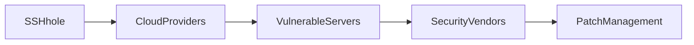

## Introducción: ¿Qué es SSHhole y por qué genera ruido?

SSHhole ( https://sshhole.com ) es una web que publica en tiempo real direcciones IP de servidores SSH con credenciales débiles o predeterminadas. La herramienta se promociona como un “honeypot compartido”: cualquiera puede consultar la lista, contribuir con datos y recibir alertas cuando se detectan máquinas vulnerables. A primera vista, parece un proyecto comunitario de código abierto que ayuda a los administradores a cerrar brechas. Sin embargo, su aparición en Hacker News ha encendido un debate más amplio sobre quién controla la información de seguridad y cómo esa información alimenta a gigantes de la nube y a proveedores de servicios de seguridad.

## El contexto económico detrás de la “exposición” de vulnerabilidades

### Capital concentrado en la infraestructura de nube

Los servidores SSH que aparecen en SSHhole son, en su mayoría, máquinas alojadas en plataformas como **Amazon Web Services (AWS)**, **Microsoft Azure**, **Google Cloud Platform (GCP)** y proveedores más modestos como **DigitalOcean** y **Linode**. Estas empresas representan el 70 % del mercado global de infraestructura como servicio (IaaS) según IDC 2023. La concentración del capital significa que una vulnerabilidad en un nodo de la red de uno de estos proveedores tiene un efecto dominó en miles de startups, pymes y organizaciones gubernamentales que dependen de sus servicios.

### Modelos de negocio basados en datos de vulnerabilidad

Al publicar listas de servidores vulnerables, SSHhole genera datos valiosos para **empresas de ciberseguridad** como **CrowdStrike**, **Palo Alto Networks** y **Rapid7**. Estas compañías ofrecen productos de detección de amenazas que se alimentan de “feeds” de vulnerabilidades. Un feed abierto como el de SSHhole reduce sus costos de recolección, pero también les permite **monetizar** la información mediante suscripciones premium, reforzando su posición dominante en el mercado de detección y respuesta (XDR).

### El papel de los “bug‑bounty” y los hunters freelance

El modelo de contribución de SSHhole permite a “hunters” independientes registrar IPs a cambio de reconocimiento o recompensas simbólicas. Este tipo de actividad ha sido explotado por plataformas como **HackerOne** y **Bugcrowd**, donde los hallazgos de seguridad se convierten en una micro‑economía. Sin embargo, la falta de regulación y la asimetría de información favorecen a los actores con mayor capital para **comprar** datos, dejando a los cazadores independientes sin una forma clara de capitalizar su trabajo.

## Relaciones de poder: quién gana y quién pierde

### Grandes proveedores de nube: guardias y beneficiarios

Los gigantes de la nube actúan simultáneamente como custodios de la infraestructura y como beneficiarios de la exposición de vulnerabilidades. Al alojar la mayor parte de los servidores SSH, pueden detectar rápidamente los incidentes y ofrecer herramientas de mitigación, pero también pueden aprovechar los datos de exposición para mejorar sus propios servicios de seguridad y reforzar su posición dominante en el mercado.

### Empresas de seguridad: intermediarios con poder de mercado

Al integrar feeds como SSHhole en sus plataformas, los proveedores de seguridad obtienen una **ventaja competitiva**. Con recursos para procesar y correlacionar datos a gran escala, pueden ofrecer alertas de “amenaza emergente” mucho antes que los equipos internos de TI. Esta asimetría refuerza la dependencia de las organizaciones a terceros, creando un ciclo donde la **externalización** se vuelve la norma y el poder de decisión se concentra en un puñado de corporaciones.

### Usuarios finales y administradores: la vulnerabilidad estructural

Los administradores que gestionan servidores SSH en la nube a menudo son **equipos pequeños** o incluso personas únicas. La presión por lanzar productos rápidamente lleva a prácticas peligrosas como el uso de credenciales por defecto o contraseñas débiles. Cuando SSHhole expone sus servidores, el daño potencial va más allá de un simple intento de intrusión: la información puede ser usada por **actores maliciosos** para lanzar ataques de ransomware o exfiltración de datos. En este escenario, las **asimetrías de información** dejan a los usuarios finales en desventaja frente a los grandes jugadores que pueden monetizar la misma vulnerabilidad.

## Tendencias históricas: ¿es SSHhole una novedad o una continuidad?

### De los primeros escáneres de puertos a los “feeds” de amenazas

En los años 90, herramientas como **Nmap** democratizaron el escaneo de puertos, pero la información se quedaba en manos de técnicos. Con la llegada de la web 2.0, surgieron servicios como **Shodan** (2009) que indexaron dispositivos conectados a Internet, creando un **mercado de datos de exposición**. SSHhole se sitúa en la misma línea, pero con un enfoque ultra‑específico en SSH y una capa colaborativa que refleja la evolución de la “crowdsourcing security”.

### La consolidación de la seguridad como producto

A principios de la década de 2000, la seguridad se vendía como hardware (firewalls) o software (antivirus). Hoy, la tendencia es **securitización como servicio (SECaaS)**, donde la detección, respuesta y mitigación son entregadas bajo suscripción. SSHhole alimenta directamente este modelo al proporcionar un “feed gratuito”, que posteriormente es **re‑empaquetado** por proveedores de SECaaS. La historia muestra una **circularidad**: datos que inicialmente prometen democratizar la seguridad terminan reforzando la dependencia de los grandes proveedores.

## Consideraciones regulatorias y éticas

### Transparencia vs. exposición

Publicar direcciones IP vulnerables mejora la **transparencia**, pero también puede violar normas de privacidad y responsabilidad (por ejemplo, el GDPR exige que los datos personales —incluyendo direcciones IP que pueden identificarse— sean tratados con cuidado). La ausencia de un marco regulatorio claro permite que servicios como SSHhole operen en una zona gris, lo que favorece a los **actores con recursos** que pueden absorber posibles litigios.

### Responsabilidad de los proveedores de nube

Al albergar la mayoría de los servidores expuestos, los gigantes de la nube pueden argumentar que la **responsabilidad** recae en los clientes. Sin embargo, la tendencia de **“shared responsibility”** en la industria obliga a los proveedores a ofrecer herramientas de gestión de credenciales y auditoría. La falta de incentivos para invertir en estas capas de seguridad —porque no impactan directamente sus ingresos operacionales— perpetúa la vulnerabilidad estructural.

## Conclusión: reflexiones sobre poder y futuro de la seguridad SSH

SSHhole ilustra de forma cruda cómo la **información de vulnerabilidad** se convierte en un activo económico en manos de unos pocos: los proveedores de nube y las empresas de seguridad que pueden transformar datos gratuitos en ingresos recurrentes. Al mismo tiempo, expone la **fragilidad** de los equipos de TI que luchan contra prácticas de gestión de credenciales obsoletas. La historia nos muestra que cada innovación que parece democratizar la seguridad —desde Nmap hasta Shodan y ahora SSHhole— termina, con el tiempo, reforzando la **concentración de capital** y la dependencia de los grandes actores.

Para romper este ciclo, se necesita una combinación de **políticas públicas** que regulen la publicación de datos sensibles, **incentivos económicos** para que los proveedores de nube ofrezcan soluciones de gestión de identidad integradas y una **cultura de seguridad** que priorice la correcta configuración de SSH desde el inicio. Sólo entonces la exposición que SSHhole brinda podrá traducirse en una mejora real de la postura de seguridad global, en lugar de alimentar una economía de amenazas que beneficia a unos pocos.