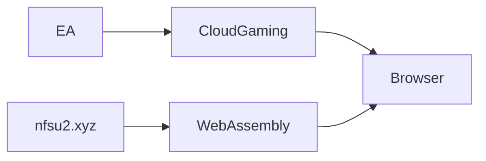

```mdx
## Introducción: Un clásico regresa, pero ¿quién mueve los hilos?

Cuando *Need for Speed Underground 2* (NFSU2) reapareció este mes como una experiencia totalmente jugable en **https://nfsu2.xyz/**, la reacción en Hacker News fue una mezcla de nostalgia y curiosidad. El sitio utiliza únicamente HTML5, JavaScript y WebAssembly para transmitir el título de 2004 directamente en cualquier navegador moderno —sin descarga, sin consola, sin Steam. Se siente como un triunfo para la preservación, sin embargo, la infraestructura subyacente revela un patrón familiar de concentración de poder en el ecosistema de los videojuegos.

La re‑edición no es un simple hack hecho por fans. Se apoya en los mismos servicios de nube, middleware y marcos de licencias que dominan la industria multimillonaria actual. Al diseccionar la pila técnica y los actores corporativos detrás de ella, podemos ver cómo las iniciativas de juego retro están tanto habilitadas como limitadas por esas mismas fuerzas que dictan el futuro de los títulos con servicio en vivo.

---

## De CD‑ROM a WebAssembly: El salto técnico


### WebAssembly como la nueva capa de compatibilidad

WebAssembly (Wasm) es un formato binario de bajo nivel diseñado para ejecutarse a velocidad casi nativa dentro de los navegadores. Su aparición en 2017 permitió a los desarrolladores portar aplicaciones pesadas —juegos, herramientas CAD, incluso sistemas operativos— sin reescribirlas en JavaScript. Proyectos como **nfsu2.xyz** compilan el motor original de DirectX 9 a Wasm y luego lo envuelven con un shim de JavaScript que traduce la entrada y el audio.

Este enfoque evita los DRM tradicionales y los canales de distribución, ofreciendo una experiencia de “juego instantáneo” que replica el lanzamiento original para PC. Sin embargo, los binarios Wasm siguen siendo servidos desde **redes de entrega de contenido (CDN)**, sobre todo Cloudflare y Amazon CloudFront, que pertenecen a las mismas corporaciones que impulsan las mayores plataformas de cloud gaming.

### Infraestructura en la nube: El costo oculto

Ejecutar un emulador basado en navegador a gran escala requiere:

1. **Servidores de borde** para cachear los activos Wasm, reduciendo la latencia para usuarios globales.
2. **Recursos de cómputo** para la transcodificación en tiempo real de audio y vídeo, especialmente en dispositivos de gama baja.
3. **Pipelines de analítica** que rastrean patrones de uso —datos que a menudo son recolectados por el proveedor de CDN.

---

## Dinámicas de poder detrás del resurgimiento retro

### Electronic Arts (EA) y el legado de NFS

La franquicia *Need for Speed* pertenece a **Electronic Arts** desde finales de los años 90. El modelo de negocio de EA pasó de ventas físicas puntuales a “juegos como servicio”, ejemplificado por **EA Play** y la suscripción **EA Access**. Aunque EA no ha sancionado oficialmente el proyecto nfsu2.xyz, la zona legal gris depende de las prioridades de ejecución de la compañía.

El control de EA sobre la propiedad intelectual, los canales de distribución y los acuerdos de licencia le otorga un **rol de custodia** que influye en si los títulos retro se vuelven accesibles públicamente o permanecen detrás de muros de pago. El hecho de que un sitio gestionado por fans pueda alojar el juego legalmente sugiere una tolerancia tácita, pero también resalta la aplicación selectiva de EA: favorece los títulos que aún generan ingresos y permite que IP menos rentables se deslicen hacia espacios de tipo dominio público.

### Gigantes del cloud gaming: Amazon, Google, Microsoft

El auge de **Amazon Luna**, **Google Stadia** (aunque ahora inactivo, su infraestructura sigue reutilizándose) y **Microsoft Xbox Cloud Gaming (xCloud)** ha creado un ecosistema donde “jugar en cualquier lugar” es sinónimo de “jugar en el hardware del proveedor de nube”. Estas plataformas agrupan juegos, incluidos títulos clásicos, en paquetes de suscripción, reflejando el propio giro de EA hacia ingresos recurrentes.

Lo crucial es que los **mismos centros de datos** que alojan Luna o xCloud también sirven los archivos estáticos de nfsu2.xyz. Esto genera una **relación simbiótica**: los proyectos independientes obtienen escalabilidad, mientras los proveedores de nube se benefician del tráfico adicional que justifica sus enormes inversiones de capital. El equilibrio de poder se inclina hacia los dueños de la infraestructura, que pueden dictar precios, limitaciones y políticas de moderación de contenidos.

### Navegadores como guardianes

Google Chrome, Microsoft Edge y Mozilla Firefox implementan soporte para WebAssembly, pero cada navegador también aplica **cajas de arena de seguridad** que limitan lo que un módulo Wasm puede hacer. El **consorcio Chromium**, mayormente impulsado por los intereses estratégicos de Google, determina el ritmo de nuevas APIs (por ejemplo, WebGPU). Al controlar la evolución de estos estándares, los proveedores de navegadores influyen en qué juegos pueden portarse eficientemente, actuando efectivamente como guardianes del futuro del gaming en el navegador.

---

## Implicaciones económicas: Por qué lo “gratuito” no es gratuito


#### Concentración de capital y el modelo “gratuito”

La apariencia de un clásico gratuito y listo para jugar oculta varias capas económicas:

| Capa | Actor | Flujo de ingresos | Efecto de poder |
|------|-------|-------------------|-----------------|
| Hosting | Proveedores de nube (AWS, Cloudflare) | Pago por uso | Dependencia de grandes proveedores, posibles aumentos de precio |
| Ancho de banda | ISP y CDNs | Tarifas escalonadas por tráfico alto | Incentiva la distribución geográfica, puede marginalizar proyectos con bajo presupuesto |
| Licencias | Propietario de IP (EA) | Posibles tasas de cumplimiento o licenciamiento | Capacidad de bloquear o monetizar títulos retro |

Aunque el proyecto opere de forma voluntaria, cualquier pico de tráfico podría generar **costos inesperados**, obligando a los mantenedores a buscar patrocinio o donaciones —otro canal donde **plataformas respaldadas por venture capital** (p. ej., Patreon, GitHub Sponsors) influyen en decisiones de contenido.

#### Tendencias de monetización: De anuncios a suscripciones

La tendencia global muestra una migración de juegos gratuitos apoyados en publicidad hacia **servicios por suscripción**. EA Play agrupa títulos clásicos, proporcionando un flujo de ingresos que compite con los costos de licenciamiento. Paralelamente, *nfsu2.xyz* ilustra un modelo alternativo: **preservación de código abierto** financiada indirectamente por la comunidad. Sin embargo, la sostenibilidad de estos proyectos es precaria en un mercado donde **los servicios de nube intensivos en capital dominan**.

---

## Contexto histórico: Del shareware a la distribución centrada en la nube

En los primeros años de los 90, títulos shareware como *Doom* se distribuían vía BBS y disquetes, democratizando el acceso pero creando **ecosistemas fragmentados**. A finales de los 90 surgieron **plataformas de distribución digital** (Steam, GOG), consolidando el control bajo unos pocos storefronts. Hoy, con **cloud gaming** y **WebAssembly**, presenciamos una tercera ola donde la *distribución* se abstrae completamente del hardware.

Cada ola ha fortalecido la **concentración del mercado**:

1. **Medios físicos** – limitados por logística, pero con barreras de entrada relativamente bajas para editoriales indie.
2. **Tiendas digitales** – generaron “oligarquías de plataformas” (Valve, EA, Ubisoft).
3. **Nube + navegador** – centraliza **cómputo y ancho de banda** bajo megacorporaciones (Amazon, Google, Microsoft).

El proyecto NFSU2 en el navegador se sitúa en la intersección de la segunda y tercera ola: aprovecha la **web abierta** mientras depende de la **infraestructura** de los gigantes de la nube.

---

## Ángulo social: Preservación vs. lucro

El éxito de **nfsu2.xyz** podría servir como **prueba de concepto** para otros títulos clásicos, presionando a EA y empresas similares a:

* Adoptar puertos impulsados por la comunidad como canal de marketing (potencialmente monetizando mediante opciones de “cloud‑play premium”).
* Aplicar sus derechos de IP de forma más rigurosa, sentando precedentes legales que podrían asfixiar futuros intentos de preservación.

Cualquiera de los resultados refuerza el **poder del capital**: los dueños pueden monetizar su patrimonio o eliminar la competencia, moldeando la memoria cultural de los videojuegos.

---

## Mirada al futuro: ¿Qué implica para el gaming?

1. **Democratización técnica** continuará a medida que WebAssembly madure, facilitando que desarrolladores desplieguen aplicaciones complejas vía navegador.
2. **Dependencia de infraestructura** en manos de unos pocos gigantes de la nube implica que la verdadera independencia sigue siendo esquiva sin financiación sustancial.
3. **Fiscalización regulatoria** del dominio de mercado de big tech podría repercutir en el sector gaming, abriendo espacio para soluciones descentralizadas de alojamiento (por ejemplo, IPFS) que reduzcan la dependencia de centros de datos al estilo AWS.
4. **Expectativas de los consumidores** están cambiando; los jugadores ahora demandan experiencias fluidas y multiplataforma, presionando a los estudios a adoptar estrategias “cloud‑first”, lo que afianza aún más el modelo intensivo en capital.

En esencia, el NFSU2 basado en navegador es un **microcosmos de la industria**: un artefacto nostálgico impulsado por las mismas fuerzas que están redefiniendo cómo creamos, distribuimos y consumimos medios interactivos.

---




## Conclusión: Un llamado a la reflexión

*Need for Speed Underground 2* puede estar corriendo por las calles virtuales una vez más, pero su travesía por la web moderna revela un panorama dominado por unas pocas entidades poderosas. Como desarrolladores independientes, archivistas y gamers, debemos preguntarnos: **¿Aceptamos un futuro donde toda experiencia está mediada por unos pocos proveedores de nube, o defendemos infraestructuras alternativas y comunitarias que preserven el patrimonio cultural sin ceder el control?**

La respuesta moldeará no solo el destino de los títulos retro, sino también la propia fibra de la industria del gaming durante generaciones.
```