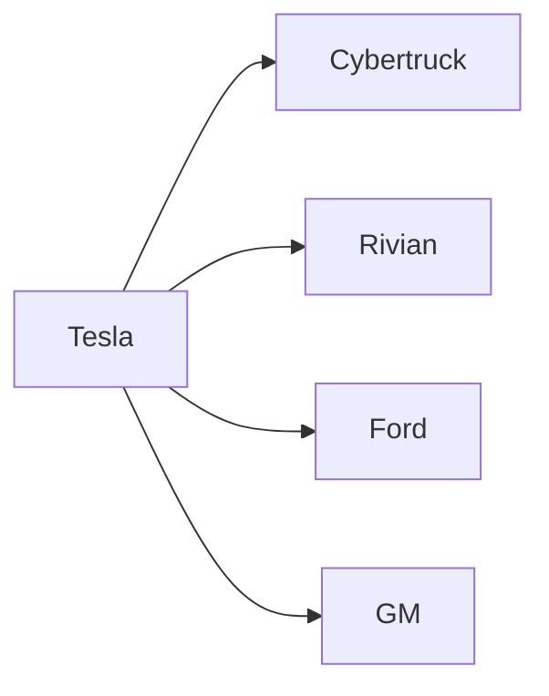

La decisión de **Tesla** de “detener” la producción del **Cybertruck** —un vehículo que, desde su anuncio en 2019, había generado tanto entusiasmo como controversia— no es solo la noticia de una línea de montaje que se vacía. Es el espejo de una dinámica más amplia: la concentración del poder económico y tecnológico en unas cuantas compañías que dictan el ritmo de la transición eléctrica, al tiempo que enfrentan la cruda realidad de mercados que no siempre se alinean con la visión de sus líderes.

## Un producto adelantado a su tiempo, pero sin demanda

El Cybertruck nació bajo la marca personal de **Elon Musk**, un CEO que ha convertido la figura del fundador en un activo de mercado. La promesa de una camioneta con diseño futurista, cero emisiones y una resistencia estructural casi militar capturó la imaginación de la comunidad de *Hacker News*, de inversores y de consumidores de estilo de vida. Sin embargo, los números cuentan otra historia. Según los últimos informes de **NBC News**, la producción del modelo empezó a disminuir a partir de 2023 y se prevé su cese definitivo en los próximos años, tras una serie de rebajas de precios que no lograron revertir la caída de ventas.

Este escenario se repite en el sector: muchos lanzamientos de vehículos eléctricos (VE) se han visto sobrepasados por la falta de infraestructura, la incertidumbre regulatoria y la competencia de modelos más asequibles. Mientras **Tesla** invierte miles de millones en su red de supercargadores y en la expansión de sus fábricas de baterías, la demanda real de una camioneta tan específica se ha quedado corta frente a la saturación de **Ford F‑150**, que ahora también ofrece una variante eléctrica, y frente a la oferta de **Rivian** y **GMC** en el segmento de vehículos utilitarios.

## Concentración de capital y poder de decisión

El caso del Cybertruck ilustra la **concentración de capital** que ha caracterizado a la industria automotriz del siglo XXI. Tres grandes conglomerados —Tesla, **Ford** y **General Motors**— controlan más del 60 % de la inversión global en desarrollo de VE, según datos de *BloombergNEF*. Este dominio no solo se refleja en la capacidad de financiar miles de millones en I+D, sino también en la habilidad de influir en normas de seguridad, incentivos fiscales y estándares de carga.

Tesla, con su estructura de empresa **público‑privada** y su bolsa de valores cotizada, ha recibido una ingente cantidad de capital de inversores institucionales como **Vanguard** y **BlackRock**. Estas entidades, a su vez, poseen participaciones significativas en los bancos que financian la construcción de fábricas y en los proveedores de baterías como **Panasonic** y **LG Energy Solution**. La **interdependencia** crea un círculo de poder donde las decisiones de producción de Tesla repercuten directamente en la cadena de suministro global y, por extensión, en la rentabilidad de los fondos de inversión que respaldan a la compañía.

Este entramado contrasta con la **fragmentación** que existía en los inicios de la era eléctrica. A principios de los 2000, empresas como **Toyota** y **Nissan** lideraron proyectos de VE (Prius y Leaf) con inversiones más distribuidas y con una mayor competencia de startups como **Better Place** o **Fisker**. La consolidación posterior ha dejado menos espacio para la experimentación de modelos de nicho —como el Cybertruck— y ha favorecido la estandarización de plataformas que reducen costos a gran escala, pero que también limitan la diversidad de oferta.

## Dinámicas de poder entre fabricantes y proveedores

La **cadena de suministro** de vehículos eléctricos está dominada por unos pocos proveedores de celdas de litio. **CATL**, **LG Energy** y **Panasonic** controlan más del 70 % de la producción mundial. Cuando Tesla decide reducir o detener la producción de un modelo, el efecto colateral se siente en estas empresas, que deben reubicar capacidad productiva o renegociar contratos. En los últimos meses, **Panasonic** anunció una expansión de su planta en Nevada precisamente para compensar la reducción de volúmenes del Cybertruck, pero la estrategia a largo plazo dependerá de la demanda de modelos como el Model Y y el futuro **Tesla Semi**.

A su vez, la relación entre **Tesla** y **Ford** ha evolucionado de una rivalidad aparente a una **cooperación tácita** en estándares de carga y en la negociación con reguladores. Ambas compañías comparten intereses en la homologación de los **CCS (Sistema de Carga Combinada)** y en la defensa contra posibles restricciones de importación de baterías chinas. Esta alineación de intereses muestra cómo la competencia en el mercado puede convertirse en una **coalición de poder**, reforzando la posición de los grandes fabricantes ante actores más pequeños.

## Lecciones históricas: de la era del SUV al dominio de la electrificación

Para comprender la magnitud del giro estratégico que representa el cese del Cybertruck, basta mirar la historia reciente del segmento de **SUVs**. En los años 90, marcas como **Jeep** y **Toyota** lideraron la popularización de los todoterrenos, mientras que fabricantes de menor escala competían en nichos locales. Con la llegada de la crisis del petróleo y la normativa de emisiones, los gigantes automotrices consolidaron sus líneas de producción y eliminaron a la mayoría de los competidores independientes. El patrón se repite hoy: la electrificación se convierte en el nuevo vector de consolidación, y los proyectos marginales se ven sacrificados cuando la rentabilidad se vuelve prioritaria.

Asimismo, el **Modelo S** de Tesla, lanzado en 2012, demostró que la apuesta por un vehículo premium podía financiar toda una cadena de valor eléctrica. El éxito del Model S permitió a Tesla financiar proyectos de mayor riesgo, como el Cybertruck y el **Tesla Roadster**. Sin embargo, el modelo de negocio basado en ingresos de alta gama está bajo presión cuando los consumidores exigen precios más bajos y mayor funcionalidad práctica. La caída de ventas del Cybertruck refleja, por tanto, una *guerra de precios* que pone a prueba la capacidad de Tesla para mantener su modelo de negocio de margen alto sin sacrificar unidades.

## Impacto en el ecosistema de innovación y la percepción del consumidor

El cese del Cybertruck tendrá efectos colaterales en la **percepción de la marca**. Tesla ha cultivado una imagen de disruptor que “rompe” la tradición automotriz. Al abandonar un producto que había generado un gran *hype*, la compañía corre el riesgo de erosionar parte de esa narrativa, algo que los analistas de *Morgan Stanley* ya señalaban como un “desalineamiento entre visión y ejecución”.

Sin embargo, la medida también puede interpretarse como una **optimización de recursos**. Al redistribuir capacidad productiva hacia modelos con mayor demanda —el Model Y y el próximo **Tesla Semi**— la empresa podría reforzar sus márgenes y acelerar su hoja de ruta de expansión en **Asia** y **Europa**. En términos macroeconómicos, la decisión envía una señal a los inversores: los capitales están dispuestos a financiar proyectos con *retornos* claros, mientras que los experimentos de marketing se relegan a fases de bajo riesgo financiero.

## Conclusión: reflexión sobre el futuro de la movilidad eléctrica

La noticia de que Tesla está “detener” la producción del Cybertruck no basta para describir una simple reestructuración de línea. Es una ventana que muestra cómo la **concentración de capital**, la **interdependencia entre fabricantes y proveedores**, y la **presión de los mercados** están redefiniendo la innovación en la industria automotriz. Mientras los gigantes como Tesla, Ford y GM continúan amoldándose a las demandas de rentabilidad y regulaciones, los consumidores y los pequeños innovadores deberán buscar nuevos nichos—posiblemente en servicios de movilidad compartida, en infraestructura de recarga o en soluciones de baterías de segunda vida.

En última instancia, el destino del Cybertruck nos obliga a preguntarnos: ¿está la revolución eléctrica siendo liderada por una élite capitalista que prioriza el retorno financiero sobre la verdadera diversificación tecnológica? O, por el contrario, ¿esta concentración es **inevitable** para lograr la escala necesaria para la descarbonización global? La respuesta determinará no solo el futuro de Tesla, sino la forma en que la sociedad entera transitará hacia una movilidad sostenible.