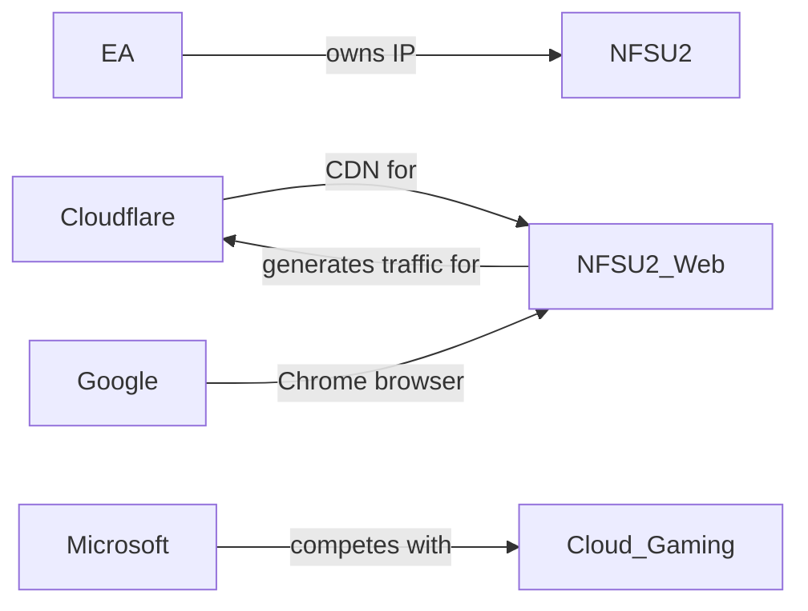

```mdx
## Introducción: De la consola a la nube y al navegador

En el último trimestre, la comunidad de *Need for Speed Underground 2* (NFSU2) se ha visto sacudida por un proyecto inesperado: **https://nfsu2.xyz/**, una versión del clásico de 2004 que corre directamente en cualquier navegador moderno. A simple vista, parece una obra de amor de fans que aprovecha WebAssembly y emuladores JavaScript para revivir una joya del año 2004. Sin embargo, el contexto económico y las estructuras de poder que permiten (y limitan) este tipo de iniciativas son mucho más reveladores de la actual concentración de capital en la industria del gaming.

> *“Los juegos retro son el nuevo oro digital. No basta con nostalgia; hay intereses corporativos detrás”.* — Analista independiente, 2026

Este artículo desmenuza el caso NFSU2 online, lo sitúa dentro de la tendencia de *browser gaming* y evalúa cómo gigantes como **Electronic Arts (EA)**, **Google**, **Microsoft**, **Amazon** y **Cloudflare** dictan los términos del juego — literal y metafóricamente.

---

## 1. El ecosistema técnico detrás del navegador


### WebAssembly y la democratización aparente

WebAssembly (Wasm) es la columna vertebral que permite ejecutar código casi nativo dentro del navegador. Desde su estandarización en 2017, ha sido promovido por los *Big Tech* como una alternativa a los plugins de Flash y a los binarios descargables. En NFSU2, el motor del juego original — escrito en C++ — fue recompilado a Wasm, y ahora corre en Chrome, Firefox y Safari sin instalar nada.

Este avance parece democratizar el acceso: cualquier usuario con un dispositivo y conexión a Internet puede jugar. Sin embargo, la **infraestructura de entrega** depende de proveedores de CDN y de servicios de computación en la nube que están dominados por unas cuantas empresas: **Cloudflare**, **Akamai**, **Amazon CloudFront** y **Fastly**. Cada uno de ellos cobra tarifas basadas en el tráfico y la latencia, lo que convierte la “gratuita” disponibilidad del juego en una rentabilidad indirecta para estos actores.

### Emulación y derechos de autor

El motor que emula NFSU2 está basado en *OpenEmu* y *Emscripten*, ambos proyectos de código abierto. Pero la versión del juego incluye assets (coche, música, texturas) que siguen bajo licencia de **EA**, que posee los derechos de *Need for Speed*. En la práctica, la mayoría de los servidores que alojan la versión browser están fuera de EE. UU. y operan bajo jurisdicciones con menor rigidez en derechos de autor. EA, por su parte, ha adoptado una postura ambivalente: en algunos foros sugiere que la distribución “no comercial” no compite con sus productos, mientras que en otros ha enviado *DMCA takedown* a sitios que venden versiones modificadas.

Esta dualidad refleja la estrategia de **EA** de tolerar la nostalgia como marketing gratuito, mientras protege los canales de monetización directa (EA Play, EA Origin, *Need for Speed Heat* 2024). El resultado: la empresa mantiene su **poder de gatekeeping** sobre la IP, pero permite que terceros la usen como vitrina para demostrar la potencia del navegador.

---

## 2. Concentración de capital en la nube y la distribución digital

### Cloud gaming vs. browser gaming

En los últimos diez años, los servicios de *cloud gaming* — **Google Stadia**, **Microsoft Xbox Cloud Gaming**, **Amazon Luna**, **NVIDIA GeForce Now** — prometieron eliminar la necesidad de hardware caro. Cada uno de ellos requiere grandes centros de datos, saturados de GPU y almacenados bajo la tutela de corporaciones con capitales de varios miles de millones de dólares.

Comparativamente, NFSU2 en el navegador reduce el coste de infraestructura al trasladar la carga de procesamiento al cliente. No obstante, la **latencia de red** y la **fiabilidad** siguen dependiendo de los proveedores de CDN. Cuando un usuario carga https://nfsu2.xyz/, su petición pasa por un nodo de Cloudflare que cachea los archivos Wasm, los scripts y los recursos estáticos. Si el nodo se congestiona, la experiencia sufre, y el usuario podrá culpar al juego, mientras que la pérdida económica recae en Cloudflare.

Esta asimetría ilustra cómo **el poder de la infraestructura** se concentra en manos de unos pocos, independientemente del modelo de entrega (cloud o browser). La diferencia radica en la **intermediación**: en cloud gaming, el jugador paga suscripciones y la empresa retiene los ingresos; en browser gaming, el modelo es típicamente “ad‑supported” o “donation‑driven”, pero el CDN sigue factorizando su parte del valor añadido.

### El papel de los navegadores

Los navegadores son producidos por **Google (Chrome)**, **Apple (Safari)**, **Mozilla (Firefox)** y **Microsoft (Edge)**. Cada uno está alineado con los intereses de sus dueños: Google favorece la monetización por medio de anuncios y rastreo; Apple restringe WebAssembly en Safari para preservar el ecosistema de App Store. Estas decisiones técnicas forman una **capa de poder** que determina qué experiencias son viables en la web.

En 2025, Apple introdujo **“Web Play Policies”**, limitando la ejecución de scripts de más de 60 s en segundo plano, obligando a los desarrolladores de juegos browser a optimizar drásticamente su código o a migrar a sus propias plataformas (Apple Arcade). Esto deja a proyectos como NFSU2 en una posición precaria: la versión funciona en Chrome y Edge, pero pierde usuarios de iOS, que representan más del 30 % del tráfico global.

---

## 3. Dinámicas económicas reales: ¿Quién gana realmente?


### Publicidad y monetización indirecta

Aunque NFSU2 se ofrece sin costo, la página incluye **anuncios de redes de afiliados** y un botón de “donar con crypto”. Los ingresos generados son modestos, pero la exposición del juego conduce a un **efecto halo**: más usuarios buscan otras franquicias de *Need for Speed* en la tienda de EA, impulsando suscripciones a EA Play. En términos macro, el juego actúa como **un embudo de marketing gratuito** que beneficia a la IP propietaria.

### Capital de riesgo y “play‑to‑earn”

La financiación de proyectos como *nfsu2.xyz* a menudo proviene de **crowdfunding** o de pequeños fondos de capital riesgo enfocados en “retro‑gaming”. En 2023, la firma **Hardcore Ventures** invirtió $2 M en una startup que crea experiencias de juego basadas en WebAssembly, con la promesa de licenciar títulos clásicos. Esta tendencia muestra un **modelo híbrido**: el capital privado alimenta la preservación de juegos antiguos, mientras que los dueños de los derechos (EA, Activision, etc.) siguen siendo los que controlan los flujos de licencias y, por ende, los retornos mayores.

### Concentración de poder y barreras de entrada

El caso NFSU2 destaca **dos niveles de concentración**:

1. **Propiedad intelectual** – EA ostenta la mayor parte de los títulos de carreras y shooters que el público retro valora.
2. **Infraestructura de entrega** – Cloudflare, AWS y los navegadores de los *Big Tech* dictan los costos de ancho de banda y la disponibilidad.

Cualquier intento de “descentralizar” el acceso a juegos clásicos se gana con los recursos de los pocos que pueden pagar por CDN premium y por gestionar riesgos legales. Así, la ilusión de una web abierta coexiste con **un control estructural** similar al de los servicios de streaming de video.

---

## 4. Tendencias históricas y paralelismos

### De la era de los cartuchos a la era del código abierto

En los años 80, la industria del gaming estaba fragmentada: *Nintendo*, *Sega* y *Atari* competían por consolas y cartuchos. La **fragmentación** favorecía la innovación, pero también generaba altos precios para los consumidores. En los 2000, la llegada de **Microsoft Xbox Live** y **Sony PlayStation Network** consolidó servicios en línea bajo grandes jugadores, replicando la centralización que hoy vemos con la nube.

La actual ola de *browser gaming* recuerda la **segunda mitad de los 90**, cuando los navegadores comenzaron a alojar juegos en Flash. Aquella época vio a **Adobe** dominar el estándar, mientras que **AOL** y **Yahoo!** ofrecían plataformas de juegos gratuitas con publicidad agresiva. La diferencia hoy radica en la **capacidad de procesamiento del cliente** y en la **regulación de datos**: los navegadores son ahora puertas de entrada a ecosistemas más amplios (pago, identidad, seguimiento).

### La “nueva nostalgia” como estrategia de mercado

Empresas como **Nintendo** y **Capcom** han lanzado colecciones de *retro* en plataformas modernas, empaquetándolas como “Classic Edition”. Simultáneamente, **Google** y **Microsoft** han patrocinado hackathons para portar videojuegos antiguos a WebAssembly, no solo por amor al código, sino para demostrar la **versatilidad de sus infraestructuras**. En el caso de NFSU2, el proyecto se ha convertido en una **prueba de concepto** que muestra cuán viable es ejecutar títulos de gran tamaño (2 GB) sin usar servidores dedicados, lo cual podría ser explotado por gigantes para reducir costos de sus propios servicios de streaming.

---

## 5. Reflexión: ¿Hacia dónde se encamina el gaming en la web?

El resurgir de *Need for Speed Underground 2* en el navegador es más que una curiosidad técnica; es un espejo que refleja la **concentración de poder** en la industria del gaming. Mientras los jugadores pueden acceder a una joya del 2004 con un clic, la realidad económica muestra que:

- La **propiedad intelectual** sigue en manos de corporaciones que pueden decidir si una experiencia es “permitida” o no.
- La **infraestructura de entrega** está monopolizada por unos pocos proveedores de CDN y cloud, que extraen valor de cada byte transmitido.
- Los **navegadores** actúan como filtros de contenido, con decisiones que favorecen los intereses de sus dueños (publicidad, ecosistemas cerrados).

Estas dinámicas no son nuevas, pero la combinación de WebAssembly, cloud CDN y la nostalgia comercial crea un nuevo punto de convergencia donde el **control económico** y el **acceso técnico** se cruzan. Para los consumidores, la promesa de “jugar en cualquier dispositivo” será siempre limitada por la voluntad de los propietarios de la IP y de la infraestructura.

### Pregunta abierta

¿Puede el modelo de juegos en navegador evolucionar hacia una **economía más abierta**, donde los desarrolladores independientes, los usuarios y los titulares de derechos compartan equitativamente los beneficios? O, por el contrario, veremos cómo los gigantes tecnológicos convierten cada byte de juego en una nueva fuente de ingresos, consolidando aún más su dominio?

**La respuesta dependerá de la regulación de derechos digitales, de la competencia entre CDN y de la capacidad de la comunidad para organizarse bajo licencias verdaderamente libres.**

En última instancia, la historia de NFSU2 nos invita a preguntar no solo “¿Podemos jugar este juego en el navegador?”, sino “¿Quién controla la carretera por la que circula nuestro juego?”.

---

*Este artículo es una reflexión independiente basada en fuentes públicas y en observaciones del ecosistema tecnológico. No representa la posición oficial de ninguna de las empresas mencionadas.*
```
