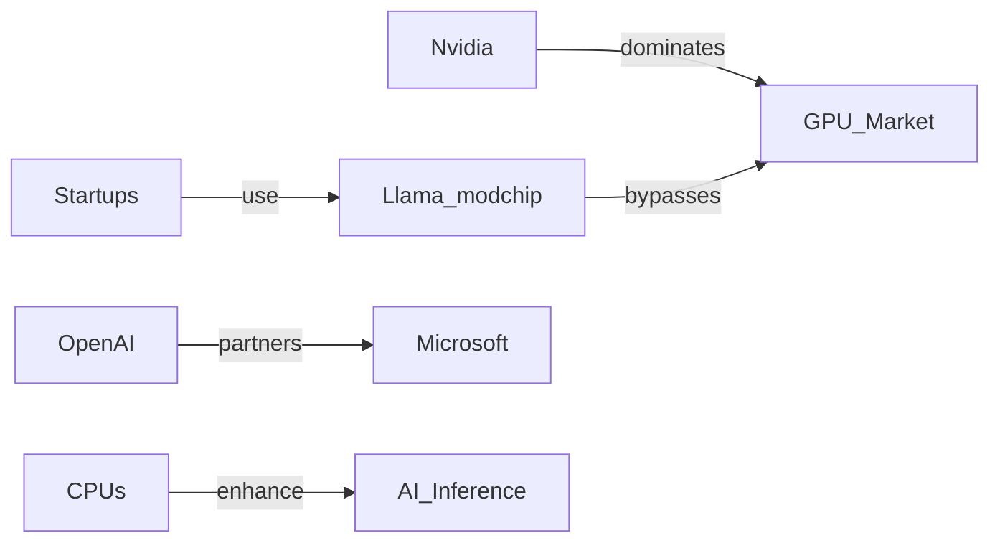

## Introducción

En la comunidad de desarrollo de IA, el anuncio del **Llama‑modchip** ha generado un revuelo inesperado. El repositorio de GitHub https://github.com/synchopate/llama-modchip muestra cómo ejecutar el modelo de lenguaje *DeepSeek‑Chat 284 B* usando únicamente **64 GB de RAM** y **sin una GPU** dedicada. En un ecosistema donde los grandes fabricantes de chips —principalmente **Nvidia** y, en menor medida, **AMD**— dictan los precios y la disponibilidad de la potencia de cómputo para IA, esta hazaña parece una bofetada simbólica a la concentración de poder.

Este artículo explora el impacto del Llama‑modchip más allá del aspecto técnico, analizando cómo desafía las dinámicas de poder en la industria, qué implicaciones económicas tiene y a qué tendencias históricas se alinea.

## ¿Qué es Llama‑modchip y por qué importa?

Llama‑modchip es una combinación de *optimización de inferencia* y *ingeniería de memoria* que permite cargar un modelo de 284 mil millones de parámetros (aproximadamente 1.1 TB de pesos) directamente en la RAM del host, usando técnicas como **bfloat16 quantization**, **off‑loading dinámico** y **pipelining de capas**. El resultado: un modelo que, tradicionalmente, requeriría varias GPUs de alta gama (A100, H100) o clusters de TPU, puede ejecutarse en una máquina de servidor con **64 GB de DDR5** y **CPU de 32‑64 núcleos**.

Para comprender la magnitud, comparemos:

| Configuración típica | GPU requerida | RAM mínima | Costo aproximado |
|----------------------|---------------|------------|------------------|
| DeepSeek 284 B (GPU) | 8 × Nvidia H100 | 1 TB | > US$ 2 M |
| Llama‑modchip (CPU)  | Ninguna       | 64 GB      | ≈ US$ 30 k (servidor) |

El ahorro económico es inmediato, pero la verdadera revolución está en la *democratización del acceso* a modelos de escala comparable a los de gigantes como **OpenAI**, **Google DeepMind** o **Microsoft**.

## El monopolio GPU y la concentración de capital

### Nvidia como pilar del ecosistema IA

Desde la introducción de la arquitectura **CUDA** en 2006, Nvidia ha construido un ecosistema cerrado donde:

* **Hardware**: GPUs como la serie A100 y la más reciente H100 son prácticamente los únicos dispositivos certificados para entrenamiento e inferencia a gran escala.
* **Software**: Herramientas como **cuDNN**, **TensorRT** y **NVIDIA AI Enterprise** refuerzan la dependencia de los desarrolladores.
* **Financiamiento**: Inversionistas institucionales y fondos de capital riesgo han invertido miles de millones en startups que dependen de GPU Nvidia para validar sus soluciones.

Este modelo ha generado una **concentración de capital** sin precedentes; los precios de las GPUs de alto nivel se dispararon durante la escasez de 2020‑2022 y, aunque han bajado, siguen siendo prohibitivos para pequeñas empresas o investigadores académicos.

### Competidores y sus limitaciones

* **AMD**: Aunque con la arquitectura **MI200** y la reciente **MI300**, AMD ha logrado mejorar su participación, su ecosistema de software sigue rezagado frente a CUDA.
* **Intel**: La estrategia **Xe** y el proyecto **Gaudi** de Habana Labs apuntan a romper el dominio, pero la adopción sigue siendo limitada y la curva de aprendizaje alta.
* **Google**: Con sus **TPU**, Google mantiene un control interno del hardware, aunque permite acceso externo mediante **Google Cloud**, lo que mantiene la barrera de entrada alta por costos de la nube.

En este contexto, Llama‑modchip representa una **alternativa de código abierto** que reduce la fricción de dependencia de proveedores específicos y abre la puerta a una infraestructura más **heterogénea**.

## Dinámicas económicas reales: ¿Qué ganan y qué pierden los gigantes?

### Reducción de costos operativos

Los costos operativos de una empresa que ejecuta IA pueden dividirse en:

1. **CAPEX** (inversión en hardware).
2. **OPEX** (electricidad, refrigeración, licencias de software).

Al prescindir de GPUs, las empresas recortan significativamente ambos rubros. Por ejemplo, una empresa de **SaaS** que ofrece servicios de generación de texto podría reducir su gasto anual en hardware en un 60‑70 %, permitiendo **más margen de beneficio** o **precios más competitivos**.

### Reconfiguración de la cadena de valor

El modelo tradicional de IA se basa en tres capas:

1. **Fabricantes de chips** (Nvidia, AMD, Intel).
2. **Integradores de sistemas** (Dell, HPE, Supermicro).
3. **Proveedores de SaaS** (OpenAI, Anthropic, Cohere).

Llama‑modchip introduce una **cuarta capa**: *proveedores de software de optimización* que, sin poseer hardware propio, pueden ofrecer servicios de **inference-as-a-service** sobre infraestructuras genéricas. Esta capa podría ser ocupada por **startups** que escalen rápidamente, erosionando la posición dominante de los proveedores tradicionales.

### Riesgo de fragmentación y seguridad

Sin embargo, la dispersión del hardware también genera **fragmentación**. Cada servidor con diferentes CPUs, micro‑arquitecturas y configuraciones de RAM introduce variabilidad en el rendimiento y en la **seguridad** del modelo (p. ej., vulnerabilidades de side‑channel). Los gigantes poseen recursos para auditorías y parches a gran escala; los jugadores más pequeños podrían no contar con esos medios.

## Conexiones históricas: De los mainframes a la IA modular

La historia de la informática está marcada por ciclos de **centralización** y **descentralización**:

* **1960‑70s**: Los mainframes dominaban el cómputo; el tiempo de respuesta y el coste limitaban la adopción masiva.
* **1980‑90s**: La llegada de los **PC** y la arquitectura **x86** democratizó la computación, desplazando el poder de IBM a cientos de fabricantes de hardware.
* **2000‑2010**: La explosión de los **servicios en la nube** volvió a concentrar recursos bajo grandes proveedores (AWS, Azure, GCP), pero con un modelo de pago‑por‑uso.
* **2020‑presente**: La era del **GPU‑centric AI** vuelve a concentrar el poder en pocos fabricantes de chips.

Llama‑modchip puede verse como la **renovación del concepto “CPU‑first”** para IA, recordándonos la fase en la que el software empezó a aprovechar el hardware existente sin requerir dispositivos especializados. Al igual que los lenguajes de alto nivel permitieron a los programadores crear aplicaciones sin conocer el detalle del ensamblador, Llama‑modchip permite a los investigadores y startups ejecutar modelos gigantes sin entender la arquitectura de GPU.

## Implicaciones para la regulación y la política pública

Los reguladores de competencia, como la **FTC** (EE.UU.) o la **ECC** (UE), siguen evaluando la posible *abuso de posición dominante* de Nvidia. Un desarrollo como Llama‑modchip ofrece argumentos a favor de **políticas que fomenten la interoperabilidad y la portabilidad del software de IA**. Si el modelo de inferencia pudiera ejecutarse en cualquier hardware de propósito general, la presión sobre los monopolios de hardware incrementaría, obligándolos a **reducir precios** y **abrir interfaces**.

Al mismo tiempo, los gobiernos deben vigilar que la democratización no abra la puerta a **uso malintencionado** de modelos potentes sin los filtros que a veces impone el ecosistema de grandes proveedores (por ejemplo, la falta de “guardrails” de OpenAI). La respuesta podría radicar en **marcos de responsabilidad** basados en la *propiedad del modelo* más que en el *hardware*.

## Perspectivas de futuro

1. **Optimización de memoria**: Expectativa de que la comunidad de código abierto entregue técnicas de compresión y *sparsity* que reduzcan la huella de los modelos aún más.
2. **Hardware heterogéneo**: Es probable que los fabricantes de CPUs (Intel, AMD) inviertan en **instrucciones de IA** (AVX‑512, AMX) para competir directamente con GPUs en inferencia.
3. **Modelos más pequeños por gran escala**: El éxito de Llama‑modchip podría incentivar a los investigadores a diseñar arquitecturas que, pese a su tamaño, sean **más “CPU‑friendly”**, como los *Mixture‑of‑Experts* (MoE) que activan solo sub‑redes.
4. **Mercado de servicios de inferencia distribuida**: Aparecerán plataformas que ofrezcan “inference‑as‑a‑service” basadas en clusters de servidores estándar, reduciendo la barrera de entrada para startups.

## Conclusión

Llama‑modchip no es únicamente un truco de hacking: es una señal de que el **modelo de negocio basado en la exclusividad de hardware** está empezando a agrietarse. Si la comunidad logra reproducir y perfeccionar este enfoque, podríamos estar frente a una nueva era donde los **modelos de IA de escala “GPT‑4”** estén al alcance de cualquier organización con recursos modestos, forzando a los gigantes de GPU a reconsiderar sus precios y sus políticas de acceso.

La pregunta que queda es: ¿estamos preparados para una IA más *distribuida*, con sus ventajas de democratización y los riesgos de fragmentación, o veremos una nueva ola de consolidación cuando los actores dominantes adapten sus estrategias a este nuevo escenario? La respuesta dependerá tanto de la **innovación tecnológica** como de la **voluntad política y empresarial** para abrir la infraestructura, romper barreras y evitar que el poder económico vuelva a concentrarse en unas pocas manos.

---

