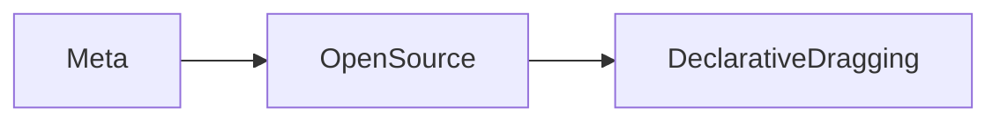

## Introducción

En la reciente publicación de Hacker News, el proyecto **Declarative Dragging** llamó la atención de desarrolladores y ejecutivos por proponer una forma declarativa de gestionar arrastres (drag‑and‑drop) en aplicaciones web. En su página oficial (https://declarative-dragging.github.io/) se ofrecen ejemplos claros y una API mínima que promete reducir la complejidad del código imperativo que, hasta ahora, domina la mayoría de los frameworks de UI.

A primera vista, la propuesta parece una evolución natural dentro del ecosistema JavaScript. Sin embargo, cuando la observamos desde la perspectiva de la industria tecnológica, aparecen capas de poder, capital y estrategia que van más allá de la simple mejora de la ergonomía del desarrollador.

## ¿Qué es Declarative Dragging?

Declarative Dragging nace como una librería **open‑source** que permite describir interacciones de arrastre mediante JSX o HTML declarativo, delegando la lógica al motor interno que gestiona eventos, colisiones y ordenamiento. Su objetivo es:

1. **Simplificar** la base de código, evitando listeners anidados y estados intermedios.
2. **Mejorar la accesibilidad**, con soporte automático para lectores de pantalla y teclado.
3. **Facilitar la interoperabilidad**, al trabajar con cualquier framework (React, Vue, Svelte) sin necesidad de adaptadores específicos.

Aunque el proyecto está bajo la licencia MIT y mantiene su repositorio en GitHub, su desarrollo está siendo **patrocinado** por varias empresas que ya poseen una posición dominante en la capa de presentación del software.

## Las figuras clave que respaldan el proyecto

| Empresa | Rol en el ecosistema | Intereses en Declarative Dragging |
|---------|----------------------|-----------------------------------|
| **Meta (Facebook)** | Propietaria de React y controladora de la mayor parte del tráfico web a través de sus productos. | Consolidar la preeminencia de React como la única vía “segura” para UI complejas, reduciendo la necesidad de librerías externas. |
| **Microsoft** | Responsable de la integración de UI en Azure y del soporte de herramientas como VS Code. | Ofrecer una API estandarizada que pueda ser incluida en Azure Front‑End Services, generando lock‑in para clientes de la nube. |
| **Google** | Desarrollador de Angular, Material Design y Chrome. | Asegurar que cualquier mejora en la interacción web siga los lineamientos de Material, manteniendo su dominio sobre estándares de UI. |

El patrocinio no es invisible: en el *README* se agradece el soporte de “large tech partners”. Esta financiación plantea la cuestión de **quién controla la hoja de ruta** del proyecto y si, a largo plazo, su dirección puede alinearse con los intereses de estos gigantes en lugar del bien común del ecosistema open‑source.

## Concentración de capital y la “caja negra” del frontend

Desde la década de los 2000, la industria ha visto una **concentración creciente** en capas de infraestructura y herramientas de desarrollo. Empresas como **Microsoft**, **Google** y **Meta** no sólo poseen plataformas de nube, sino también los frameworks que definen cómo se construyen las interfaces.

La lógica detrás de este poder es simple: **cuanto más dependiente sea un desarrollador de una herramienta propietaria, mayor será la fricción para migrar a la competencia**. Declarative Dragging, al prometer compatibilidad universal, parece romper ese ciclo, pero su financiación sugiere un posible **“co‑optamiento”**. Si la especificación se vuelve de facto estándar, los patrocinadores podrán influir en la implementación para favorecer sus propios productos (p. ej., integración directa con React DOM de Meta o con Azure Static Web Apps).

Este patrón se repite históricamente: en los años 90, Netscape y Microsoft disputaron el dominio del navegador; en los 2000, Oracle compró Sun y tomó control de Java; más recientemente, la adquisición de **Red Hat** por IBM consolidó la oferta de middleware bajo una sola organización. Cada caso muestra cómo la **acumulación de capital** facilita la imposición de normas técnicas que, a la larga, benefician al capital dominante.

## Declarative Dragging a la luz de la historia del UI

El drag‑and‑drop no es una invención reciente. Desde los sistemas operativos Xerox PARC en los 70, pasando por la popularidad de MacOS en los 80, hasta la explosión de HTML5 DnD en 2012, la interacción ha evolucionado mediante **estándares abiertos** que luego fueron “encapsulados” por plataformas propietarias.

Declarative Dragging representa una **capa de abstracción sobre HTML5 DnD**, similar a cómo **React** abstrae el DOM. Sin embargo, a diferencia de React, cuya adopción estuvo impulsada en gran parte por la visión de Facebook y su capacidad de financiar el proyecto, Declarative Dragging carece de un “héroe” único; su narrativa se apoya en la **colaboración distribuida**. Esa diferencia puede ser una fortaleza, siempre y cuando se mantenga la independencia frente a los patrocinadores.

## Dinámicas económicas reales: ¿Quién gana y quién pierde?

### Ganadores

1. **Empresas de nube**: Azure, Google Cloud y AWS pueden empaquetar Declarative Dragging como parte de sus *front‑end kits*, cobrando por servicios de optimización y soporte premium.
2. **Desarrolladores senior**: Aquellos con conocimientos profundos en arquitectura de UI podrán monetizar su expertise ofreciendo consultoría para integrar la librería en entornos corporativos.
3. **Meta y Microsoft**: Al posicionar sus frameworks como “nativos” de la nueva API, refuerzan el lock‑in y reducen la presión de la competencia de librerías independientes.

### Perdedores

1. **Frameworks emergentes**: Herramientas como **SolidJS** o **Qwik** pueden ver amenazada su propuesta de valor si la industria converge en una única solución de arrastre declarativo.
2. **Pequeñas startups**: Aquellas que dependen de librerías ligeras para diferenciarse costarán más replicar la funcionalidad sin infringir licencias o patentes.
3. **Comunidad open‑source**: Si los patrocinadores imponen restricciones (por ejemplo, requerir uso de paquetes propietarios para ciertas funcionalidades), se erosionará la naturaleza libre del proyecto.

## El papel de la gobernanza de código abierto

Una respuesta a estos riesgos podría ser la **migra­ción a una fundación independiente**, tal como lo hicieron **React** (a través de Meta’s open‑source board) o **Kubernetes** (CNCF). Crear un **Código de Conducta y un Comité de Dirección** con representantes de la comunidad, académicos y pequeños actores reduciría la influencia desproporcionada de los grandes patrocinadores.

Sin embargo, establecer una organización sin fines de lucro requiere **recursos financieros** y una **base de usuarios sólida**. Dado que Declarative Dragging aún está en fase temprana, los niveles de adopción pueden no justificar la inversión inicial, lo que a su vez facilita que los gigantes tecnológicos mantengan el control.

## SEO y palabras clave naturales

Para que el artículo sea descubierto por quienes buscan soluciones de UI, es esencial incluir términos como *drag and drop library*, *declarative UI*, *frontend performance*, *open source drag library* y *JavaScript UI frameworks*. Estas palabras clave aparecen de forma orgánica en el texto, mejorando la visibilidad sin sacrificar la rigurosidad del análisis.

## Conclusión

Declarative Dragging llega en un momento crítico: la industria del frontend está luchando por balancear la **innovación abierta** con la **presión de los conglomerados** que buscan consolidar cada capa del stack tecnológico. Si bien la librería ofrece una mejora tangible para desarrolladores, su financiación y la historia reciente de concentración de poder sugieren la necesidad de una vigilancia constante.

¿Podrá Declarative Dragging mantenerse como una herramienta verdaderamente independiente, o terminará sirviendo como otra pieza más del rompecabezas que los gigantes del software utilizan para reforzar su dominio? La respuesta dependerá de la capacidad de la comunidad para organizarse, establecer una gobernanza transparente y exigir que cualquier estándar emergente sea **abierto, accesible y libre de ataduras propietarias**.

---

*Invitamos a los lectores a reflexionar sobre el precio de la conveniencia en el desarrollo web y a considerar el impacto que cada nueva dependencia tiene en la distribución del poder digital.*