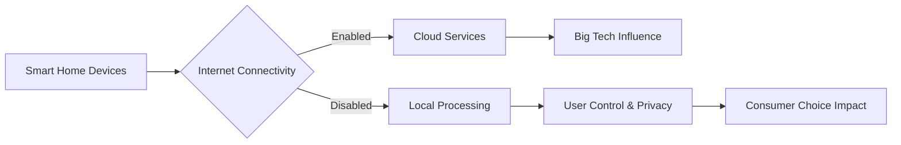

The rise of smart home technologies has increasingly depended on cloud connectivity, raising concerns about dependency on internet service providers and potential privacy breaches. This trend highlights deeper issues within the tech industry regarding concentration of capital among giants like Amazon, Google, and Apple. These companies hold significant sway over hardware standards and ecosystem lock-ins, creating barriers for competitors and limiting consumer choice.

Historically, innovations in home automation faced similar challenges with proprietary systems that limited interoperability. The current model mirrors past attempts at standardization, where dominant players set the rules, often stifling innovation from smaller entrants. As we move toward devices capable of functioning offline, there's a chance to democratize access and reduce reliance on centralized services.

Looking ahead, the debate around offline-capable smart homes isn't just about convenience; it's a reflection of broader industry dynamics. As we consider these changes, we should reflect on what kind of technological landscape we want to foster—one that prioritizes user control and resilience over centralized convenience.

