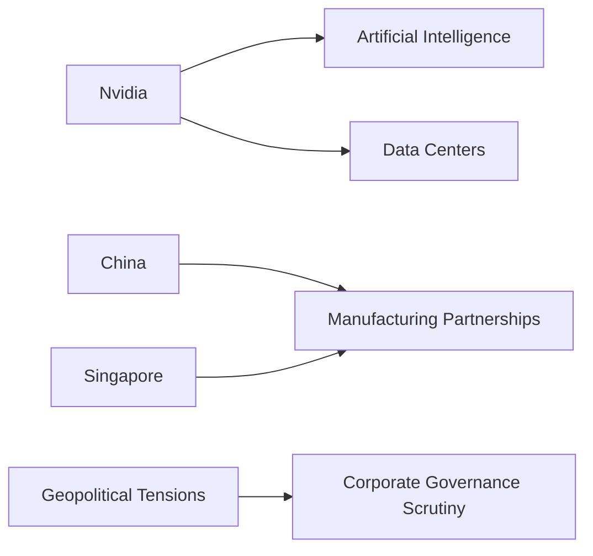

Jensen Huang's resignation from Nvidia marks a significant shift in the technology sector's power structure. As CEO of one of the world's leading semiconductor companies, Huang's departure highlights the growing influence of corporate governance and executive leadership on technological innovation and market dominance.

Nvidia, known for its high-performance graphics processing units (GPUs) that are essential for artificial intelligence and data center applications, has been at the forefront of transforming industries through advanced computing capabilities. Huang's strategic decisions have not only propelled Nvidia to new heights but also set a precedent for how technology leaders navigate global markets, particularly in China and Singapore.

The resignation comes amid heightened scrutiny over corporate practices, including supply chain management and geopolitical tensions. As companies like Apple and Intel face challenges related to manufacturing and intellectual property rights, the tech industry is witnessing a reevaluation of its relationships with major economies such as China and Singapore, which are crucial for production and distribution channels.

Historically, the tech sector has seen cycles of concentration where a few dominant players emerge due to their ability to innovate rapidly and capture market share. Nvidia's leadership under Huang exemplifies this trend, emphasizing the importance of strategic acquisitions and partnerships to maintain competitive advantage. This mirrors patterns observed in industries like telecommunications and automotive technology, where consolidation leads to greater efficiency but also raises concerns about monopolistic practices.

Looking ahead, the tech industry must grapple with balancing innovation with ethical considerations and regulatory compliance. The departure of key executives like Jensen Huang may prompt a reexamination of corporate strategies, including diversity in leadership roles and alignment with evolving global standards.

As we reflect on these developments, it's clear that the landscape of technology is continuously evolving, driven by both internal company dynamics and external economic forces. This shift could redefine how tech giants operate internationally, influencing everything from data center operations to AI development, and ultimately shaping the future of digital infrastructure worldwide.

