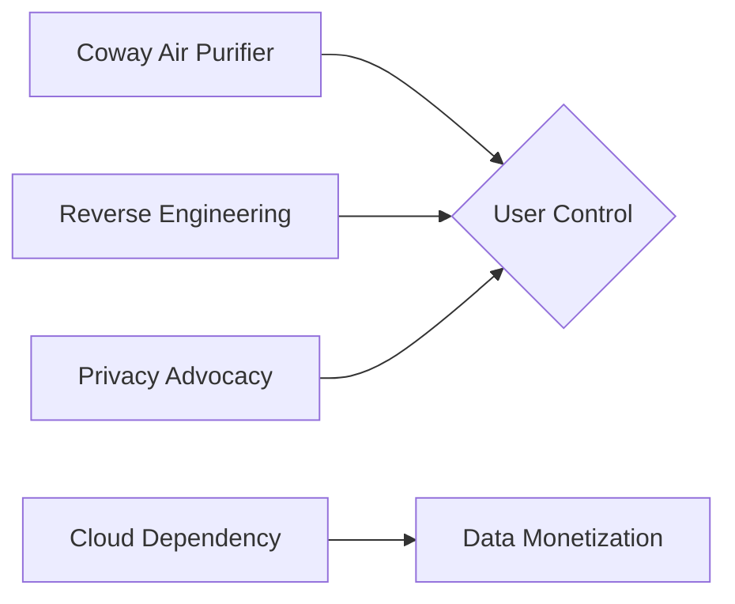

🌟 **Unlocking Freedom from Cloud Dependency: My Journey with Coway Air Purifier Reverse Engineering** 🌟

Reverse engineering my Coway air purifier was not just about fixing a device; it was a statement against the pervasive cloud dependency that many modern appliances now rely on. By dismantling the unit, I uncovered how proprietary software governs its operation, often without clear disclosure of what data is collected or sent to the cloud. This practice raises critical questions about corporate power structures and user autonomy.

Historically, industries have faced scrutiny over such trends. Take, for instance, the early days of personal computing when users demanded more control over their devices. Similarly, today’s smart home appliances echo those concerns, as seen in the rise of IoT (Internet of Things) products that promise convenience but often come with hidden data collection clauses.

The Coway air purifier incident highlights how specific companies—here, Coway and its technology partners—hold sway over user experience through proprietary software. This mirrors larger industry dynamics where a few tech giants dictate standards, sometimes at the expense of consumer privacy and choice.

By opting to reverse engineer my device, I reclaimed agency over its operation, sidestepping reliance on cloud services that could compromise personal data. It’s a reminder that consumers can take actionable steps to resist overly centralized control mechanisms.

In conclusion, this journey with my Coway air purifier underscores the importance of questioning and understanding the technology we integrate into our lives. As we move forward, it’s crucial to advocate for transparency and user-centric design in tech products, ensuring that innovation serves not just corporate interests but also empowers individuals toward greater autonomy and privacy.

