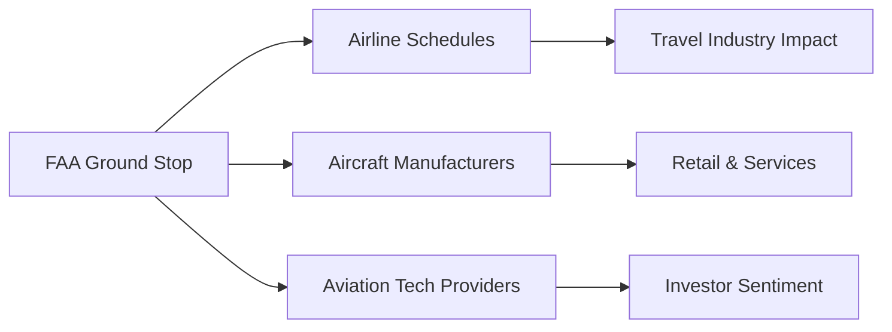

📰 **FAA issues national ground stop – lifted 4.5 hours later**

**Analysis:**
The FAA's decision to halt all departures from Atlanta International Airport stemmed from a technical issue with one aircraft, prompting immediate safety measures across the nation. This episode underscores how quickly information can spread in today’s interconnected world, where social media and news outlets amplify concerns rapidly. It also reflects the concentration of capital within aviation technology—companies like Boeing and Airbus have immense influence over flight schedules and safety protocols.

Historically, such grounding events are not uncommon, with notable examples including the 2009 "Max" incident that led to a similar nationwide shutdown. These occurrences often serve as reminders of the critical role regulatory bodies play in maintaining public trust and ensuring safety across the industry.

**Economic Dynamics:**

**Corporate Power Structures:**

**Conclusion:**
As we reflect on this incident, it’s clear that while technology has revolutionized air travel efficiency and connectivity, it also introduces vulnerabilities where safety concerns can quickly escalate into broader industry-wide disruptions. The resilience required in managing such situations highlights the importance of robust governance frameworks and the ongoing need for innovation to mitigate risks effectively.

