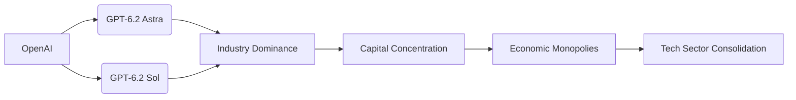

The announcement of GPT-6.2 Astra and Sol by OpenAI marks a significant evolution in AI capabilities and underscores deeper shifts within the technology sector. As these models promise enhanced efficiency and broader applicability, they also signal a tightening grip on market leadership that could further concentrate capital among tech giants. OpenAI, now backed by substantial investment from its parent company, Sam Altman's strategic vision continues to push boundaries. This development comes at a time when concerns about monopolistic practices in AI are growing louder. The integration of advanced language models like Astra and Sol suggests OpenAI is positioning itself as not just an innovator but potentially the de facto standard bearer for generative AI technologies. The implications are profound. Companies reliant on proprietary AI solutions may find themselves either adapting to new standards set by OpenAI or facing obsolescence. This could reinforce existing power structures where established players have greater resources to invest in research and development, while smaller startups struggle to compete. Historically, similar technological leaps—think of the early days of personal computing with IBM's dominance—have led to consolidation within industries. As AI becomes more integral across sectors from healthcare to finance, those who can afford or access these advanced models will likely reap disproportionate benefits. Moreover, as we witness a surge in demand for scalable and efficient AI solutions, the economics of production could shift toward centralized hubs where infrastructure investments are most lucrative. This mirrors patterns seen with cloud computing services that have historically favored large geographic locations close to data centers. In conclusion, while GPT-6.2 Astra and Sol represent exciting advancements in artificial intelligence capabilities, they also highlight broader economic realities within the tech industry—namely, the potential for increased concentration of power and resources among leading players like OpenAI. As we move forward, it's crucial to reflect on how these technological shifts might influence innovation pathways and accessibility across different segments of society.

