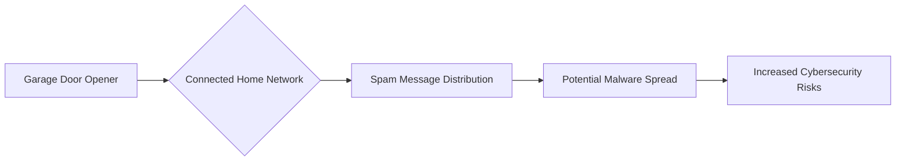

## Garage Door Spam: A New Frontier in Cybersecurity Breaches

The recent surge of "garage door spam" highlights a concerning trend in how everyday smart devices are being exploited for malicious purposes. Originally designed to provide convenience and security for homeowners, garage door openers have now become unwitting tools for cybercriminals to flood networks with spam messages.

This phenomenon underscores deeper issues within the technology industry, particularly regarding the concentration of capital among tech giants that often overlook basic security protocols in favor of rapid innovation. Companies like Chamberlain, known for their popular Q-Link wireless garage doors, are at the forefront of this issue due to their widespread adoption and relatively lax security measures.

Historically, cybersecurity breaches have often begun with seemingly innocuous devices. The 2013 Stuxnet worm, which targeted industrial control systems, began as a digital weapon designed for espionage. Similarly, the rise of IoT (Internet of Things) devices has expanded the attack surface exponentially. As more homes integrate smart technologies—ranging from voice assistants to security cameras—the risk of these devices being co-opted for spamming or other malicious activities grows.

The structural dynamics within the tech industry exacerbate this problem. Large corporations, with their vast resources and influence, may prioritize features that enhance user experience over robust security frameworks. This power imbalance can lead to a situation where vulnerabilities in widely used products are exploited by less sophisticated cybercriminals, who often lack the technical sophistication needed for more complex attacks.

The implications of garage door spam extend beyond mere inconvenience. It represents a potential pathway for larger-scale attacks, such as botnet formation or phishing campaigns, that could compromise not just individual devices but entire networks. As these systems become interconnected within smart home ecosystems, a single point of failure can cascade into broader security incidents.

In response to this growing threat, stakeholders across the industry must reconsider their approach to cybersecurity in consumer electronics. This includes implementing mandatory security standards for IoT devices, encouraging transparency from manufacturers about potential vulnerabilities, and fostering collaboration between tech companies and cybersecurity experts to develop proactive mitigation strategies.

Ultimately, while garage door spam may seem like a niche issue today, it serves as an early warning of the broader challenges posed by the increasing interconnectivity of our digital world. As we move forward, addressing these security gaps will be crucial in safeguarding both personal privacy and the integrity of our increasingly automated environments.

---

