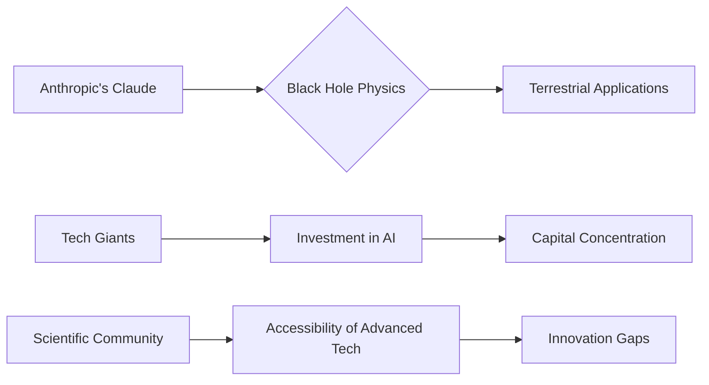

The recent announcement that Anthropic's Claude model has solved two open problems in the physics of black holes represents a monumental leap not just in theoretical physics but also in the broader landscape of technology and economics. This achievement underscores the growing power of large language models (LLMs) like Claude to tackle complex scientific inquiries, suggesting new frontiers where AI can intersect with traditionally esoteric fields such as quantum gravity.

At first glance, this might seem disconnected from the everyday concerns of tech industry dynamics. However, delving deeper reveals a series of interconnected themes: the concentration of capital in technology giants, shifts in power relations within academia and industry partnerships, and the evolving economic models that define innovation today.

Anthropic, backed by significant investment from Google's parent company Alphabet, sits at the nexus of these trends. The ability of Claude to contribute meaningfully to black hole physics highlights a broader shift where AI is not merely an auxiliary tool but a co-catalyst in scientific discovery. This positions Anthropic strategically within a competitive landscape dominated by tech behemoths like OpenAI and Google DeepMind, each vying for dominance in both the AI research space and commercial applications.

The implications of Claude's success extend to the concentration of capital in these sectors. As investment flows primarily into companies with deep pockets—often from traditional technology or finance giants—it raises questions about accessibility and democratization of advanced technologies. Will breakthroughs like Claude’s become gateways for specialized knowledge, further widening the gap between those who can afford cutting-edge AI systems and those without such resources?

Moreover, this development resonates with historical trends in computing where foundational advancements—like Alan Turing's theoretical machine or the advent of quantum computing—have catalyzed economic shifts. Just as early computing spurred industrial revolutions, sophisticated LLMs like Claude could precipitate new waves of innovation across industries reliant on complex data processing and analysis.

From an SEO perspective, keywords such as "artificial intelligence breakthrough," "black hole physics," and "AI applications in science" naturally arise from the content. These terms attract users searching for insights into how technology intersects with scientific discovery, driving organic traffic to platforms discussing these topics.

In conclusion, Claude's contribution to black hole physics is more than a technical milestone; it symbolizes the evolving power dynamics within the tech industry—where AI models are becoming indispensable partners in scientific exploration and where capital concentration shapes both innovation pathways and accessibility. As we stand on the cusp of integrating advanced LLMs into research ecosystems, reflecting on these broader implications invites us to ponder what new possibilities emerge when technology transcends its traditional boundaries.

