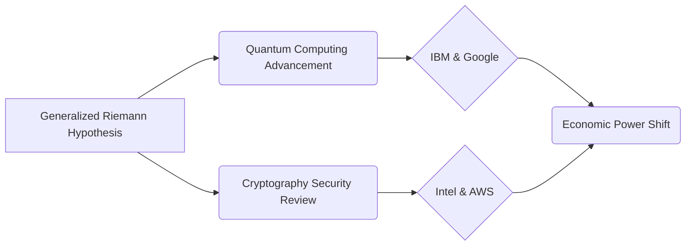

# Proof of Generalized Riemann Hypothesis: Implications for Quantum Computing and Crypto Economics

The potential proof of the Generalized Riemann Hypothesis (GRH) by Levent Alpöge has sent ripples through the tech industry, particularly in fields reliant on advanced mathematical theories. This hypothesis, if proven true, could significantly impact quantum computing capabilities and cryptographic security models.

## Technological Impact

The GRH's validation would bolster algorithms used in quantum computing, potentially enhancing their efficiency and problem-solving capacities. Quantum computers rely heavily on number theory and complex mathematical functions; a proof of the GRH could lead to breakthroughs in optimizing these computations. Companies like IBM and Google are at the forefront of quantum research, and such a proof might accelerate their developments, positioning them further ahead in the competitive landscape.

## Economic Power Dynamics

The implications extend beyond pure computation. Cryptography, especially public-key encryption methods relying on number theory (like RSA), could see new vulnerabilities or more robust defenses if the GRH holds true. This shift would affect tech giants and startups alike, with firms like Intel and AWS potentially needing to reevaluate their security protocols. The concentration of capital in these technology leaders could be influenced as they adapt to the new mathematical landscape.

## Historical Context

Historically, significant mathematical proofs have paralleled technological revolutions. The proof of Fermat's Last Theorem by Andrew Wiles in 1995, for example, underscored how deep mathematical insights can drive innovation across various fields. Similarly, the GRH could herald a new era of computational capabilities, echoing past moments when theoretical advancements translated into practical applications.

## Conclusion

As we stand on the cusp of this potential breakthrough, it invites reflection on how mathematics continues to shape our technological world. The interplay between pure mathematical theory and applied technology not only highlights the power of innovation but also underscores the importance of interdisciplinary collaboration in driving forward progress.