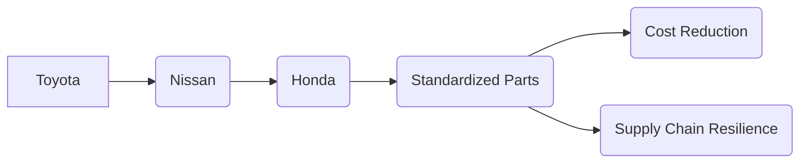

The automotive sector is witnessing a strategic shift as major players like Toyota, Nissan, and Honda embark on a joint initiative to standardize parts across their product lines. This move not only promises significant cost reductions but also underscores the growing power of conglomerate cooperation in shaping industry dynamics.

At the heart of this collaboration are three titans of the automotive world, each wielding substantial influence within their respective markets. Toyota, known for its relentless pursuit of efficiency and innovation, has long been a pioneer in adopting standardized components to streamline production processes. Similarly, Nissan, with its robust global footprint, is leveraging this initiative to enhance supply chain resilience. Honda, renowned for its engineering excellence, joins the fray to bolster competitiveness and maintain its position as a leader in hybrid technology.

This partnership reflects broader trends in the industry where consolidation among automakers accelerates economies of scale. By aligning on part specifications, these companies aim to minimize inventory costs, reduce waste, and accelerate time-to-market for new models. Historically, such collaborations have been instrumental; consider General Motors' early 20th-century efforts to standardize vehicle parts, which laid the groundwork for modern mass production techniques.

Moreover, this move aligns with global shifts towards sustainable manufacturing practices. As environmental regulations tighten worldwide, automakers are under increasing pressure to reduce their carbon footprints and operational costs. Standardizing parts can lead to more efficient use of materials, lower emissions from reduced transportation needs, and enhanced vehicle longevity—key factors in meeting these regulatory demands.

The implications extend beyond immediate cost savings; they signal a broader industry trend towards greater integration and innovation at scale. As these companies continue to refine their supply chains, we may see ripple effects across the automotive ecosystem, influencing OEMs, suppliers, and even aftermarket parts manufacturers.

In conclusion, Toyota, Nissan, and Honda's initiative to standardize parts represents more than just an operational strategy—it’s a testament to the power of collaboration in driving industry-wide efficiency and sustainability. As these automakers navigate a rapidly evolving market landscape, their success could well set precedents for future cross-industry alliances, inspiring other sectors to follow suit.

