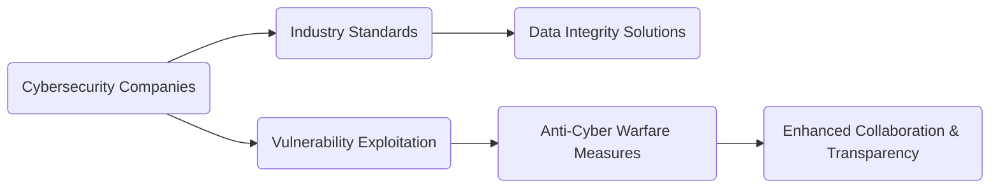

The recent active intrusion campaign targeting Check Point's security management servers highlights a growing trend in sophisticated cyber-attacks that challenge traditional notions of digital sovereignty. As the landscape evolves, understanding how these attacks intersect with broader industry trends and power structures is crucial for stakeholders across the cybersecurity sector.

Check Point, a leader in network security solutions, has become a focal point for adversaries seeking to exploit vulnerabilities within its management servers. This campaign underscores the escalating nature of cyber threats, where attackers leverage advanced techniques to bypass or subvert security protocols designed to protect critical infrastructure. The implications are far-reaching, affecting not only Check Point but also its clients and partners who rely on these services for maintaining data integrity and network resilience.

In the realm of cybersecurity, power dynamics are increasingly defined by access to cutting-edge technology and proprietary solutions. Companies like Check Point hold significant influence due to their foundational role in shaping industry standards and security practices. However, this very authority can become a double-edged sword if not coupled with robust defensive measures against evolving threats.

Historically, the rise of cyber warfare has mirrored patterns seen during earlier technological revolutions, where dominance shifted between nations and corporations based on innovation and strategic deployment. Today's battlefield is digital, with states and non-state actors vying for control over sensitive information and infrastructure. The vulnerability exposed in Check Point's systems serves as a stark reminder that cybersecurity is no longer optional but essential for national security and economic stability.

As we navigate these turbulent times, it becomes imperative to invest more heavily in both defensive technologies and proactive threat intelligence. Collaboration among industry leaders will be key to developing shared standards that enhance resilience across the board. Moreover, fostering transparency regarding vulnerabilities can help mitigate future risks by allowing a broader community of experts to contribute solutions.

In conclusion, the ongoing campaign against Check Point's security management servers is not just an isolated incident but part of a larger narrative about power, innovation, and responsibility in cybersecurity. It calls for collective action from all stakeholders to fortify defenses, adapt strategies, and ensure that technological advancements do not inadvertently weaken our digital frontiers.

