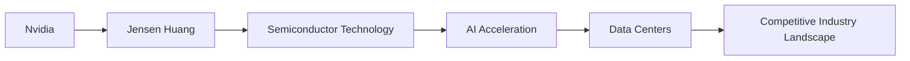

Nvidia's decision to reinstate Jensen Huang as CEO amidst a backdrop of escalating competition and technological innovation offers a fascinating glimpse into the evolving landscape of power within the tech sector. This move not only underscores Nvidia's resilience but also highlights broader themes of capital concentration and how traditional industry dynamics are reshaping.

At its core, this event is emblematic of the growing influence wielded by technology leaders who can navigate both market volatility and strategic pivots with agility. As semiconductor companies like AMD intensify their efforts to close the performance gap, Nvidia's reaffirmation of Huang signals confidence in its product roadmap and execution capabilities. This reassurance is crucial for investors and partners alike, reinforcing Nvidia's status as a dominant force in AI acceleration and data center technologies.

The implications extend beyond financial metrics, touching on the structural shifts within the tech industry. As capital increasingly consolidates around key players—Nvidia, AMD, Intel—the risk of monopolistic tendencies rises, prompting regulatory scrutiny and calls for more equitable market access. This scenario mirrors historical patterns where dominant firms faced antitrust challenges due to their pervasive influence across multiple sectors.

Moreover, the reinstatement reflects a broader economic trend towards specialization and vertical integration in high-tech manufacturing. Companies are increasingly seeking vertically integrated supply chains to maintain control over critical components like chips and semiconductors, reducing dependency on external partners. This strategic pivot is vital for sustaining competitive advantage amid rapid technological advancements.

In conclusion, Nvidia's strategic move with Jensen Huang reinstated as CEO serves as a microcosm of the larger tech industry's power dynamics. As we continue to witness consolidation and specialization in high-tech sectors, it invites reflection on how these shifts might influence innovation trajectories, market competition, and regulatory landscapes over the coming years.

