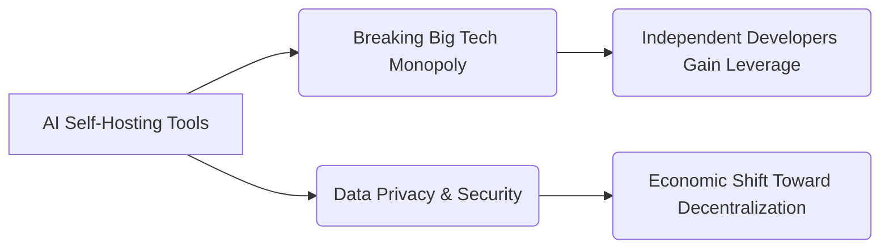

The rise of AI-powered self-hosting tools marks a significant shift in the tech landscape, empowering users to regain control over their personal data. This development challenges the entrenched power dynamics within the industry, where large corporations have traditionally monopolized cloud services and user information.

As highlighted by Jan Lukasiewicz in his recent blog post, platforms like LangChain and LlamAI are leveraging AI to simplify the process of hosting applications locally. This trend is reminiscent of historical movements that sought to decentralize technology, such as the early days of personal computing which aimed at reducing dependence on centralized servers.

Companies like IBM and Red Hat have shown that with the right tools, users can maintain autonomy over their data without sacrificing functionality or accessibility. The emergence of self-hosting solutions for AI applications suggests a growing demand for transparency and security in how our digital interactions are managed.

The implications extend beyond mere convenience; they signal a potential economic shift where smaller entities or independent developers gain competitive leverage by offering services that respect user privacy. This could disrupt the current capital concentration seen in major tech firms, which often wield significant power due to their vast data repositories and market reach.

Moreover, this movement aligns with broader historical trends towards decentralization in technology, from peer-to-peer networks in the late 1990s to modern blockchain applications. By reinvigorating self-hosting practices through AI innovation, we may be witnessing a new wave of technological democratization that could reshape the future of digital services.

In conclusion, as AI continues to permeate various sectors, the ability to self-host responsibly becomes increasingly vital. It prompts us to reflect on how we prioritize data ownership and privacy in an era where technology profoundly influences our daily lives. What does this evolution mean for the balance of power in tech, and how might it affect the broader societal implications of digital transformation?

