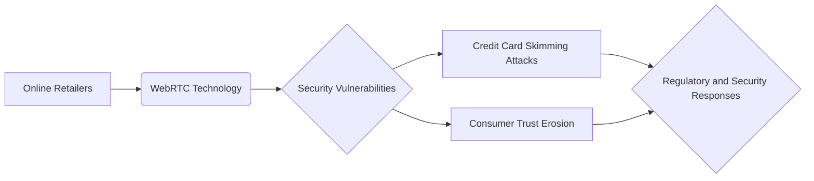

The recent revelation of credit card skimming scripts exploiting WebRTC (Real-time Transport Protocol) on popular shopping sites during Black Friday highlights a growing concern in the tech industry. This incident underscores deeper issues within digital infrastructure and corporate power dynamics.

WebRTC, designed for real-time communications like video calls, has inadvertently become a tool for malicious actors to intercept sensitive data. Major e-commerce platforms, reliant on WebRTC for seamless transactions, now face heightened security risks. Companies like Shopify and Amazon, which dominate the online retail space, are particularly vulnerable due to their extensive user bases and complex ecosystems.

The use of such scripts demonstrates how technological advancements can be repurposed for nefarious purposes. It reflects a broader trend where centralized platforms hold significant power over consumer trust and data integrity. The concentration of capital within these tech giants amplifies the impact of security breaches, as seen with the Black Friday skimming attacks that could compromise millions of transactions.

Historically, similar vulnerabilities have emerged in other technologies, such as SQL injection flaws in early web databases or Flash player exploits in the mid-2000s. These events often prompted regulatory responses and shifts towards more secure coding practices. The current situation calls for a renewed focus on cybersecurity measures across digital platforms, especially during peak shopping seasons when consumer data volume spikes.

As consumers become increasingly wary of online security threats, businesses must prioritize robust encryption methods and continuous monitoring to protect against such skimming techniques. This incident serves as a reminder that technological innovation should never come at the expense of user safety and privacy.

In conclusion, the rise of WebRTC-based credit card skimming scripts on Black Friday shopping sites reveals critical vulnerabilities in our digital infrastructure. It prompts reflection on how power dynamics within tech companies influence security practices and what measures can be taken to safeguard consumer data more effectively.

